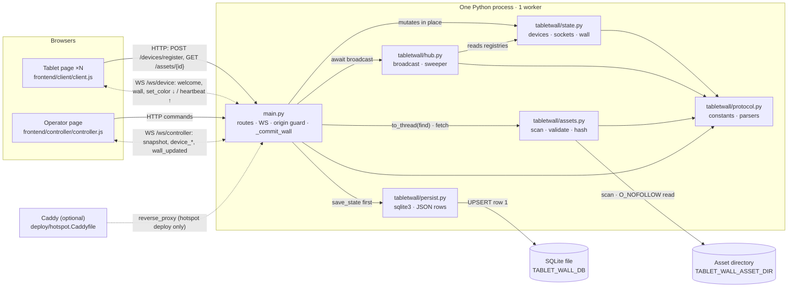
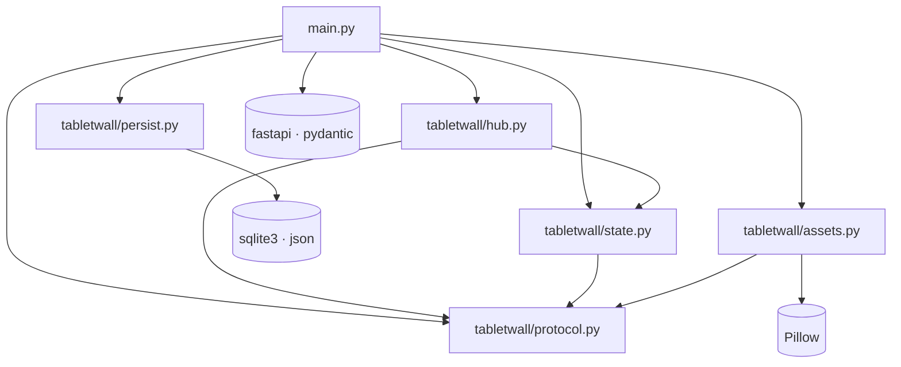
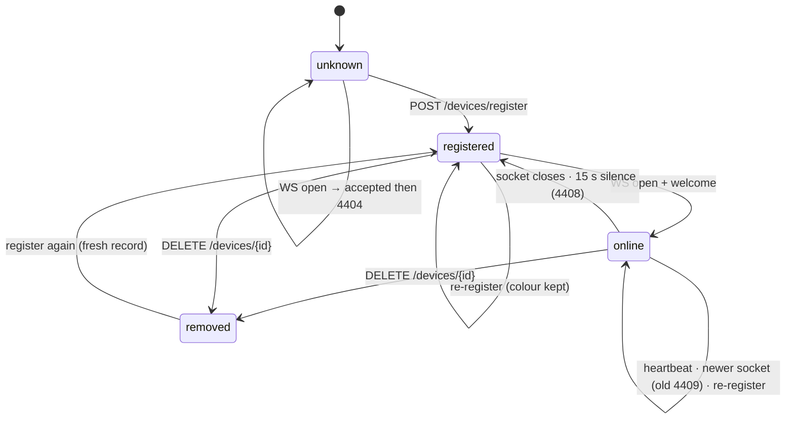
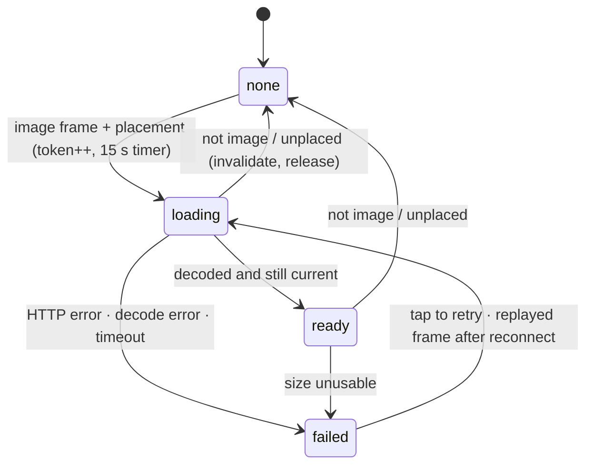
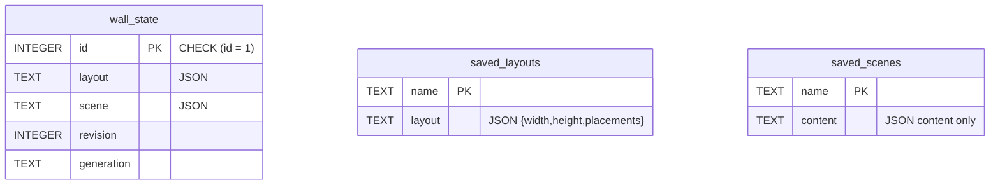
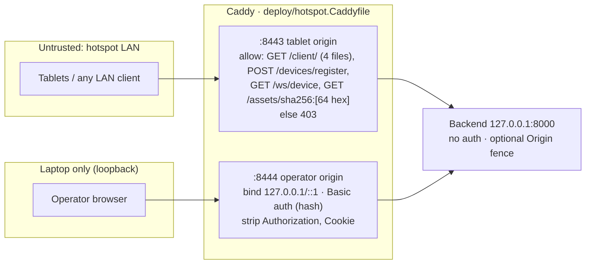

# tablet-wall-ai: codebase guide

> **Read this first.** It describes the architecture and the current code of this repository.
> Companion file: `docs/codebase-explorer.html`. It has the same content in visual, interactive form.
> The two files must agree. When the code changes, update both.
>
> **Verified against:** commit `0899e04`, 7 Oct 2026. `uv run pytest` → 500 passed. `node tests/client_image.test.js` → 23 passed. `simulator/run.py` → 1,075/1,075 checks in 22 scenarios.
>
> **Evidence labels:** **[code]** read in source · **[doc]** stated in README, PROTOCOL.md or code comments · **[inferred]** a reasonable conclusion that the authors do not state · **[unknown]** cannot be determined from the repository.

---

## Contents

1. [What the project is](#1-what-the-project-is)
2. [Mental model and vocabulary](#2-mental-model-and-vocabulary)
3. [Architecture](#3-architecture)
4. [Repository map](#4-repository-map)
5. [Module dependencies](#5-module-dependencies)
6. [Patterns in use](#6-patterns-in-use)
7. [Execution flows](#7-execution-flows)
8. [The commit boundary](#8-the-commit-boundary)
9. [Revision and generation](#9-revision-and-generation)
10. [Lifecycles](#10-lifecycles)
11. [Concurrency](#11-concurrency)
12. [Where state lives](#12-where-state-lives)
13. [Data model](#13-data-model)
14. [HTTP and WebSocket API](#14-http-and-websocket-api)
15. [Design decisions](#15-design-decisions)
16. [Errors and failure modes](#16-errors-and-failure-modes)
17. [Security boundaries](#17-security-boundaries)
18. [Configuration and deployment](#18-configuration-and-deployment)
19. [Testing](#19-testing)
20. [Complexity hotspots](#20-complexity-hotspots)
21. [Change guides](#21-change-guides)
22. [Learning roadmap](#22-learning-roadmap)
23. [Check yourself](#23-check-yourself)
24. [Evidence, corrections and open questions](#24-evidence-corrections-and-open-questions)

---

## 1. What the project is

tablet-wall-ai turns a set of tablets into one coordinated display wall. It is a small client/server web app. The "ai" in the name is historical. The README states that no AI capability exists or is planned. **[doc]**

| Actor | Opens | What it does | Code |
| --- | --- | --- | --- |
| Tablet (×N) | `/client/` | Keeps a device UUID in `localStorage`. Registers over HTTP, holds a WebSocket, sends a heartbeat every 5 s, paints its slice on a canvas. | `frontend/client/client.js` (1,824 lines) |
| Operator | `/controller/` | Sees the live roster. Edits wall size and placements with number fields (no drag). Picks colour, calibration or a curated image. Saves and recalls named layouts and scenes. | `frontend/controller/controller.js` (4,088 lines) |
| Server | — | One FastAPI process. Validates commands, writes the wall to SQLite, keeps the roster in memory, pushes frames over WebSockets, serves both pages and the image bytes. | `main.py` (1,448) + `tabletwall/` (1,159) |
| Reverse proxy (optional) | — | Reference Caddy config with two HTTPS origins for a laptop-hotspot trial. | `deploy/hotspot.Caddyfile` |

**What the wall can show** **[code]**

- `color`: each tablet shows the colour the operator assigned to it (protocol v1 behaviour).
- `calibration`: each placed tablet draws its slice of one grid pattern with wall-wide diagonals, to check geometry and seams.
- `image`: one curated JPEG/PNG, scaled with centred `cover` across the **whole** wall. Each tablet clips its own slice.

**What does not exist** **[doc]**

- No authentication or authorization inside the app.
- No upload endpoint, no video, no clock synchronisation.
- No Dockerfile, Compose file or CI workflow.
- No per-tablet render acknowledgement. The server knows what it *sent*, not what a screen shows.

**Status by phase** **[doc]** (README "Roadmap")

| Phase | Scope | Status |
| --- | --- | --- |
| 0 | Hygiene: README, Makefile, pytest | Done |
| 1 | Realtime core: WebSockets, heartbeats, reconnect, colour, controller tiles | Done |
| 2 | Still-image wall: protocol v2, placements, bezels, calibration, persistence, curated images (2b), named save/recall (2c) | Software done; physical tablets pending |
| 3 | Safe operation: proxy, HTTPS, systemd template, kiosk notes, backups (3a/3b); logs, health, CI (3c/3d) | Reference files only; 3c/3d deferred |
| 4 | Timed media, only if a prototype shows acceptable seams | Not started |

---

## 2. Mental model and vocabulary

**The model in four sentences**

1. The server holds one **wall**: a **layout** (where screens are), a **scene** (what to show), and two ordering tokens (**revision**, **generation**).
2. Operators change the wall with **HTTP commands**. The server saves the change to **SQLite first**, then changes memory, then pushes it.
3. Every tablet receives a **complete** `wall` frame over its WebSocket. The frame contains only that tablet's own placement.
4. Each tablet computes the **same** wall-space picture and draws only the part behind its own glass. That is why the seams line up.

| Term | Meaning | Where it lives |
| --- | --- | --- |
| Wall unit | Abstract integer coordinate. Not pixels, not millimetres. Default wall 2000 × 1000. | `state.DEFAULT_WALL_WIDTH/HEIGHT` |
| Placement | A device's full **footprint** `{x, y, w, h}` plus a `bezel` inset per edge, in wall units. | `wall["layout"]["placements"][id]` |
| Visible rect | Footprint minus bezel. Must stay positive (422 otherwise). | `client.visibleRectOf()` |
| Layout | Wall width, height, sparse placements map. | `wall["layout"]` |
| Scene | `content` (`color` / `calibration` / `image`) plus `layout: "active"`. | `wall["scene"]` |
| Revision | Integer bumped once per accepted wall change. Persisted. Orders frames inside one generation. | `wall["revision"]` |
| Generation | 8 hex chars minted on **every** server start. A new generation tells clients to accept state even if the revision went down. | `state._new_generation()` |
| Roster | Registered devices and metadata. Memory only. | `state.devices` |
| Reservation ("vacant") | A persisted placement whose device is not in the roster (e.g. after a restart). Kept so the tablet can reclaim its slot. | derived |
| Asset | Curated image addressed by `sha256:` + hash of its bytes. | `assets.Asset` |
| Caps | What a v2 client can render (`calibration`, `image`). The server never sends unadvertised content. | `devices[id]["caps"]` |

---

## 3. Architecture

One deployment unit: a single Python process. Browsers talk only to `main.py`. Only `persist.py` touches SQLite. Only `assets.py` touches the image directory. **[code]**



**Synchronous vs asynchronous**

- HTTP command → response is request/response. The operator waits for a status code.
- WebSocket pushes do not wait for tablets. An HTTP 200 does not mean a tablet rendered anything.
- The only background task is the heartbeat sweeper, an `asyncio` task in the same process.
- Asset scans run in worker threads (`asyncio.to_thread` in `put_scene`; plain `def` routes `get_assets`/`get_asset` run in Starlette's threadpool). SQLite calls run on the event loop. **[code]**

**Startup to normal operation** **[code]**

1. uvicorn imports `main.py`. Static dirs mount by relative path, so the working directory must be the repo root.
2. `lifespan()` → `_restore_wall_state()`: load row id=1 (or `_fresh_wall()`), fill `wall` in place, mint a new generation, save it.
3. `assets.refresh()` scans images. A missing directory is empty; an unreadable one stops startup.
4. `_sweep_loop()` starts. Requests are served.
5. The roster is empty until tablets re-register, which they do on their own.

---

## 4. Repository map

| Path | Lines | Class | Responsibility | Depends on | Used by | Read |
| --- | --- | --- | --- | --- | --- | --- |
| `main.py` | 1,448 | entry · API · orchestration | FastAPI app, lifespan, Pydantic models, Origin guard, every route, both WS endpoints, `_commit_wall` | hub, state, protocol, assets, persist | uvicorn, tests, simulator | Now |
| `tabletwall/protocol.py` | 139 | utilities | Timing constants, close codes, versions, caps, pure parsers | stdlib | main, state, hub, assets | Now (first) |
| `tabletwall/state.py` | 195 | domain state | `devices`, `device_sockets`, `controller_sockets`, `controller_protocols`, `wall`; projectors `_device_record`, `_wall_state`, `_wall_frame`, `_project_scene` | protocol | main, hub | Now |
| `tabletwall/hub.py` | 161 | infrastructure | `_broadcast`, `_broadcast_wall`, `_send_wall_to_device`, `_send_color_to_device`, `_broadcast_offline`, `_sweep_once`, `_sweep_loop` | state, protocol, anyio | main only | Stage 2 |
| `tabletwall/persist.py` | 275 | data layer | `load_state`/`save_state` for row id=1; CRUD for `saved_layouts`, `saved_scenes` | sqlite3, json | main only | Stage 2 |
| `tabletwall/assets.py` | 383 | data layer · untrusted input | Scan, validate (Pillow), content-address, re-hash on serve, log each rejection once | Pillow, protocol | main | Stage 3 |
| `frontend/client/client.js` | 1,824 | frontend | identity → register → socket → heartbeat → `applyWallFrame` → render → reconnect loop | wire contract only | tablets, JS test | Now (top), later (image loader) |
| `frontend/client/index.html`, `client.css` | 19, 92 | frontend | Canvas + status pill; colour via `--surface-color` | — | — | Skim |
| `frontend/controller/controller.js` | 4,088 | frontend | One IIFE: socket, `handleMessage`, tiles, wall map, placements, reservations, asset browser, snapshot panels, all HTTP commands | wire contract only | operator | Stage 4 |
| `frontend/controller/index.html`, `controller.css` | 449, 2,069 | frontend | Panels and styling | — | — | Skim |
| `PROTOCOL.md` | 657 | interface doc | Authoritative realtime contract | — | everyone | Now |
| `README.md` | 317 | doc | Quickstart, API table, known limitations, roadmap | — | — | Now |
| `tests/` | — | tests | pytest contract tests (in-process `TestClient`) + Node renderer test | main, client.js | `make test` | Stage 1–4 |
| `simulator/` | — | test tooling | 15–20 virtual sockets against the real app; geometry oracles; no browser | main | `make sim` | Stage 5 |
| `deploy/` | — | build/deployment | Caddyfile, `run-hotspot.sh`, `smoke.sh`, `load-smoke.py`, systemd template, `backup.py` (1,400), OPERATIONS/KIOSK/README | Caddy, stdlib | operator | Stage 5 |
| `Makefile` | 39 | build | `sync`, `dev`, `run`, `test`, `sim`, `clean`; every recipe `cd`s to repo root | uv, node | developers | Now |
| `pyproject.toml`, `uv.lock` | 23 | config | Python ≥ 3.13; `fastapi[standard]`, `pillow`; dev `httpx2`, `pytest`, `pytest-timeout` (30 s) | — | uv | Now |

Not source: `assets/` (operator-created image dir) and `tablet-wall.db` (default database) are local data and ignored by git.

---

## 5. Module dependencies

Arrows point from importer to imported. No cycles. **[code]**



- `protocol.py` imports nothing from the package, so `state`, `hub` and `assets` can all depend on it.
- `persist.py` is a leaf. It knows nothing about live state. `main.py` hands it plain dicts.
- `hub.py` is imported only by `main.py` and never imports `persist`, so delivery cannot write to disk.
- `state.py` imports `fastapi.WebSocket` for type hints only.
- **Deliberate coupling:** `main.py` imports `devices`, `wall`, `device_sockets`, … *by name* and re-exports them. Tests reset them through `main`. Mutate these objects in place (`wall.clear(); wall.update(...)`). Never reassign them, or the state splits in two.
- **Browser ↔ server coupling:** the JS files import nothing from Python. Their only contract is `PROTOCOL.md`. A frame-shape change must update `state._wall_frame`/`_wall_state`, both pages, `PROTOCOL.md` and the tests together.
- **Boundary notes [inferred]:** `main.py` mixes models, routes, orchestration (`_commit_wall`) and some domain rules (auto-arrange geometry, saved-snapshot validation). `_valid_saved_layout()` re-implements the rules of `PlacementCommand`.

---

## 6. Patterns in use

| Pattern | Where | Why | Benefit / cost | Applied consistently? |
| --- | --- | --- | --- | --- |
| Client/server, modular monolith | One FastAPI process serving two static apps | One small wall, no infrastructure **[inferred]** | Simple / cannot scale out | Yes; README forbids multiple workers |
| Command (HTTP) / event (WS) split | `controller.requestJson` for writes; `hub._broadcast*` for pushes | **[doc]** PROTOCOL.md "Transports" | Status codes for commands / two channels can arrive in either order | Yes |
| In-process pub/sub | Socket sets in `state.py`, fan-out in `hub.py` | Simplest fan-out **[inferred]** | No broker / no delivery guarantee, sequential sends | Yes |
| Write-ahead commit | `main._commit_wall` | **[doc]** docstring, PROTOCOL.md "Persistence" | Failed write changes nothing / sync SQLite, callback runs twice | Yes for the wall; colour and registration are memory-only by design |
| Full-state replication (not deltas) | `state._wall_frame`; replay after `welcome` | **[doc]** | Idempotent replay / resend whole frame | Yes |
| Browser state machines | `client.js` connection cycle and image attempt; controller `connState`, snapshot confirm flows | Async work can outlive its frame **[inferred]** | Late results cannot paint / states are implicit flags | Mostly; the controller spreads state over many flags |
| Version negotiation + capability downgrade | `protocol._parse_protocol`, `ws_device`, `state._wall_frame` | **[doc]** cached old clients | Old clients keep working / two frame shapes | Yes |
| Content addressing | `assets.py` | **[doc]** module docstring | Rename-safe, cache-safe / rescans on every read | Yes |

**Not used:** MVC framework, ORM, repository/service classes, DI container, queue, CQRS. Do not describe the code with these labels.

---

## 7. Execution flows

Each flow: trigger, then steps as **control** (what calls what) · **data** (what moves) · **effect**.

### 7.1 Operator shows an image (main flow)

Trigger: the operator selects an asset and presses "Show on wall".

```mermaid
sequenceDiagram
  autonumber
  participant C as controller.js
  participant G as Origin guard
  participant R as main.put_scene
  participant A as assets (thread)
  participant W as _commit_wall
  participant D as SQLite
  participant H as hub
  participant T as client.js
  C->>G: PUT /scene {content:{type:image, asset, fit:cover}}
  G->>R: pass (or 403)
  R->>R: SceneUpdate / SceneContent validation (422)
  R->>A: await to_thread(assets.find, id)
  A-->>R: Asset(width, height) or None (422)
  R->>W: _commit_wall(apply)
  W->>W: proposed = deepcopy(wall); apply; revision+1
  W->>D: save_state(proposed) → UPSERT row 1, COMMIT
  W->>W: apply(wall); revision+1 (live, in place)
  R->>H: await _broadcast_wall()
  H-->>C: wall_updated {wall}
  H-->>T: wall frame (own placement, url, caps-filtered)
  R-->>C: 200 full wall state
  T->>R: GET /assets/sha256:…
  R-->>T: bytes (re-hashed) or 404
  T->>T: decode, isCurrentImageAttempt, cover whole wall, clip
```

| # | Where | Control | Data | Effect |
| --- | --- | --- | --- | --- |
| 1 | `controller.js` `applyImageScene()` | `requestJson('PUT','/scene')`, 10 s timeout; blocked while another scene write is pending | `{content:{type:'image', asset:'sha256:…', fit:'cover'}}` | Selecting an asset alone changes nothing |
| 2 | `main.operator_origin_guard` | If `TABLET_WALL_OPERATOR_ORIGIN` is set: exactly one matching `Origin` or 403 | headers | 403 happens before validation |
| 3 | `main.SceneUpdate`, `SceneContent` | Pydantic; `extra="forbid"`; id regex; `fit` only `cover` (default filled) | JSON → model | 422, incl. a client echoing `url` or dimensions |
| 4 | `main.put_scene` → `assets.find` → `refresh` | Worker thread rescans, validates, hashes, decodes all candidates | id → `Asset` or `None` | 422 "Unknown asset"; event loop stays free |
| 5 | `main.put_scene` | Build stored content | `{type, asset, fit, intrinsicWidth, intrinsicHeight}`, no URL | — |
| 6–8 | `main._commit_wall` → `persist.save_state` | Copy, mutate, revision+1, UPSERT + COMMIT, then same change on live dict | JSON (`sort_keys=True`) | Durable; failure → 500 with memory unchanged |
| 9 | `hub._broadcast_wall` | `wall_updated` to v2 controllers; `_send_wall_to_device` per v2 device | `_wall_state()`; `_wall_frame(id, record)` with URL composed and caps downgrade | Failed send: socket dropped and closed; commit not undone |
| 10 | `client.applyWallFrame` | Validate whole frame; reject only if same generation and revision ≤ held | frame → `wallState` | Held pair updated |
| 11 | `main.put_scene` reply → `controller.applyImageScene` | Adopt reply; push may arrive before or after | full wall | Controller re-renders |
| 12 | `client.startImageLoad` → `main.get_asset` → `assets.fetch` | token++, LOADING panel, one 15 s timer; server rescans, `O_NOFOLLOW` capped read, re-hash | bytes + MIME, `nosniff`, immutable cache; else 404 | Missing/changed bytes → IMAGE FAILED, tap to retry |
| 13 | `client.decodeBlob` → `isCurrentImageAttempt` → `drawWallImage` | `createImageBitmap` or `` + object URL; paint only if still current | `s = max(W/iw, H/ih)` over the whole wall; visible rect → viewport by centred cover; clip | Bitmap cached; old pictures and race losers released |

### 7.2 Tablet joins the wall

1. `client.resolveDeviceId()`: `localStorage['tablet-wall-device-id']`, else `crypto.randomUUID` → `getRandomValues` → labelled `Math.random` fallback.
2. `attemptCycle()` → `register()`: `POST /devices/register {device_id, width: innerWidth, height: innerHeight, device_type: 'ipad'}` before **every** socket attempt. Exempt from the Origin guard.
3. `main.device_register`: record completed before the first await; keeps colour, protocol and caps; `last_seen = now`. Broadcasts `device_updated` (always, even first time).
4. `openSocket()`: `WS /ws/device?device_id=…&protocol=2&caps=calibration,image`.
5. `main.ws_device`: accept first; then 4426 (protocol) → 4400 (id format) → 4404 (not registered).
6. Claim the slot before any await: `device_sockets[id] = ws`; set protocol, caps, last_seen. A previous socket is closed with 4409 and its task skips the offline broadcast.
7. Send `welcome {heartbeat_interval_ms: 5000, protocol: 2, server_caps}` → client resets backoff, starts the heartbeat timer.
8. Replay: full `wall` frame, then `set_color` if a colour is assigned. Then `device_online` to controllers.
9. `_device_loop`: each heartbeat updates `last_seen` only if this socket still owns the slot. Other frames are ignored.

### 7.3 Server startup

`import main` → `FastAPI(lifespan=...)`, mounts, middleware, routes → `_restore_wall_state()` (`load_state`; `wall.clear(); wall.update(...)`; new generation; `save_state`) → `assets.refresh()` → `create_task(_sweep_loop())` → `yield`. On shutdown the sweeper is cancelled and awaited. An unreadable wall row raises on purpose: serving defaults would overwrite real state on the next save. **[code]**

### 7.4 Heartbeat timeout

Tablet goes silent without a TCP close → every 2 s `_sweep_once` collects sockets with `last_seen` older than 15 s → re-checks slot owner and age just before acting → pops the slot, closes with 4408 → `_broadcast_offline` (shielded) → roster entry kept. Client sees `close` → stops heartbeat → backoff 500 ms doubling to 15 s plus ≤ 25 % jitter → re-register → reconnect → replay restores the picture.

### 7.5 Restart and resync

Tablet holds (gen `a1b2c3d4`, rev 12). Process stops: roster, sockets, colours, `last_seen` lost. Startup loads the row (say rev 3 from a restored backup) and saves a new generation. Tablet re-registers and reconnects; the frame (new gen, rev 3) is accepted because the generation differs; held pair resets. Controller `snapshot` replaces its wall unconditionally. Placements of absent tablets show as vacant reservations until those tablets return.

### 7.6 Recall a saved scene

`POST /scenes/{name}/recall` → `_snapshot_name` (422) → `load_scene` (404 unknown, 409 undecodable/null) → `_valid_saved_content` strict shape (409) → **no inventory check** → `_commit_wall` (content only, revision +1, generation unchanged, placements untouched) → broadcast → reply. Controller `adoptWallState`, then `refreshAssets(true)` so a missing-asset warning is truthful. Tablets show IMAGE FAILED if the file is gone. Layout recall is the same shape but replaces width, height and all placements (including reservations) and keeps the scene; the controller asks for a second click first.

---

## 8. The commit boundary

```python
def _commit_wall(change):
    proposed = deepcopy(wall)        # 1 detached copy
    change(proposed)                 # 2 mutate the copy
    proposed["revision"] += 1
    save_state(proposed)             # 3 SQLite commit (may raise)
    change(wall)                     # 4 same change on the live dict, in place
    wall["revision"] += 1
# every wall route then: await _broadcast_wall()   # 5
```

- If `save_state` raises, memory, disk and clients still agree; the route returns 5xx; nothing is broadcast. Covered by `tests/test_commit_boundary.py`. **[doc][code]**
- `change` runs **twice**. It must be deterministic, synchronous and free of its own side effects.
- No `await` may appear between steps 1 and 4.
- `persist._connection()` applies the schema with one `execute` per statement (never `executescript`, which would implicitly commit) and commits only on success.

| Through `_commit_wall` (revision +1, broadcast) | Not through it |
| --- | --- |
| `PUT /wall`, `PUT /scene`, `PUT`/`DELETE /devices/{id}/placement`, `POST /wall/auto`, `POST /layouts/{n}/recall`, `POST /scenes/{n}/recall`, `DELETE /devices/{id}` (only when the device had a placement) | Colour commands (roster state, memory only), registration, `PUT`/`DELETE /layouts|scenes/{n}` (own tables, no revision, no broadcast), all reads |

---

## 9. Revision and generation

**Rule** (`client.applyWallFrame`; same rule in `controller.js` `wall_updated`): reject a frame **only if** its generation equals the held generation **and** its revision ≤ the held revision. Otherwise accept and reset the held pair. **[code]**

| Event | Frame | Tablet holds (a, 12) | Result |
| --- | --- | --- | --- |
| Operator change | (a, 13) | → (a, 13) | accepted |
| Reconnect replay | (a, 13) | (a, 13) | ignored; retries a failed image once |
| Late stale frame | (a, 12) | (a, 13) | ignored; no rollback |
| Restart | (b, 13) | → (b, 13) | accepted (new generation) |
| Restore backup at rev 3 | (c, 3) | → (c, 3) | accepted (new generation) |
| Counterfactual: generation persisted, restore at rev 3 | (a, 3) | (a, 13) | **rejected forever** until revision passes 13: the bug the design prevents |

The generation is regenerated on every start, so the reset is unconditional. Detecting "was this database restored?" from inside the database is documented as unreliable. **[doc]**

Controller detail: `wall_updated` rejects `revision <= held`; `adoptWallState` (replies to its own HTTP commands) rejects only `revision < held`. A `snapshot` is adopted unconditionally. **[code]**

---

## 10. Lifecycles

### Device



A disconnect never removes a device; only `DELETE` does. `DELETE` drops its placement through `_commit_wall`, closes the socket with 1000, and broadcasts `device_offline` (if a socket closed) then `device_removed`.

### Image scene on the tablet



`isCurrentImageAttempt()` requires: not settled, same token, image content, same generation and revision, same image key. A late decode is released, never painted. While a new image loads, the previous picture may stay visible only under a LOADING banner.

---

## 11. Concurrency

One asyncio event loop. Shared state is plain dicts with no locks. Safety rule: **never `await` while a mutation is half done** (PROTOCOL.md "Concurrency rules"). Every `await` is a point where another request, socket task or the sweeper can run.

| Concern | What the code does | Residual risk |
| --- | --- | --- |
| Half-applied state | `_commit_wall`, registration and device delete mutate before their first `await` | A future `await` inside a mutation breaks this silently **[inferred]** |
| Broadcast while sockets change | Iterate `list(...)` copies; per-send `try`; failed controller sockets discarded and closed | Sequential sends, no timeout: one slow socket delays the rest |
| Two sockets for one device | New socket claims the slot before any await; old one closed 4409; its task skips offline broadcast | Two tabs on one origin share a UUID and keep replacing each other |
| Heartbeat from a replaced socket | `_device_loop` updates `last_seen` only if it still owns the slot | None found |
| Sweeper vs reconnect | `_sweep_once` re-checks owner and age before closing | None found (simulator `22_sweeper`) |
| Competing operators | Writes apply in completion order | Last write wins; no revision precondition on PUT routes |
| Blocking I/O | Asset scans in threads; SQLite on the loop | Slow disk stalls heartbeats during `save_state` **[inferred]** |
| Controller liveness | No controller heartbeat | Vanished controller removed only when a send fails |
| Inventory swap | `refresh()` replaces `_inventory` wholesale | Parallel tablet fetches each rescan the directory |
| Cancellation | `_broadcast_offline` sends inside `anyio.CancelScope(shield=True)` | — |

---

## 12. Where state lives

| State | Owner | Survives restart | Notes |
| --- | --- | --- | --- |
| Roster `devices` | server memory | No | Rebuilt by re-registration |
| Assigned colour | server memory (device record) | No | Not wall state; no revision; not committed |
| Sockets, protocol, caps, `last_seen` | server memory | No | `last_seen` pushed only when something else changes |
| Active layout, scene, revision | SQLite `wall_state` id=1 + `state.wall` | Yes | Written before memory |
| Generation | SQLite + memory | Replaced every start | Forces resync |
| Saved layouts / scenes | SQLite `saved_layouts`, `saved_scenes` | Yes | Separate name spaces; saving never changes the active wall |
| Image bytes | `TABLET_WALL_ASSET_DIR` | Yes | DB stores only IDs; back up both |
| Inventory cache | `assets._inventory` | Rebuilt | Rescanned on every read path |
| Device identity | tablet `localStorage` | Yes (per origin) | A new origin (http → https) means a new identity |
| Held gen/rev, image cache, timers | tablet memory | No | Reload accepts the first frame |
| Roster map, wall, drafts, selection, confirm timers | controller memory | No | Rebuilt from `snapshot` and boot reads |

Consequence: after a restart, placements exist before their devices re-register (vacant reservations). `POST /wall/auto` returns 409 rather than covering one. Release is an explicit `DELETE /devices/{id}/placement`.

---

## 13. Data model

Three SQLite tables, no foreign keys. Layout and scene are JSON documents. `CREATE TABLE IF NOT EXISTS` on every connection is the only migration. **[code]**



Relationships are by value only: a recall copies a saved document into `wall_state`; an image `content.asset` names a file by hash. A missing file is a visible failure, not a constraint violation.

**Live wall (`state.wall`)**

```json
{
  "layout": {"width": 2000, "height": 1000,
             "placements": {"<uuid4>": {"device_id": "<uuid4>", "x": 0, "y": 0, "w": 1000, "h": 1000,
                                         "bezel": {"top": 0, "right": 0, "bottom": 0, "left": 0}}}},
  "scene": {"content": {"type": "image", "asset": "sha256:…", "fit": "cover",
                        "intrinsicWidth": 3840, "intrinsicHeight": 2160},
            "layout": "active"},
  "revision": 7,
  "generation": "5c1f9a2e"
}
```

**Per-device `wall` frame:** layout flattened to `wall: {width, height}`; only this device's `placement` (no `device_id`, or `null`); `url` composed by `_project_scene`; `scene.content` becomes `{"type":"color"}` if the device lacks the needed cap.

**Device record (wire):** `{device_id, width, height, type, color, protocol, caps, online, last_seen}`. The key is `type`, not `device_type`.

| Boundary | Mechanism | File · symbol |
| --- | --- | --- |
| HTTP bodies | Pydantic; `extra="forbid"` on wall/scene; UUID4; colour regex; positive sizes; bezel leaves visible area | `main.py` `DeviceRegistration`, `ColorCommand`, `WallUpdate`, `SceneContent`, `PlacementCommand`, `WallAutoCommand` |
| Path ids and names | Parsed by hand: bad id → 404; bad name → 422 | `protocol._parse_device_id`, `_parse_snapshot_name` |
| WS query | 4426 / 4400 / 4404; caps split on commas | `main.ws_device` |
| Stored snapshots | Exact-shape check before recall → 409 | `main._valid_saved_layout`, `_valid_saved_content` |
| Image files | Pillow format, extension match, ≤ 10 MiB, ≤ 12 MP, still, upright EXIF, full decode | `assets._load`, `_inspect` |
| To SQLite | `json.dumps(sort_keys=True)`; bound parameters; table names from a constant | `persist.save_state`, `_save_one` |
| To the wire | Detached projections; URL from ID; caps downgrade | `state._wall_state`, `_wall_frame`, `_project_scene`, `_device_record` |
| In the browser | Whole frame validated before storing | `client.applyWallFrame`, `controller.normalizeWall` |

---

## 14. HTTP and WebSocket API

All routes are in `main.py`. "Commit" = goes through `_commit_wall`. "Guard" = Origin fence applies when `TABLET_WALL_OPERATOR_ORIGIN` is set.

| Method | Path | Caller | Effect | Commit | Guard | Errors |
| --- | --- | --- | --- | --- | --- | --- |
| GET | `/` | — | Liveness greeting | | | |
| POST | `/devices/register` | tablet | Create/refresh roster entry; `device_updated` | | exempt | 422 |
| GET | `/devices` | controller | Roster keyed by id | | | |
| GET | `/device/{id}` | any | One record | | | 404 |
| POST | `/devices/{id}/color` | controller | Set colour (memory), push `set_color`, return `delivered` | | ✓ | 404, 422 |
| POST | `/devices/color` | controller | Colour on every device; `updated`/`delivered` counts | | ✓ | 422 |
| DELETE | `/devices/{id}` | controller | Remove device, close socket 1000, drop placement, `device_offline` + `device_removed` | ✓ | ✓ | 404 |
| GET | `/wall` | controller | Full wall state | | | |
| PUT | `/wall` | controller | Width/height only | ✓ | ✓ | 422 |
| PUT | `/scene` | controller | Content: color / calibration / image (fresh lookup) | ✓ | ✓ | 422 |
| PUT | `/devices/{id}/placement` | controller | Footprint + bezel | ✓ | ✓ | 404, 422 |
| DELETE | `/devices/{id}/placement` | controller | Clear placement; works for vacant reservations | ✓ | ✓ | 404 |
| POST | `/wall/auto` | controller | Grid-place online devices; `columns` default `max(1, round(sqrt(n)))`; never covers reservations | ✓ | ✓ | 409, 422 |
| GET | `/layouts` | controller | List; damaged rows `invalid: true` | | | |
| PUT | `/layouts/{name}` | controller | Save active layout; no body; `?replace=true` | | ✓ | 409, 422 |
| POST | `/layouts/{name}/recall` | controller | Replace dimensions + all placements; keep scene | ✓ | ✓ | 404, 409, 422 |
| DELETE | `/layouts/{name}` | controller | Delete snapshot only | | ✓ | 404, 422 |
| GET | `/scenes` | controller | List | | | |
| PUT | `/scenes/{name}` | controller | Save active content (URL stripped) | | ✓ | 409, 422 |
| POST | `/scenes/{name}/recall` | controller | Replace content only; no inventory check | ✓ | ✓ | 404, 409, 422 |
| DELETE | `/scenes/{name}` | controller | Delete snapshot only | | ✓ | 404, 422 |
| GET | `/assets` | controller | Fresh scan; `Cache-Control: no-store` | | | 500 if dir unreadable |
| GET | `/assets/{id}` | tablet | Verified bytes; immutable cache; `nosniff` | | | 404 |
| GET | `/operator-config` | controller | `{tablet_origin}` | | | 500 if env invalid |
| WS | `/ws/device` | tablet | Liveness + pushed frames | | | 4426, 4400, 4404, 4408, 4409 |
| WS | `/ws/controller` | controller | `snapshot` + events; listens only | | ✓ (HTTP 403 before accept) | 4426 |
| GET | `/client/`, `/controller/`, `/docs` | browsers | Static mounts; OpenAPI UI | | | |

Snapshot names: trimmed, case-sensitive, `[A-Za-z0-9][A-Za-z0-9 ._-]{0,63}`. Ids in paths: malformed and unknown are both 404.

**Frames**

| Direction | Frame | When |
| --- | --- | --- |
| server → device | `welcome` | First frame; v2 adds `protocol`, `server_caps` |
| server → device | `wall` | After welcome (v2) and every wall change |
| server → device | `set_color` | On colour command; after welcome if set |
| device → server | `heartbeat` | Every `heartbeat_interval_ms` (5000); others ignored |
| server → controller | `snapshot` | First frame: roster list (+ `wall` on v2) |
| server → controller | `device_online`, `device_updated`, `device_offline`, `device_removed` | Roster changes |
| server → controller | `wall_updated` | Every committed wall change (v2) |

**Close codes:** 4426 unsupported protocol (checked first) · 4400 bad id · 4404 unregistered · 4408 heartbeat timeout · 4409 replaced · 1000 normal. The server accepts the handshake first so the browser can see the real code instead of 1006. The tablet client does not branch on codes; every close leads to the same backoff/re-register cycle. **[code]**

**Timing:** heartbeat 5 s · timeout 15 s · sweep 2 s · client register timeout 10 s · controller request timeout 10 s · image attempt 15 s · tablet backoff 0.5 → 15 s (+≤25 %) · controller backoff 0.5 → 15 s (±20 %).

---

## 15. Design decisions

Each: decision · evidence · problem solved · tradeoff · alternatives · if you change it.

| # | Decision | Evidence | Problem solved | Tradeoff | Alternatives | If changed |
| --- | --- | --- | --- | --- | --- | --- |
| D1 **[doc]** | One process holds all live state | `state.py`; README "one worker"; `test_deployment_guards` | Live presence and fan-out with no infrastructure; one loop makes dicts safe without locks | No scale-out, no zero-downtime restart; a 2nd worker diverges and overwrites revisions | Redis + pub/sub; DB as bus | Needs externalised state and conflict control; "just add workers" corrupts behaviour |
| D2 **[doc]** | Commands over HTTP, events over WS | PROTOCOL.md "Transports"; controller listens only | Commands get outcomes; pushes are low-latency | Two channels, either order | Commands over WS with ids; polling | Needs correlation ids/acks; polling raises latency |
| D3 **[doc]** | Persist → apply → notify | `_commit_wall`; `test_commit_boundary.py` | Clients never hear about non-durable state | Deep copy + sync SQLite on the loop; callback runs twice | Apply-then-rollback; write-behind; async driver | Keep the invariant and tests; async needs an outbox |
| D4 **[doc]** | Roster in memory, placements on disk | README; PROTOCOL.md reservations; `delete_placement` | Tablets re-introduce themselves; arrangement is valuable | Vacant reservations after restart; auto-arrange 409 | Persist roster with ageing; prune on boot | Changes delete semantics; pruning loses slots |
| D5 **[doc]** | Layout and scene separate | PROTOCOL.md "kept separate on purpose"; separate routes and tables | Recall content without losing placement work | Full restore needs two recalls | Fused object; a preset type | Add a preset as a separate action |
| D6 **[doc]** | Revision + generation minted every start | `_new_generation`; `_restore_wall_state`; `applyWallFrame` | Restored/rolled-back DB with lower revision is still accepted | Every restart forces re-render; order is per process life | Persist generation and detect restores | Do not persist the generation without restore detection |
| D7 **[doc]** | Full-state frames, not deltas | PROTOCOL.md; replay after welcome | Reconnect needs no history | Whole frame per change | Deltas + gap recovery | Needs sequence tracking on both sides |
| D8 **[doc]** | Protocol versions + caps downgrade | `_parse_protocol`; `_wall_frame` | Old cached clients keep working | Two shapes; mixed content on mixed walls | Force reloads | Keep "absent = v1"; every new cap needs a downgrade |
| D9 **[doc]** | Abstract units + whole-wall cover | PROTOCOL.md "Fit"; `drawWallImage` | Seams align because all tablets share one transform | Calibration pass needed; aspect mismatch crops | Millimetres; per-tablet cover (breaks seams) | New fits must be computed in wall space |
| D10 **[doc]** | Content-addressed curated images, rescanned per read, re-hashed on serve | `assets.py` docstring; no upload route | No traversal surface, no stale cache, rename-safe | CPU/I/O per read; manual curation | Uploads; path keys; cached index | Cache must keep "changed bytes ⇒ 404" |
| D11 **[doc]** | Accept the WS handshake, then close with a code | `ws_device` comment; PROTOCOL.md | Browser sees 44xx instead of 1006 | Brief accepted sockets for bad requests | Reject during handshake | Keep protocol check before identity |
| D12 **[doc]** | Auth belongs to the proxy; Origin guard is a fence | `main.py` comment block; Caddyfile; `test_security.py` | Operator surface off the tablet LAN; CSRF blocked | Direct `:8000` access = full control; Origin forgeable | App sessions/tokens; device pairing | Never call the guard authentication |
| D13 **[doc]** | Stdlib SQLite, JSON docs, no migration framework | `persist.py` comments | Zero deps; shapes change without schema changes | Shape checks live in Python; old rows need care | SQLAlchemy + Alembic | New stored fields need defaults and validator updates |
| D14 **[inferred]** | Plain JS, no build, no external resources | `client.js` header (offline LAN); no `package.json`; deployment guard test | Works offline on a hotspot and older browsers | 4,088-line controller file; heuristic static caching | Bundler + framework | A build step changes deploy and the offline guarantee |
| D15 **[doc]** | Registration is the only way to create a device | README; `ws_device` 4404; `attemptCycle` | One metadata source; restarts self-heal | Two steps per connect; public write, no rate limit | Implicit register on WS | Splits metadata across two entry points |
| D16 **[doc]** | Visible failure states | `drawImageFailure`, `drawUnsupported`, `drawUnplaced`; controller `assetsLoaded`, coverage alerts | A wrong-but-healthy-looking wall is worse than a visible error | More UI states | Silent colour fallback | New content needs its own loading/failure panels |

---

## 16. Errors and failure modes

| Failure | Created | Handled | What the user sees |
| --- | --- | --- | --- |
| Invalid body | Pydantic | FastAPI | 422 `detail`; controller status bar |
| Unknown device id | route checks | `HTTPException(404)` | 404; controller drops tile when relevant |
| Origin mismatch | `_origin_denial` | middleware, before route | 403; nothing changed |
| Invalid origin env var | `_validated_origin` | fail closed | 403 on every write; 500 from `/operator-config` |
| SQLite write fails | `sqlite3` | not caught; rollback on close | 500; wall/memory/sockets unchanged (tested) |
| Unreadable wall row at boot | `persist.load_state` | not caught on purpose | Server does not start |
| Damaged saved snapshot | `json.loads` / shape check | recall 409; list `invalid: true` | Row stays deletable/replaceable |
| Name taken | `INSERT … ON CONFLICT DO NOTHING` | 409 unless `?replace=true` | Controller asks for a second click |
| Auto-arrange covers a reservation | `wall_auto` | 409 before commit | Message names conflicting ids |
| Bad image file | `assets._Rejected` | excluded; logged once per file+reason | Missing from inventory; log says why |
| Image bytes changed/removed | `assets.fetch` hash check | 404 | Tablet IMAGE FAILED + tap to retry; controller missing-asset warning after refresh |
| Image too slow | client 15 s timer | `failImageScene` | IMAGE FAILED; late result discarded |
| Dead device socket | sweeper or failed send | slot popped, closed | `device_offline`; tablet reconnects |
| Dead controller socket | failed send | discarded, closed | Controller reconnects, fresh snapshot |
| Server unreachable | browser | retry loops | Tablet "Reconnecting…"; controller "retry in Ns" |
| Unsupported content type | client `render` | `drawUnsupported` | Explicit panel, never a misleading colour |

**Fragile or incomplete** — no structured logs, health or readiness endpoint (roadmap 3c); HTTP 200 means "committed and sent", not "displayed"; if the second `change(wall)` in `_commit_wall` ever raised, disk and memory would disagree until restart **[inferred]**; registration accepts any integer size, has no rate limit, and the roster has no cap.

---

## 17. Security boundaries



| Area | Handling | Keep in mind |
| --- | --- | --- |
| Authentication | None in app; proxy Basic auth for operator | Never call the Origin guard authentication |
| CSRF / cross-site WS | `operator_origin_guard`: POST/PUT/PATCH/DELETE need exactly one matching `Origin`; `/ws/controller` denied with HTTP 403 before accept; registration exempt | Non-browser clients can forge `Origin`; invalid config fails closed |
| Device identity | Self-chosen UUID4 | Identifier, not credential; pairing/revocation undecided |
| Untrusted files | Top-level regular files, `O_NOFOLLOW`, `fstat`, 10 MiB/12 MP caps, full decode, re-hash, `nosniff` | Keep Pillow updated; tablet-origin clients can read all assets |
| SQL | Bound parameters; table names from a constant | Keep names out of f-strings |
| Controller XSS | Names/ids written as text nodes or encoded path components | Keep `textContent` for server data |
| Secrets | None in app; Caddy reads a password **hash** | Never commit plaintext |
| Tablet page | No external resources; same-origin images; guarded secure-context APIs | Must work offline on plain HTTP |

Reference only: ingress, certificate trust and real tablets are not validated. `deploy/smoke.sh` checks allow/deny rules against a running proxy. **[doc]**

---

## 18. Configuration and deployment

No settings object. Four environment variables are read **at call time** by the function that needs them (tests change them per test; a running process does not see a changed parent shell).

```text
TABLET_WALL_DB               → persist.db_path()        → SQLite file (default ./tablet-wall.db)
TABLET_WALL_ASSET_DIR        → assets.asset_dir()       → image dir (default ./assets; missing = empty; unreadable = error)
TABLET_WALL_OPERATOR_ORIGIN  → main._origin_denial()    → Origin fence on writes + /ws/controller (unset = off; invalid = refuse all writes)
TABLET_WALL_TABLET_ORIGIN    → GET /operator-config     → tablet URL shown in controller (unset = null; invalid = 500)
```

Makefile variables: `HOST` (127.0.0.1), `PORT` (8000). Caddy variables: `WALL_HOTSPOT_IP`, `WALL_OPERATOR_PASSWORD_HASH` (validated by `deploy/run-hotspot.sh`).

```bash
uv sync        # .venv from uv.lock (Python ≥ 3.13)
make dev       # fastapi dev main.py, reload, 127.0.0.1:8000
make run       # fastapi run, HOST/PORT overridable, one process
make test      # uv run pytest && node tests/client_image.test.js
make sim       # simulator/run.py (18 tablets) + simulator self-tests
```

The app must run from the repo root (`StaticFiles(directory="frontend/client")` is relative); every Make target `cd`s there. Static files send `Cache-Control: no-cache` (`RevalidatedStaticFiles`), so browsers revalidate by ETag on every load.

**Deployment references (nothing is installed by the repo):** `hotspot.Caddyfile` + `run-hotspot.sh` (two-origin proxy) · `tablet-wall.service.example` (systemd, one worker, loopback, deliberate placeholders) · `backup.py` (`backup` / `verify` / `restore`: SQLite online backup + only referenced assets + SHA-256 manifest; restore only into new paths with the service stopped; rollback = repoint env vars) · `smoke.sh`, `load-smoke.py` (ingress checks, 20 concurrent sockets) · `OPERATIONS.md`, `KIOSK.md` (lifecycle, restore drill, kiosk settings, unticked real-device gates).

No Dockerfile, Compose or CI. CI and linting (3d) are deferred until real-tablet validation.

---

## 19. Testing

| Suite | Functions | Pins down |
| --- | --- | --- |
| `tests/test_wall.py` | 55 | v2 negotiation, frames, placements, bezels, auto-arrange, 409 rule |
| `tests/test_backup.py` | 53 | backup/verify/restore drill, manifest safety, refusals |
| `tests/test_assets.py` | 45 | inventory rules, rejections, hashing, serving, caps downgrade |
| `tests/test_snapshots.py` | 34 | named layouts/scenes, names, 409/404/422, damaged rows, recall semantics |
| `tests/test_security.py` | 32 | Origin guard: exact match, duplicates, `null`, fail closed, WS denial |
| `tests/test_websocket.py` | 26 | presence, heartbeats, close codes, replacement, colour delivery |
| `tests/test_api.py` | 14 | registration, basic HTTP |
| `tests/test_persistence.py` | 11 | restart semantics, generation reset, schema upgrade |
| `tests/test_commit_boundary.py` | 6 | failing `save_state` changes and broadcasts nothing |
| `tests/test_deployment_guards.py` | 2 | systemd template single-worker; no external assets |
| `tests/client_image.test.js` | 23 cases | `client.js` in a Node `vm` with fake DOM/canvas/fetch/timers: cover math, stale races, timeouts, cleanup |
| `simulator/` | 22 scenarios | real app, 18 virtual sockets, independent geometry oracles |

278 pytest functions expand to 500 cases through parametrization.

- **Isolation:** `tests/conftest.py` autouse fixture sets `TABLET_WALL_DB`/`TABLET_WALL_ASSET_DIR` to temp paths, unsets origin vars, clears shared state through `main`. `TestClient(main.app)` runs the real lifespan.
- **Mocked:** `save_state` (forced failure), timing constants (patched on `main.hub`), browser DOM/canvas (JS test). **Not mocked:** SQLite, filesystem, Pillow.
- **Confidence:** high for the server contract; medium for the tablet renderer (fake APIs); low for `controller.js` (no automated tests found); none for real pixels, Safari/Chrome, TLS, Caddy, hotspot radio, sleep/kiosk (see `deploy/KIOSK.md` gates).

---

## 20. Complexity hotspots

| Level | Area | Files | Why |
| --- | --- | --- | --- |
| Risky | Commit boundary and wall routes | `main._commit_wall`, `put_*`, `recall_*`, `wall_auto`, `delete_device` | Ordering invariant; callback twice; in-place identity; no await |
| Risky | Tablet image lifecycle | `client.js` `syncImageScene`, `startImageLoad`, `isCurrentImageAttempt`, `release*` | Async loads outlive frames; token/gen/rev/timer/bitmap interplay |
| Risky | Socket slot ownership | `ws_device`, `_device_loop`, `hub._sweep_once`, `_send_wall_to_device` | Every await allows interleaving; identity checks are load-bearing |
| Risky | Trust boundary | Origin guard, Caddyfile, asset serving | No app auth; unvalidated ingress |
| Difficult | Controller reconciliation | `controller.js` | One 4,088-line closure; HTTP replies vs pushes; many flags; no tests |
| Difficult | Untrusted image validation | `assets._inspect`, `_read_capped`, `_candidates` | Pillow call order; filesystem races |
| Difficult | Backup tool | `deploy/backup.py` | Reference closure, path safety, staging + rename; never run in production |
| Moderate | Auto-arrange geometry | `wall_auto`, `_rects_overlap` | Rounding, zero-size cells (422), reservation conflicts (409) |
| Moderate | Duplicated placement rules | `PlacementCommand`, `_valid_saved_layout`, `client.visibleRectOf`, `controller.placementProblem` | Four copies of one rule |
| Moderate | Persistence evolution | `persist.py` | JSON docs, no migrations; old rows and snapshots |
| Easy | Pure helpers, read routes | `protocol.py`, `state.py` projections, GET routes | Small, pure, covered |

---

## 21. Change guides

**Invariants for every change:** persist → apply → broadcast · no `await` inside a mutation · mutate shared objects in place · full-state frames · never send unadvertised content · layout and scene stay separate · update `PROTOCOL.md` with any wire change · one worker.

**G1 · Add a read-only endpoint** (e.g. `GET /health`). Files: `main.py` route using state projections (copies) → README/PROTOCOL API table → `tests/test_api.py` → Caddyfile only if tablets must reach it. Breaks: nothing if read-only; exposing live dicts lets callers mutate state. Tests: contract test; `make test`; `deploy/smoke.sh` if Caddy changes. Keep: GETs are unguarded by design; who may read is the proxy's call.

**G2 · Add a scene content type** (e.g. centred text). Files: `PROTOCOL.md` (shape, cap, downgrade) → `protocol.SERVER_CAPS` → `main.SceneContent`, `put_scene`, `_valid_saved_content` → `state._wall_frame` downgrade → `client.js` `CAPS`, `applyWallFrame`, `render`, wall-space draw, loading/failure panels → `controller.js` controls, labels, coverage warnings → tests (`test_wall.py`, `test_snapshots.py`, JS). Breaks: old clients must get colour; saved scenes must validate on recall. Keep: compute once in wall space; full frames only.

**G3 · Add a placement field** (e.g. rotation). Files: `PROTOCOL.md` → `PlacementCommand`, `put_placement`, `wall_auto` defaults, `_valid_saved_layout` → `state._placement_for_client` → `client.visibleRectOf` + transform → `controller.js` `PLACE_FIELDS`, `normalizePlacement`, `placementProblem`, map → `simulator/geometry.py`. Breaks: `_valid_saved_layout` uses an exact key set, so old snapshots would 409 unless defaults are handled. Tests: old-row compatibility, simulator geometry, backup verify.

**G4 · Add a render acknowledgement.** Files: `PROTOCOL.md` (e.g. `{type:'rendered', generation, revision, status}`) → `main._device_loop` (accept only from slot owner) → per-device memory state → hub push to controllers → `client.js` send after paint/failure → controller tile status. Breaks: older clients never send it; treat absence as unknown. Tests: ownership/staleness socket tests; JS ack-after-paint test.

**G5 · Persist device colours.** Decide: part of the wall (commit, revision, broadcast) or its own table → `persist.py` → colour routes + startup restore → docs. Breaks: registration must not overwrite a restored colour. Tests: restart cases; commit-boundary-style failure test.

**G6 · Add operator authentication.** Design session vs token and who can register tablets → dependency/middleware on every write and `/ws/controller` → controller login, 401 handling, socket auth → `test_security.py` and every route fixture → proxy config and `smoke.sh`. Breaks: every controller command; tablet routes must stay reachable. Keep the Origin fence as a second line.

**G7 · Run more than one process.** Not a config flag: move `state`/`hub` to a shared store and pub/sub; make the revision a cross-process compare-and-swap; redefine the generation. Breaks: presence, replacement, sweeper, ordering. Until then: one worker per wall and database.

---

## 22. Learning roadmap

| Stage | Time | Read | Checkpoint |
| --- | --- | --- | --- |
| 0 · See it run | 30–60 min | `uv sync`, `make dev`; two `/client/` tabs + `/controller/`; place a device, switch to calibration; `make sim` | Describe what each content type looks like on a tablet |
| 1 · The contract | 1–2 h | README (How it works, Known limitations); PROTOCOL.md (Transports, Device lifecycle, Wall state, Revision and generation); `protocol.py`; `tests/conftest.py` | Explain what survives a restart and why the generation changes |
| 2 · Backend core | 2–3 h | `state.py`; `main.py` `_restore_wall_state`, `lifespan`, `_commit_wall`, `put_scene`, `ws_device`; `hub.py`; `test_commit_boundary.py` | Explain why `_broadcast` iterates a copy and why `apply()` runs twice |
| 3 · Persistence and assets | 2–3 h | `persist.py` `_connection`, `_save_one`; snapshot routes + validators; `assets.py`; persistence/snapshot/asset tests | Explain why saving a scene does not bump the revision but recalling one does |
| 4 · Browser apps | 4–6 h | `client.js` in banner order; `tests/client_image.test.js`; `controller.js` transport, `handleMessage`, `requestJson`, `applyImageScene`, `adoptWallState`, snapshots | Explain what happens to a late decode after a new scene arrives |
| 5 · Operations and boundaries | half a day | Origin guard + `test_security.py`; `deploy/README.md`, Caddyfile, `smoke.sh`; `OPERATIONS.md`, `backup.py` docstring; `KIOSK.md`; simulator limitations | Name what the proxy protects, what it does not, and what a backup must contain |

Why this order: the contract first, because every file produces or consumes it; then the server core that owns state; then persistence; then the two consumers; then the deployment boundary.

---

## 23. Check yourself

Answers are in the HTML explorer, unlocked after you type an attempt.

1. After a restart the controller shows a "vacant" placement. Why does it exist, and why does auto-arrange refuse to cover it?
2. SQLite raises during `PUT /scene`. What does the operator see, and what state changed?
3. A tablet holds (a1, 12). It receives (a1, 12), then (b7, 3). What happens to each?
4. Why must every tablet compute image cover against the whole wall?
5. Two browser tabs on one origin open `/client/`. What happens on the server?
6. Someone turns an `apply()` callback into an `async def`. What goes wrong?
7. An operator replaces `assets/poster.png` with new bytes under the same name. What happens to the scene that showed it?
8. Is the `TABLET_WALL_OPERATOR_ORIGIN` guard authentication? What does it protect against?

---

## 24. Evidence, corrections and open questions

**Corrections to earlier drafts** (three earlier AI guides were compared against the source):

| Earlier belief | Evidence | Correct model |
| --- | --- | --- |
| The JS suite has 26 cases | `node tests/client_image.test.js` prints "23 passed" | 23 cases |
| `state.py` depends on `persist.py` | `state.py` imports only `protocol` (+ `WebSocket` type) | Only `main.py` calls `persist` |
| "Nothing is timed" | `controller.js` `setInterval(tick, 1000)`; tablet heartbeat interval | No *network polling*; the 1 Hz tick redraws relative times only |
| Colours are wall state | `change_color` writes `devices[key]["color"]`, never `_commit_wall` | Colours are memory-only roster state |
| Close codes drive client behaviour | `client.js` never reads `event.code` | Codes are diagnostic; all closes → same retry cycle |
| Controller rejects equal revisions everywhere | `wall_updated` rejects `<=`; `adoptWallState` rejects `<` | Both keep "not older within a generation" |

**Unknown [unknown]:** real iPad Safari / Android Chrome rendering, sleep and seams · whether the Caddy ingress and certificate trust work on the target hotspot · performance with a large asset directory and 15–20 tablets fetching at once · dependency-selection intent beyond the code comments.

**How this guide was verified:** every backend module read in full; `client.js` read in full; controller transport, state, command and snapshot code read; tests, simulator and JS suite run on commit `0899e04`.
