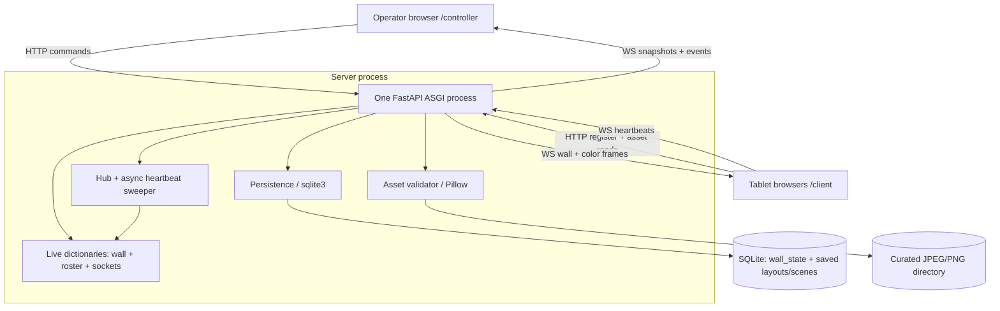
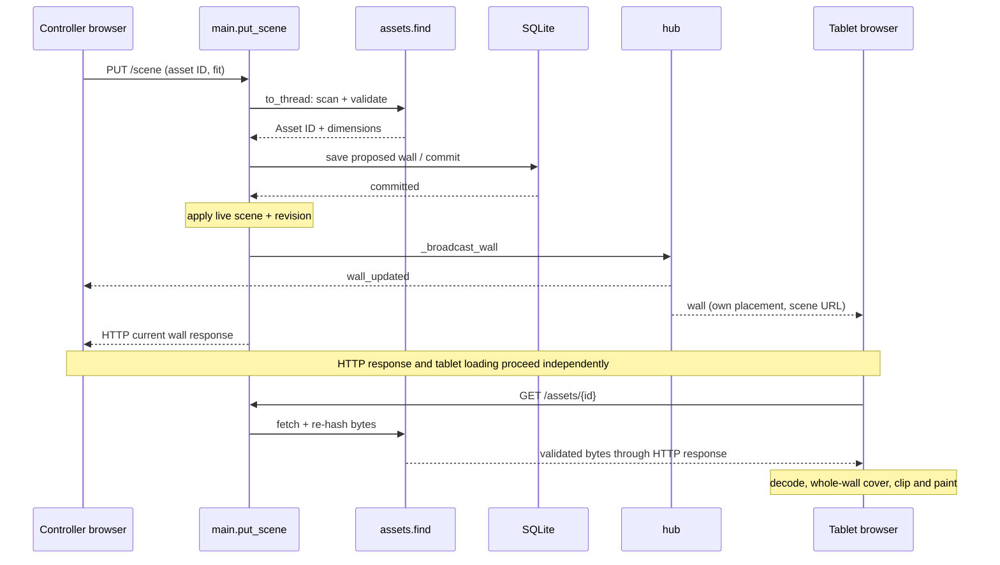

# Tablet Wall AI: codebase guide

> Initial onboarding pass · inspected 2026-10-07 · application code unchanged. Companion: `docs/codebase-explorer.html`. Scope: purpose, architecture, repository map, one image flow, discovered decisions and learning order. This is not a complete subsystem audit.

## One wall, many browsers

The project turns separate tablets into a coordinated display. An operator arranges the tablets in a logical coordinate space and selects the content. Each tablet renders the part of that space assigned to it.

### What exists today

Fact: the system supports per-device colors, a shared calibration pattern, curated JPEG/PNG still images, and named layout and scene save/recall. There is no AI capability. There is no video playback, upload endpoint, or clock synchronization. See `README.md`, `SceneContent` in `main.py`, and `frontend/client/client.js`.

### Who uses it

The operator opens `/controller/` on a laptop or other browser. Each tablet opens `/client/`. The controller changes server-owned state. The tablet page maintains its identity, connection, and rendering state. Both pages are plain HTML/CSS/JavaScript, served by the same FastAPI application.

### The mental model

A layout answers “where are the screens?” A scene answers “what should the wall display?” Device presence answers “which screens are connected now?” Keep these three concepts separate. A saved placement can exist even when its device is absent.

### Evidence and limits

Code facts describe the inspected working tree on 2026-10-07. Documented rationale is identified explicitly. Inferences describe consequences, not proven author intent. The README reports Phase 2 software complete, with physical iPad/Safari and Android/Chrome validation pending. This first guide does not establish real-device reliability or a deployed security boundary.

## Architecture and ownership

One Python server owns the active wall. Browser pages communicate with it over HTTP and WebSocket. SQLite and a curated filesystem directory provide persistent storage.

### High-level architecture

HTTP commands and reads are request/response operations. WebSocket events are asynchronous notifications. The optional two-origin proxy sits in front of the single backend; it is not required in local development.

### Runtime boundaries

The backend is one FastAPI/ASGI process. It serves HTTP routes, static pages, two WebSocket endpoints, and an asynchronous heartbeat sweeper. The sweeper is a task inside that process, not a separate worker service. Image validation for `put_scene()` runs through `asyncio.to_thread(assets.find, ...)`. Synchronous asset GET handlers run through FastAPI’s thread execution.

### Where state lives

| Owner | State | Survives restart? |
| --- | --- | --- |
| Tablet browser | UUID4 in localStorage under `tablet-wall-device-id` | Usually, on the same browser origin |
| Tablet browser | held generation/revision, image attempt/cache, canvas and reconnect timers | No; current wall is replayed on connect |
| Controller browser | device Map, normalized wall, form drafts, selected asset and pending commands | No; snapshot and HTTP reads rebuild it |
| `tabletwall/state.py` | devices, device_sockets, controller_sockets, controller_protocols | No |
| `tabletwall/state.py` → SQLite | wall: layout, scene, revision, generation | Layout/scene/revision survive; generation changes at startup |
| SQLite | wall_state id=1; saved_layouts and saved_scenes keyed by name | Yes |
| Curated directory | Image bytes; database stores SHA-256 references and dimensions | Yes, if the files remain |

### Startup to normal operation

Importing `main.py` constructs `app` and mounts relative static directories. `lifespan()` calls `_restore_wall_state()`: load persisted state or defaults, mint a fresh generation, then save it. `assets.refresh()` scans curated images. The lifespan creates `_sweep_loop()` and yields so requests can run. A tablet resolves its UUID, POSTs registration before each connection attempt, then connects to `/ws/device`. `ws_device()` negotiates the protocol, installs the socket, sends welcome and current wall, and reads heartbeats. A controller receives an initial roster/wall snapshot and later events. Shutdown cancels and awaits the sweeper.

### Architecture pattern

Inference: this is a small client/server application with a modular backend, not microservices. `main.py` combines validation models, route handling, orchestration, and some layout rules. `state.py`, `persist.py`, `hub.py`, `assets.py`, and `protocol.py` split reusable responsibilities. The split is useful, but it is not a strict service/repository architecture: routes directly access shared dictionaries and persistence functions.

### Dependency direction

`main.py` imports hub, state, protocol, assets, and persistence. `hub.py` imports state and protocol. `state.py` imports protocol. `assets.py` imports protocol and Pillow. `persist.py` uses standard-library sqlite3/JSON and does not import live state. In the inspected backend import graph there is no internal circular import. The browser modules communicate through the wire contract, not Python imports. Tests deliberately mutate state through main’s re-exported object identities.

### External dependencies

`pyproject.toml` requires Python 3.13+, FastAPI standard, and Pillow. FastAPI standard provides the ASGI server/tooling; SQLite comes from Python. Dev dependencies include pytest, pytest-timeout, and httpx2. `uv.lock` records the resolved environment. Node runs the client JavaScript test. Caddy is optional deployment infrastructure. No model API, external media API, message broker, or separate database server appears in the traced runtime.

## Repository map

Read by responsibility and runtime dependency. The filenames below are navigation points, not architectural evidence by themselves.

### Important files and directories

| Path | Role | Responsibility and dependencies | Read |
| --- | --- | --- | --- |
| `main.py` | Entry / API / orchestration | App, lifespan, Pydantic inputs, origin guard, routes, `_commit_wall()`; imports all backend modules | First |
| `tabletwall/state.py` | Core state / projection | Owns live dictionaries; `_fresh_wall()`, `_wall_state()`, `_wall_frame()`; used by main and hub | First |
| `tabletwall/protocol.py` | Shared contract utilities | Timing, close codes, normalization, version/capability parsing, asset URL helpers; used by main/state/hub/assets | First |
| `tabletwall/hub.py` | Realtime infrastructure | Pushes frames, handles failed sends, sweeps heartbeat expiry; depends on state/protocol | Next |
| `tabletwall/persist.py` | Data layer | SQLite connections, active-state save/load, named snapshot CRUD; receives dicts from main | Next |
| `tabletwall/assets.py` | Filesystem / validation | Scans and validates image bytes, computes IDs, verifies reads; used by API routes; depends on Pillow/protocol | Next |
| `frontend/client/` | Tablet UI | `index.html` loads `client.js` and `client.css`; identity, registration, connection, canvas and async image lifecycle | First, then deep dive |
| `frontend/controller/` | Operator UI | `index.html` loads `controller.js` and `controller.css`; roster, layout editor, wall map, assets and snapshots | First, then deep dive |
| `PROTOCOL.md` | Interface documentation | Canonical HTTP/WS shapes, geometry and ordering rules; compare against both server and browsers | First |
| `tests/` | Supporting tests | HTTP/WS, commit failures, assets, persistence, snapshots, security and backup; conftest isolates data | Next |
| `simulator/` | Supporting fleet harness | Real app with virtual sockets and independent geometry; no browser/JS/pixels | Later |
| `deploy/` | Deployment / operations | Caddy reference, startup wrapper, smoke/load checks, systemd template, backup tool and kiosk notes | Later |
| `Makefile`, `pyproject.toml`, `uv.lock` | Build / configuration | Development, run, test, simulator commands and dependency environment | First |
| `assets/`, `tablet-wall.db` | Local data, normally ignored | Optional curated image directory and default SQLite file; not application source | Next |

### Configuration and deployment entry points

`TABLET_WALL_DB` → `persist.db_path()` → SQLite (default `tablet-wall.db`). `TABLET_WALL_ASSET_DIR` → `assets.asset_dir()` → image scan/read (default `./assets`). `TABLET_WALL_OPERATOR_ORIGIN` → HTTP write middleware and controller WebSocket guard. `TABLET_WALL_TABLET_ORIGIN` → `GET /operator-config` → controller’s tablet address. There is no central config object; these variables are read at use time. Changing a parent shell environment does not change an already running process.

### Run the development system

From the repository root: `uv sync`, then `make dev` (loopback port 8000, auto reload). `make run` uses `HOST=127.0.0.1`, `PORT=8000` by default and one server process. Static paths require the repository working directory. No Dockerfile, Compose configuration, or CI workflow was found in the inspected tree. Do not assume the roadmap’s CI wording means a workflow currently exists.

### Reference ingress

`deploy/hotspot.Caddyfile` describes two origins: tablet HTTPS at the hotspot IP on 8443, operator HTTPS on localhost:8444 with proxy Basic auth. Both proxy to loopback:8000. The tablet listener allowlists client files, registration, device WS, and hashed asset byte reads; other requests receive 403. `deploy/run-hotspot.sh` validates the hotspot address and Caddy config before running it. The systemd template is a reference with placeholders, not an installed service. Certificate trust and real deployment remain unverified.

## Follow one image onto the wall

Preconditions: a curated file exists, tablets have registered and connected using protocol 2 with image capability, and placements have been assigned. This is a complete scene-selection path, not the tablet’s initial registration path.

### Scene selection sequence

### Execution trace

| Step | Calls and files | Transport | Data and effect |
| --- | --- | --- | --- |
| 1. Operator selects and applies | `frontend/controller/controller.js`: `applyImageScene()` → `requestJson()` | HTTP request | Selected SHA-256 ID becomes `PUT /scene` with `{content:{type:"image",asset,fit:"cover"}}`. Selection alone changes no server state. |
| 2. Guard and validate | `main.py`: `operator_origin_guard()`, `SceneUpdate`, `SceneContent`, `put_scene()` | HTTP request | If configured, the write must match the operator Origin. Pydantic rejects unsupported content, malformed IDs, wrong fit, and extra fields with 422. |
| 3. Resolve the curated file | `main.py`: `await asyncio.to_thread(assets.find, ...)`; `tabletwall/assets.py`: `find()` → `refresh()` | Filesystem read | The scan validates candidates and derives the content ID and dimensions. A missing image ID gives 422 without a wall mutation. Scanning may yield to other requests. |
| 4. Commit the proposed wall | `main.py`: `_commit_wall(apply)` → `tabletwall/persist.py`: `save_state()` | SQLite transaction | Copy live wall, replace scene content, increment revision, JSON-encode layout/scene and commit row id=1. Persist the ID/fit/dimensions, not a URL or image bytes. A failed save leaves live state unchanged. |
| 5. Apply to memory, then notify | `main.py`: `_commit_wall()` → `tabletwall/hub.py`: `_broadcast_wall()` | WebSocket events | Apply the same change to the live wall and increment revision. Controller receives `wall_updated`; each v2 tablet receives its own `wall` frame. A send failure does not undo the committed change. |
| 6. Project and accept the frame | `tabletwall/state.py`: `_wall_frame()` → tablet `applyWallFrame()` | WebSocket frame | Server composes the asset URL and includes only the receiving tablet’s placement. Devices without image capability receive color content. Tablet rejects old/equal revisions in the same generation; a new generation can reset ordering. |
| 7. Fetch, decode, and paint | `frontend/client/client.js`: `syncImageScene()` → `fetchImageSource()` → `drawImageScene()` → `drawWallImage()` | HTTP image read + browser work | `GET /assets/{id}` → `assets.fetch()` returns verified bytes. The tablet loads and decodes the image with a 15-second whole-attempt deadline and stale-attempt checks. It computes centered cover in whole-wall coordinates, then maps and clips the visible placement onto its canvas. |

### The request and resulting state

Input: `{ "content": { "type": "image", "asset": "sha256:<64 lowercase hex digits>", "fit": "cover" } }`. Stored scene content adds `intrinsicWidth` and `intrinsicHeight`. `_project_scene()` adds a same-origin URL only on output. The wall revision increases once; the generation stays unchanged. The HTTP response contains current wall state. The controller also receives a pushed update, so it can observe the same change through both channels.

### Geometry in plain terms

Placement `(x,y,w,h)` is the tablet’s footprint in logical wall units. Bezel insets reduce that footprint to a visible rectangle. For image dimensions `(iw,ih)` and wall dimensions `(W,H)`, whole-wall cover uses `s=max(W/iw,H/ih)`, centered at `((W-iw*s)/2,(H-ih*s)/2)`. Each tablet uses the same image rectangle. `drawWallImage()` maps its visible rectangle to its viewport without stretching. A mismatched viewport aspect ratio causes extra cropping, which can harm seams.

### What success proves

A successful scene response proves a validated scene was committed and the notification path completed. It does not prove that every tablet decoded or displayed the image. The production device receive loop only processes heartbeat messages; it does not collect render acknowledgements. The controller is therefore a view of requested presentation and connectivity, not confirmed pixels.

### Failures on this path

Origin mismatch → 403 when the guard is enabled. Invalid body/unknown asset → 422. Database failure → uncaught server error before live mutation or broadcast. A disappearing file can cause asset GET 404 after the scene commit. Client fetch/decode/timeout failures produce an explicit image failure panel with retry when possible. A late result from an obsolete image attempt is discarded rather than painted. There is no transaction spanning database, filesystem and every browser.

## Decisions, tradeoffs, and hotspots

Most rationale below is explicit in code comments or PROTOCOL.md. Alternatives are teaching comparisons, not recommendations to rewrite the project.

### Decisions discovered so far

| Decision | Evidence | Benefit | Tradeoff | Alternative / effect |
| --- | --- | --- | --- | --- |
| HTTP commands; WebSocket events | Documented in `PROTOCOL.md`; `requestJson()` writes and `hub._broadcast_wall()` pushes. | HTTP gives explicit validation/status; WS keeps browser views live without roster polling. | Two channels can observe one change at different times. A successful send is not a rendering acknowledgement. | Polling would simplify transport but increase delay/traffic. Command-over-WS needs request IDs and response semantics. |
| Layout and scene are separate | `wall.layout`, `wall.scene`; `PUT /wall` vs `PUT /scene`; separate snapshot tables. | Recall content without moving screens; preserve arrangement independently. | Shared revision couples changes; clients must combine layout and content. | A combined presentation snapshot could be simpler to recall, but would remove independent recall unless both forms remain. |
| Persist before apply/notify | `_commit_wall()` deep-copies, saves, then changes live state. Explicit rationale in comments and protocol. | A failed database write does not advertise state that was never committed. | Synchronous SQLite blocks the event loop; mutation callback runs twice and must be deterministic and free of external effects. | Offloaded/queued writes need serialized ownership and carefully preserved commit order. |
| One process with shared mutable registries | Module-level state and direct imports; README explicitly prohibits multiple workers. | Simple ownership for a small wall; no distributed state or broker. | Multiple workers would have different rosters/sockets/walls and could overwrite revisions. | Scaling requires externalized authoritative state, cross-process delivery and conflict control, not merely more workers. |
| Generation plus revision | Startup creates generation; browser `applyWallFrame()` checks it alongside revision. | A restart/backup rollback can replay lower revisions without getting stuck. | Ordering is within a generation only; it is not optimistic concurrency control for HTTP writes. | Revision alone fails after rollback. Persistent global ordering needs stronger storage semantics. |
| Content IDs and local curated stills | `assets.refresh()` hashes bytes; URL derived by protocol; no upload route. | Rename-safe identity and immutable caching; constrained and verified input. | Repeated scans cost CPU/I/O. Missing bytes remain a failed scene; DB backup alone is insufficient. | Indexed inventory or object storage could improve scale but needs invalidation and integrity rules. |
| Full per-device wall projection and capabilities | `state._wall_frame()` selects one placement and downgrades unsupported image/calibration content. | Reconnect can reconstruct presentation from current state; older clients remain usable. | Capability fallback can leave mixed content across the physical wall. No synchronized paint barrier. | Deltas save bandwidth but require recovery; coordinated scheduled rendering adds clock/acknowledgement complexity. |
| Optional browser Origin guard and proxy boundary | `operator_origin_guard()` exempts registration; Caddy restricts ingress and authenticates operator. | Browser cross-site writes can be fenced while tablet registration stays available. | Origin is forgeable by non-browser callers; backend has no built-in authentication or device credentials. | An authenticated session/API and tablet pairing would change both server and browser contracts. |

### Where to slow down

| Difficulty | Area | Why it needs care |
| --- | --- | --- |
| Risky | Commit boundary and wall mutation | Callbacks execute twice; preserve deterministic mutation, in-place object identity and persist-before-notify. Read commit-failure tests. |
| Difficult | Tablet image lifecycle and transforms | Decode can finish after a new scene; generation, revision, attempt tokens, timers and bitmap cleanup interact. Test races and seams. |
| Risky | Socket replacement and presence | Every await can allow disconnect/reconnect. Identity checks prevent an old socket removing or keeping a replacement alive. |
| Risky | Deployment and asset trust boundaries | No application auth; public tablet asset reads; filesystem swaps, hashes and certificate trust matter. Reference configs are not proof of deployment. |
| Moderate | Controller state reconciliation | Large single JS closure combines transport, forms and UI; HTTP responses and pushed updates can overlap. Inspect before adding new mutations. |
| Easy to moderate | Read-only API addition | Routes are accessible entry points, but data projection, origin exposure and test isolation still matter. |

### Concurrency limits

Within this one event loop, `_commit_wall()` performs synchronous copy/save/apply without an await. Other coroutine handlers cannot run in the middle of that block. Asset scans yield through worker threads before the commit, and broadcast sends yield afterwards. Sends are sequential, with no explicit send timeout in the hub. A slow send can delay later recipients. There is no compare-and-swap revision precondition, so competing valid HTTP writes are applied in completion order. These properties do not prove thread/process safety or globally ordered delivery.

### Security scope

Tablet UUIDs are identifiers, not credentials. Anyone who can reach the direct backend can access its ungated surface when the Origin guard is unset. Even with the guard set, non-browser callers can forge Origin. Asset files are treated as untrusted input: top-level non-symlink still JPEG/PNG only, format/size/pixel/orientation checks, safe file opening and re-hashing before serving. Sensitive images need a separate tablet/asset access boundary. This is an architectural warning, not a full security audit.

## Read, trace, then change

Read a narrow vertical path before reading every utility. Use the tests to learn the behavior the project promises.

### Recommended reading order

| Stage | Read | What you should be able to explain |
| --- | --- | --- |
| 1. System shape | README → PROTOCOL wall/transport sections → main lifespan → state._fresh_wall/_wall_frame → put_scene | Who owns state, what survives restart, and how a scene reaches a tablet |
| 2. Realtime ownership | main.device_register/ws_device/_device_loop/ws_controller → hub._broadcast_wall/_sweep_once → client connection code | Welcome/replay, heartbeats, reconnect and socket replacement |
| 3. Durable presentation | main._commit_wall and snapshot routes → persist → commit/persistence/snapshot tests | Commit ordering, separate save/recall and vacant reservations |
| 4. Rendering and UI | client.applyWallFrame/syncImageScene/drawWallImage → controller.applyImageScene/renderWallMap/adoptWallState → JS tests | Whole-wall cover, stale decode rejection, controller confirmation and async limits |
| 5. Operations and boundaries | assets → security/assets tests → deploy README/OPERATIONS/KIOSK/backup → simulator harness/geometry | Ingress, verified bytes, backup closure, and what simulation cannot prove |

### Testing map and commands

`make test` runs `uv run pytest` and `node tests/client_image.test.js`. `tests/conftest.py` points DB/assets to temporary paths and resets shared state, then TestClient executes the lifespan. Python tests cover HTTP/WS contract, layouts, persistence failures, snapshots, assets, origin guards and backup tooling. The JS test supplies browser substitutes to test rendering math and loading races; it is not physical tablet verification. `make sim` runs the virtual-fleet harness and its separate self-tests. Pytest’s default testpaths is tests, so simulator self-tests require that explicit invocation. TCP, proxy/TLS, physical sleep/kiosk behavior and real screen seams need separate validation.

### Safe change: a new scene type

Start with PROTOCOL.md: define its input, descriptor, capability and fallback. Then update main.SceneContent/put_scene, saved-content validation and recall as needed; update state._wall_frame, client apply/render logic, and controller content controls. Add API validation, capability fallback, persistence/recall and client race/render tests. Preserve full-state replay and generation/revision semantics. Do not treat this first pass as a complete checklist for an unknown media type.

### Safe change: layout data

Trace main.PlacementCommand/put_placement → state placement projections → persistence JSON → saved-layout validation → client visibleRectOf → controller normalizers/editor. Add stored-field defaults or migration behavior before changing payloads. Verify old snapshots and backup validation if persisted structure changes. Run wall, snapshot, persistence and JS geometry tests. Keep bezel and placement in logical wall units.

### Safe change: a read-only route

Define the response and who may read it. Add a route in main using detached state projections where appropriate, then contract tests in tests/test_api.py or the related subsystem suite. Update PROTOCOL.md. If tablets need it through the proxy, review the exact Caddy allowlist and deployment-guard tests; exposing the direct backend is not the same as exposing the tablet origin.

### Next subsystem lessons

This initial pass establishes the big picture and one end-to-end flow. Continue with device identity and connection lifecycle, then persistence/save-recall, then renderer geometry and image races, then operator reconciliation, assets and operations. Deepen both artifacts together. Unresolved questions include detailed controller race behavior, old active-state schema compatibility, real-browser/device rendering and actual deployed ingress. Original dependency-selection intent beyond the explicit comments is not established.

### Check your understanding

1. After a server restart, why can a placement exist before its device appears in the roster? 2. Why must a tablet compute cover against the whole wall rather than its own rectangle? 3. If SQLite fails during scene selection, what should remain unchanged? Answers are intentionally withheld until you attempt the questions.
