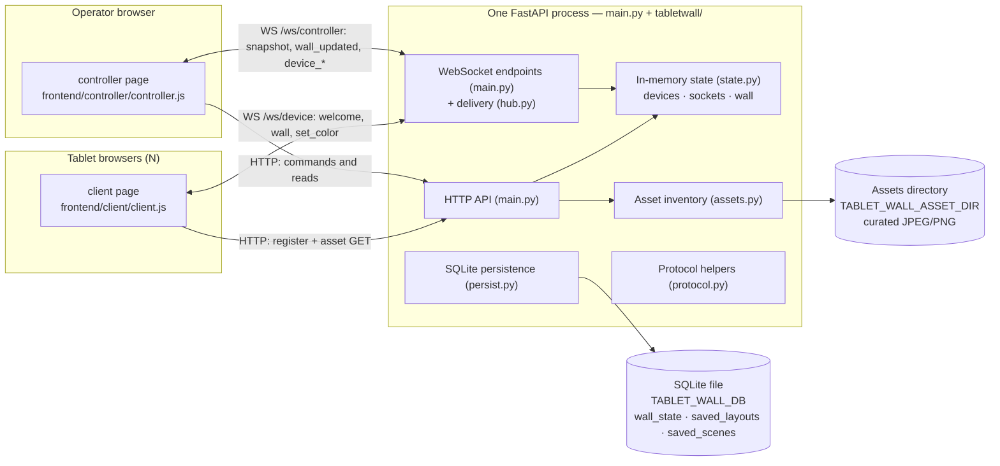
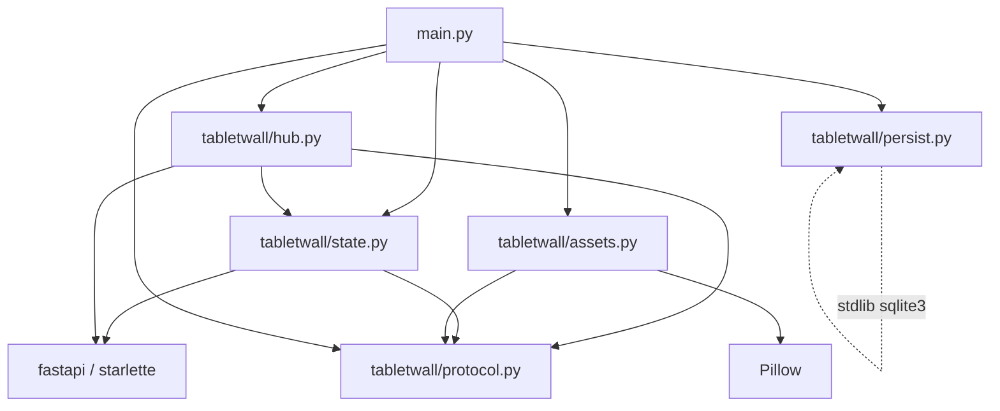
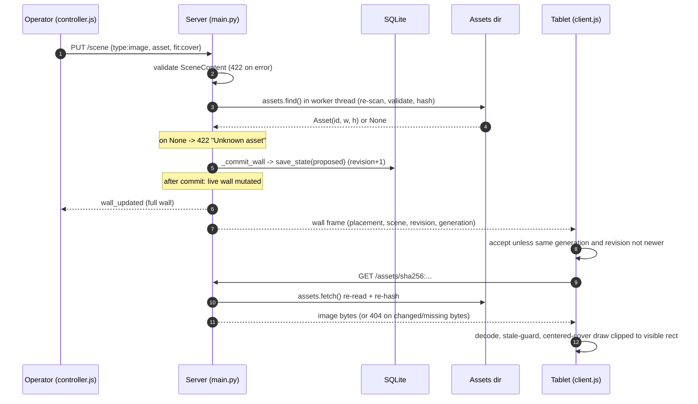

# tablet-wall-ai — Codebase Guide

> **Purpose of this document.** A durable architectural reference for the
> repository. It is written so a future developer (or a future AI coding
> session) can read it and understand the system without re-exploring
> everything. Section 1–7 are the **first pass**: purpose, architecture,
> repository structure, one end-to-end flow, key design decisions, and a
> learning order. Deeper subsystem sections are appended as exploration
> continues; this header notes which pass the document is at.
>
> **Status of the code itself (from `README.md`):** Phase 2 software complete;
> physical tablet validation pending. No authentication. No AI capability
> (the name is historical).
>
> **Rule for edits:** the architecture described here is measured against the
> code. Where a claim is an inference rather than a documented fact, it is
> marked **[inference]**. Where the code cannot be trusted to know, it says
> "not determinable from the code".

---

## 1. What this project is

**Facts.**

`tablet-wall-ai` turns a set of tablets into one coordinated display wall.
A single Python server (`main.py` + the `tabletwall/` package) serves two
browser pages:

| Surface | URL | Who opens it | Role |
| --- | --- | --- | --- |
| Client | `/client/` | every tablet | registers itself, holds a live socket, paints its slice of the wall |
| Controller | `/controller/` | the operator | watches the roster, arranges tablets on a logical wall, chooses content, saves/recalls snapshots |
| API docs | `/docs` | developer | FastAPI-generated OpenAPI page |

The server is a FastAPI application (Python 3.13+, `uv` for dependency
management). It has two runtime dependencies only: `fastapi[standard]` and
`pillow` (`pyproject.toml`). Persistent state is one SQLite file plus a
directory of curated images. There is no external service, no cloud
dependency, no task queue, and no background worker process.

**What the wall can show today** (`PROTOCOL.md` "Wall state", `README.md`):

1. **Assigned colour** — each tablet shows a colour chosen by the operator.
   This is the original version-1 behaviour.
2. **Calibration pattern** — every placed tablet renders its slice of a grid
   pattern, used to check that the geometry and seams are aligned.
3. **Curated still image** — one JPEG/PNG, fitted with centered `cover` across
   the *whole logical wall*; each tablet clips to its own visible rectangle.

**Vocabulary that the code assumes** (define these before reading further):

- **Wall** — one logical canvas measured in abstract integer units, not
  pixels and not millimetres. The operator picks its size (default
  `2000×1000`, `tabletwall/state.py`).
- **Placement** — a rectangle (`x, y, w, h`) on the wall assigned to one
  device, plus a **bezel** inset per edge. The **visible rect** is the
  footprint minus the bezel.
- **Scene** — what is being shown (`content` object) plus a reference to the
  layout in use.
- **Layout** — the arrangement: wall dimensions and the placements map.
- **Reservation** — a placement whose device is not currently in the roster
  (for example, a tablet that has not re-registered after a server restart).
- **Generation** — a token minted fresh on every server start; combined with
  `revision`, it lets a client decide whether a `wall` frame is stale.
- **Asset** — a curated image, addressed by the SHA-256 of its bytes.

**Explicit non-goals / absences** (documented in `README.md` and
`PROTOCOL.md`; do not assume they exist):

- No authentication or authorization. The optional operator-`Origin` check in
  `main.py` is a CSRF fence, not auth (see decision D9).
- No AI, no model, no planned schema space for one.
- No video, no upload endpoint, no clock synchronisation (Phase 4 is a
  conditional prototype only).
- No container configuration (no Dockerfile, no compose file anywhere).
- No CI configuration in the repository (no `.github/`); README says basic CI
  was planned for Phase 2a but no workflow file exists.

**How to run it** (from `README.md`, `Makefile`):

```bash
uv sync                  # create .venv and install dependencies
make dev                 # server with auto-reload on http://127.0.0.1:8000
make test                # pytest + node tests/client_image.test.js
make sim                 # 18 virtual tablets against an isolated app/database
```

Two environment details matter from the first minute:

- The app **must** run from the repository root. `main.py` mounts static
  directories by relative path (`StaticFiles(directory="frontend/client")`),
  so importing it elsewhere raises `RuntimeError`. The `make` targets `cd`
  to the repo root for you.
- `make dev` / `make run` bind to `127.0.0.1` by default. A tablet cannot
  reach that over the LAN. The intended tablet trial uses the two-origin
  Caddy proxy in `deploy/` (see §1.1).

### 1.1 Deployment shape (as documented, not yet validated on hardware)

`deploy/README.md` describes the intended first trial: 15–20 tablets on a
laptop hotspot, reached over two HTTPS origins served by Caddy, both proxying
one backend on `127.0.0.1:8000`:

- `https://<hotspot-ip>:8443` (tablets) — default-deny allowlist: only the
  client page, `POST /devices/register`, `/ws/device`, and asset bytes.
- `https://localhost:8444` (operator, laptop only) — HTTP Basic auth before
  the controller and all operator APIs.

The repository does not install, enable, or start anything. The systemd unit
(`deploy/tablet-wall.service.example`) and backup tool (`deploy/backup.py`)
are references, "pending validation".

---

## 2. High-level architecture

### 2.1 One process, two browsers, two storage mediums



Communication is deliberately split by direction (`PROTOCOL.md`
"Transports"):

- **HTTP carries commands.** The operator sets a colour, a placement, a wall
  size, a scene, or saves a snapshot with an HTTP request. HTTP gives a
  status code and a response body, so the caller knows what happened.
- **WebSocket carries events and pushes.** Devices hold `/ws/device` for
  liveness (heartbeats) and commands pushed *to* them (`set_color`, `wall`).
  Controllers hold `/ws/controller` and only listen (roster events and
  `wall_updated`). The controller never sends meaningful frames up its
  socket.

### 2.2 Component responsibilities

| Component | File(s) | Owns | Depends on |
| --- | --- | --- | --- |
| FastAPI app, lifespan, routes, middleware | `main.py` (1448 lines) | HTTP routes, both WebSocket endpoints, commit boundary, Origin guard | everything below |
| Protocol constants + pure validators | `tabletwall/protocol.py` (139) | timing constants, close codes, UUID/colour/name/protocol/caps parsing, asset URL composition | nothing in the package |
| In-memory state | `tabletwall/state.py` (195) | `devices`, `device_sockets`, `controller_sockets`, `controller_protocols`, `wall`, wire-shape projectors (`_device_record`, `_wall_state`, `_wall_frame`) | `protocol` |
| Frame delivery + sweeper | `tabletwall/hub.py` (161) | `_broadcast`, `_broadcast_wall`, `_send_wall_to_device`, `_send_color_to_device`, `_broadcast_offline`, heartbeat `_sweep_loop` | `protocol`, `state` |
| Wall persistence | `tabletwall/persist.py` (275) | `load_state`/`save_state` (single row), saved layouts/scenes CRUD, schema creation | stdlib `sqlite3` |
| Curated asset inventory | `tabletwall/assets.py` (383) | directory scan, validation, content IDs, byte-verified serving, one-shot rejection logging | Pillow, `protocol` |
| Tablet page | `frontend/client/client.js` (1824), `index.html`, `client.css` | device identity, registration, socket, heartbeat, reconnect, rendering (colour / calibration / image), diagnostics | server contract only (no build step) |
| Controller page | `frontend/controller/controller.js` (4088), `index.html`, `controller.css` | roster tiles, wall editor (numeric placements), wall map, content controls, asset browser, named snapshots UI, warnings | server contract only |
| Contract tests | `tests/` (278 Python test functions + 26 JS cases) | HTTP, WebSocket, wall, persistence, snapshots, assets, commit boundary, security guard, backup tool, client image renderer | pytest, Starlette TestClient, Node |
| Simulator | `simulator/` | in-process virtual fleet driving the real app; geometry oracles; report | the app itself |
| Deployment references | `deploy/` | Caddy two-origin ingress, smoke tests, backup/verify/restore, systemd template, kiosk notes | Caddy, SQLite |

### 2.3 Communication matrix

| From → To | Transport | Path | Purpose |
| --- | --- | --- | --- |
| Tablet → server | HTTP POST | `/devices/register` | introduce itself (id, viewport, type) before every socket attempt |
| Tablet → server | HTTP GET | `/assets/{id}` | fetch curated image bytes |
| Tablet ↔ server | WebSocket | `/ws/device?device_id=…&protocol=2&caps=…` | heartbeat up; `welcome`, `wall`, `set_color` down |
| Controller → server | HTTP | `/wall`, `/scene`, `/devices/…`, `/wall/auto`, `/layouts…`, `/scenes…`, `/assets` | every command and read |
| Controller ← server | WebSocket | `/ws/controller?protocol=2` | `snapshot`, `device_online/offline/updated/removed`, `wall_updated` |
| Server → SQLite | in-process | `tabletwall/persist.py` | wall row + named snapshots |
| Server → filesystem | in-process | `tabletwall/assets.py` | scan/read curated image files |

No component polls. The controller's only timer is a 1 Hz DOM clock
(`controller.js` `tick`), which performs no network access.

### 2.4 Where state lives

| State | Location | Survives restart? | Notes |
| --- | --- | --- | --- |
| Device roster (`devices`) | server process memory (`state.py`) | **No** | tablets re-register on their own |
| Open sockets, negotiated protocol, caps | server process memory | No | |
| `last_seen` timestamps | server process memory | No | only pushed to controllers when something changes |
| Active wall: layout + scene + revision | SQLite single row `wall_state` | **Yes** | |
| Generation | SQLite row, but re-minted at every startup | Not meaningfully | forces clients to resynchronise |
| Named layouts | SQLite table `saved_layouts` | Yes | names are their own namespace |
| Named scenes | SQLite table `saved_scenes` | Yes | |
| Curated image bytes | filesystem (`TABLET_WALL_ASSET_DIR`, default `./assets`) | Yes (outside the DB) | the DB stores only references (SHA-256 IDs) |
| Held device identity | browser `localStorage` key `tablet-wall-device-id` | Yes (per browser) | |
| Held revision/generation, image cache | tablet page memory | No | |
| Operator selection state, form drafts | controller page memory | No | |

Two consequences are load-bearing and documented in `README.md`:

1. After a restart the roster is empty until tablets re-register. A
   persisted placement whose device is absent is shown as a **vacant
   reservation**, not deleted, because the returning tablet should reclaim
   its slot. Auto-arrange (`POST /wall/auto`) refuses to overwrite
   reservations (409) instead of pruning them.
2. Backups must include **both** the SQLite file and the referenced image
   bytes; the DB contains references, not pixels. `deploy/backup.py` exists
   for exactly this.

---

## 3. Repository structure

### 3.1 Annotated tree (important entries only)

```text
tablet-wall-ai/
├── main.py                        ENTRY POINT — FastAPI app, lifespan, all routes,
│                                  both WebSocket endpoints, `_commit_wall`,
│                                  Origin guard middleware
├── pyproject.toml                 CONFIG — deps (fastapi[standard], pillow),
│                                  dev deps (httpx2, pytest, pytest-timeout),
│                                  pytest config (timeout=30)
├── Makefile                       CONFIG — sync / dev / run / test / sim / clean
├── README.md                      DOC — quickstart, API table, known limitations, roadmap
├── PROTOCOL.md                    DOC — the authoritative realtime contract (v1 + v2)
├── uv.lock                        generated lockfile
│
├── tabletwall/                    BACKEND PACKAGE (split out of main.py in 521c28c)
│   ├── __init__.py                    package docstring only
│   ├── protocol.py                    constants + pure validators; imports nothing local
│   ├── state.py                       module-level mutable state + wire projectors
│   ├── hub.py                         frame delivery + heartbeat sweeper
│   ├── persist.py                     SQLite: one wall row + saved layouts/scenes
│   └── assets.py                      curated image inventory and serving
│
├── frontend/
│   ├── client/                    TABLET UI — no build step, no external resources
│   │   ├── index.html                 canvas + status pill only
│   │   ├── client.js                  identity → register → socket → render
│   │   └── client.css
│   └── controller/               OPERATOR UI — no build step
│       ├── index.html                 panels: wall, image, snapshots, device grid
│       ├── controller.js              socket + all HTTP commands + all DOM rendering
│       └── controller.css
│
├── tests/                         TESTS — Starlette TestClient, in-process
│   ├── conftest.py                    autouse isolation: tmp DB/assets, clear state
│   ├── test_api.py                    HTTP basics and registration
│   ├── test_websocket.py              sockets, presence, close codes, colours
│   ├── test_wall.py                   protocol v2: negotiation, wall, placements, auto
│   ├── test_persistence.py            restart semantics, generation reset, schema upgrade
│   ├── test_snapshots.py              named layouts/scenes
│   ├── test_assets.py                 inventory, serving, validation, caps gate
│   ├── test_commit_boundary.py        failed save changes nothing
│   ├── test_security.py               operator Origin guard
│   ├── test_deployment_guards.py      static guards on the unit file + no external assets
│   ├── test_backup.py                 deploy/backup.py end to end
│   └── client_image.test.js           client.js under a Node vm, mocked DOM/canvas
│
├── simulator/                     TEST-ONLY FLEET — virtual tablets, no browser
│   ├── run.py / harness.py            in-process TestClient + socket reader threads
│   ├── scenarios.py                   22 scenarios + registry
│   ├── geometry.py                    pure seam/tiling oracles
│   ├── report.py
│   └── test_simulator_selftest.py     plumbing self-tests (run by `make sim`)
│
└── deploy/                        DEPLOYMENT REFERENCES (not installed by the repo)
    ├── README.md                      two-origin hotspot proxy reference
    ├── hotspot.Caddyfile              default-deny allowlist + operator Basic auth
    ├── run-hotspot.sh / smoke.sh      proxy launcher + negative-route checks
    ├── load-smoke.py                  20 concurrent WS clients through the ingress
    ├── tablet-wall.service.example    systemd unit template (single worker, loopback)
    ├── OPERATIONS.md                  lifecycle, backup/verify/restore drill, rollback
    ├── KIOSK.md                       OS-side tablet behaviour + real-device gates
    └── backup.py                      verified backup/verify/restore CLI
```

### 3.2 Module dependency direction



The direction is acyclic and points one way: `main` knows everything;
`hub` knows `state` + `protocol`; `state` knows `protocol`; `assets` and
`persist` are leaves (plus Pillow / `sqlite3`). `protocol.py` imports nothing
from the package, which is what lets both `state` and `hub` depend on it.
There are no circular imports today and no cross-layer shortcuts such as
`persist` reading sockets.

**One unusual, deliberate coupling:** `main.py` imports the state objects
*by name* (`from tabletwall.state import devices, wall, …`) and re-exports
them. Comments in `main.py` and `state.py` state that tests mutate these
through `main`, so they must never be copied, only mutated in place. Treat
`main.devices`, `main.wall`, `main.device_sockets` as the same objects as
`tabletwall.state.*`.

### 3.3 File classification for reading

| Class | Files |
| --- | --- |
| Entry point | `main.py` |
| Domain/business logic | `tabletwall/state.py`, `tabletwall/hub.py`, placement/commit rules inside `main.py` |
| API/interface layer | routes in `main.py`; `PROTOCOL.md` as the written contract |
| Data layer | `tabletwall/persist.py`, `tabletwall/assets.py` |
| Infrastructure | lifespan + sweeper task in `main.py`, `tabletwall/hub.py`; `deploy/` |
| Configuration | `pyproject.toml`, env vars (`TABLET_WALL_*`), `Makefile` |
| Utilities | `tabletwall/protocol.py` |
| Frontend/UI | `frontend/client/`, `frontend/controller/` |
| Tests | `tests/`, `simulator/` |
| Build/deployment | `Makefile`, `deploy/` (no container files exist) |

---

## 4. Main end-to-end flow: the operator shows a curated image

### 4.1 Why this flow

This is the Phase 2 capability and the densest path through the system. It
touches controller UI, HTTP validation, the asset scanner, the commit
boundary, SQLite, both WebSocket fan-outs, the version/capability gate, the
tablet image loader, and the rendering transform. If you understand this
flow, you understand most of the system.

### 4.2 Control-flow trace

**Trigger:** the operator selects an asset in the controller and presses
**Show on wall** (`controller.js` `applyImageScene`, around line 1590).

| # | Step | Where | What happens |
| --- | --- | --- | --- |
| 1 | Controller sends `PUT /scene` with `{content:{type:"image", asset:"sha256:…", fit:"cover"}}` | `controller.js` `applyImageScene` | only `cover` is ever sent today; the button is gated on a selection and on no other scene write being in flight |
| 2 | Server validates the body | `main.py` `put_scene` (line 869), `SceneContent` model (line 194) | unknown type / missing asset / bad fit / unknown keys → 422; nothing changes |
| 3 | Server finds the asset | `main.py` line 881 → `assets.find` (assets.py line 194) | runs in a worker thread (`asyncio.to_thread`); re-scans the directory, validates and hashes candidates, returns the `Asset` with intrinsic dimensions, or `None` → 422 "Unknown asset" |
| 4 | Server commits before applying | `main.py` `_commit_wall` (line 312) → `persist.save_state` (persist.py line 112) | deep-copies the live wall, applies the new `scene.content` (with derived dimensions, **no URL**), bumps `revision`, upserts the single `wall_state` row. If this raises, the route 500s and **memory is untouched** |
| 5 | Live wall mutated | `_commit_wall` second half | same change runs on the live `wall` dict in place; `revision` bumped again by 1 (the same amount) |
| 6 | Server broadcasts | `main.py` line 903 → `hub._broadcast_wall` (hub.py line 93) | to every **v2** controller: `wall_updated` with the full wall; to every **v2** device socket: a per-device `wall` frame |
| 7 | Per-device frame is projected | `state._wall_frame` (state.py line 166) | includes wall dimensions, this device's placement (or `null`), the scene, `revision`, `generation`; if the device lacks the `image` cap, the content is rewritten to `{"type":"color"}` |
| 8 | Tablet applies the frame | `client.js` `applyWallFrame` (line 1524) | rejects the frame only when `generation` is unchanged **and** `revision` is not newer; a different generation is accepted and resets the held revision |
| 9 | Tablet starts the image load | `client.js` `syncImageScene` (line 1109) → `startImageLoad` (line 1178) | renders a loading diagnostic first, then `GET /assets/sha256:…` with a 15 s deadline covering headers, body, and decode |
| 10 | Server serves bytes | `main.py` `get_asset` (line 1281) → `assets.fetch` (assets.py line 204) | re-reads with `O_NOFOLLOW`, re-hashes; the hash must equal the requested ID, else 404. Success: `Content-Type`, `nosniff`, immutable cache |
| 11 | Tablet decodes and draws | `client.js` `drawWallImage` (line 1363) | `createImageBitmap` (or the `` fallback), stale-attempt guard, then one centered-cover transform computed from the **whole wall**, clipped to the visible rect; failure shows an `IMAGE FAILED` panel with tap-to-retry |

### 4.3 Sequence diagram



### 4.4 Data transformations along the path

| Stage | Shape |
| --- | --- |
| Controller request | `{content:{type:"image", asset:"sha256:…", fit:"cover"}}` |
| Validated model | `SceneContent` fields; `fit` defaulted to `cover` if omitted; unknown keys rejected |
| Committed scene content | `{type, asset, fit, intrinsicWidth, intrinsicHeight}` — dimensions derived from the file the scan just validated; **no URL** |
| Wire projection (`_project_scene`) | persisted content + `url:"/assets/sha256:…"` composed from the ID |
| Device frame (`_wall_frame`) | `{type:"wall", revision, generation, wall:{width,height}, scene:{content,layout}, placement:{x,y,w,h,bezel} or null}` |
| Tablet acceptance | held `{generation, revision}`; content descriptor normalised into `{key, asset, url, fit, iw, ih}` |
| Pixels | one global cover transform in wall units, clipped to `visible = footprint − bezel` |

### 4.5 Side effects

- One SQLite row updated (`wall_state`) with `revision + 1`.
- `wall_updated` sent to every v2 controller socket.
- One `wall` frame per v2 device socket — including **offline devices with a
  retained socket? No**: only devices currently holding a socket get frames;
  the next reconnect replays the wall because the server sends a `wall`
  frame immediately after `welcome` (`ws_device`, main.py line 1386).
- Asset directory re-scanned at least twice: once for acceptance, once per
  serve. This is deliberate (freshness over caching) and is the main CPU
  cost of the feature.

### 4.6 Failure modes along this path

| Failure | Behaviour | Evidence |
| --- | --- | --- |
| Unknown/malformed asset ID in body | 422, no commit | `put_scene` |
| Malformed JSON body / unknown keys | 422 | Pydantic models with `extra="forbid"` |
| Disk write fails | 500; live wall, DB, and subscribers all unchanged; no broadcast | `_commit_wall`; `tests/test_commit_boundary.py` |
| Asset file removed after acceptance | The scene stays; `GET /assets/{id}` 404s; tablet shows `IMAGE FAILED` and retries on tap | `assets.fetch`; client diagnostic panels |
| File bytes replaced (same name) | New hash = new identity; old ID 404s | content addressing in `assets.py` |
| Tablet lacks `image` cap | It receives `{"type":"color"}` instead; controller shows a partial-wall warning | `state._wall_frame`; `controller.js` `renderCoverage` |
| Tablet offline during broadcast | Nothing pushed; on reconnect the server replays the wall right after `welcome` | `ws_device` |
| Controller socket dead | Send raises; socket dropped, closed, and later reconnects | `hub._broadcast` |

---

## 5. Key design decisions (initial set)

The code comments and `PROTOCOL.md` document intent unusually well. Each
decision below separates **evidence** from **inference**.

### D1 — Commands over HTTP, events over WebSocket

- **Decision.** State-changing operations are HTTP requests with response
  bodies. WebSockets are used for liveness and server→client push.
- **Evidence.** `PROTOCOL.md` "Transports"; the controller only listens on
  its socket; `POST /devices/{id}/color` returns a `delivered` count.
- **Problem solved.** A command needs an outcome (applied? delivered? not
  found?) and must not be lost while a socket is reconnecting. A push needs
  low latency to many clients.
- **Tradeoff.** Two protocols to keep in sync; a controller can observe a
  `wall_updated` that arrived *after* its own HTTP response (it must tolerate
  both orderings). The `delivered` boolean is a best-effort handoff, not a
  receipt.
- **Alternatives.** Commands over the socket with request IDs; REST-only
  with polling (rejected by Phase 1: "replace polling with a WebSocket
  channel").
- **If changed.** Moving commands onto sockets would need correlation IDs
  and acknowledgement; moving pushes to polling would raise latency and load
  and was explicitly a Phase 1 goal to remove.

### D2 — The roster is in memory; the wall is in SQLite

- **Decision.** Devices, presence, sockets, and `last_seen` are process
  state. The active wall, revision, and named snapshots are persisted.
- **Evidence.** `state.py` vs `persist.py`; `README.md` known limitations;
  `tests/test_persistence.py` asserts precisely this split.
- **Problem solved.** Persistence where correctness matters (the arrangement
  and content the operator curated), volatility where it is natural
  (tablets can re-introduce themselves in seconds).
- **Tradeoff.** After restart the roster is empty and placements appear as
  vacant reservations; presence is never durable.
- **Alternatives.** Persist the roster too (more schema, stale rows, cleanup
  policy); hold the wall in memory only (lose operator work on restart).
- **If changed.** Persisting the roster would change delete semantics and
  needs aging/cleanup rules; the client already re-registers on every
  attempt, so it self-heals.

### D3 — Layout and scene are separate; recall is one-sided

- **Decision.** `layout` (dimensions + placements) and `scene.content` are
  separate objects with separate named namespaces and separate recalls.
- **Evidence.** `PROTOCOL.md` "Wall state" ("kept separate on purpose");
  `PUT /wall` accepts only dimensions and forbids extra keys; `PUT /scene`
  separately; `POST /scenes/{name}/recall` never touches placements.
- **Problem solved.** Recalling a scene must not silently discard placement
  work done afterwards. Saving a layout must not carry content with it.
- **Tradeoff.** Restoring "the whole look" takes two recalls; there is no
  combined preset (documented as out of scope).
- **Alternatives.** One fused state object; a combined preset action.
- **If changed.** Fusing them would make recall ambiguous and is exactly
  what the comment warns against.

### D4 — Revision *and* generation: accept newer revisions, always resync
on a new lineage

- **Decision.** `revision` is monotonic within a `generation`; the
  generation is re-minted on **every server start**, while the revision is
  persisted and keeps climbing.
- **Evidence.** `state._new_generation`; `main._restore_wall_state`
  (main.py line 107) writes the fresh generation immediately; the client
  gate in `client.js` `applyWallFrame`; `PROTOCOL.md` "Revision and
  generation".
- **Problem solved.** A restored/rolled-back database can hold a *lower*
  revision than a connected tablet. Without a lineage token the tablet would
  reject the server's state forever. Resetting the generation on every start
  makes resynchronisation unconditional instead of relying on unreliable
  detection.
- **Tradeoff.** Every ordinary restart forces every client to accept and
  re-render, even when nothing visible changed.
- **Alternatives.** Persist the generation and try to detect a restore;
  documented as unreliable from inside the database alone.
- **If changed.** Do not "optimise" this by persisting the generation
  without solving restore detection — that is the exact failure the design
  avoids.

### D5 — Commit before apply, notify last (`_commit_wall`)

- **Decision.** Every wall mutation runs first on a detached deep copy,
  bumps the revision, and writes to SQLite; only after the write commits is
  the same change applied to live memory and broadcast.
- **Evidence.** `main._commit_wall` (main.py line 312) with its docstring;
  `tests/test_commit_boundary.py` monkeypatches `save_state` to fail and
  asserts wall, DB, and broadcasts do not move.
- **Problem solved.** A controller is never told about state that would not
  survive a restart; no request can observe a half-updated wall.
- **Tradeoff.** Each mutation deep-copies the whole wall and performs a
  synchronous SQLite write inside the request path. At this scale (one row,
  tens of placements) that is cheap; it does not scale to huge walls.
- **Alternatives.** Apply-then-persist with rollback; write-behind queue.
- **If changed.** Any reordering must preserve the invariant (tests exist).
  Making it async would need a durable outbox and would change failure
  semantics.

### D6 — Content-addressed assets, no upload, scan-on-read

- **Decision.** Curated files live in a server-local directory. Their ID is
  `sha256:` + the SHA-256 of the bytes. Every read path re-scans and
  re-validates; serving re-hashes the bytes it just read.
- **Evidence.** `tabletwall/assets.py` module docstring;
  `PROTOCOL.md` "Still images"; no upload route exists.
- **Problem solved.** No path traversal surface, no upload endpoint to
  secure, no stale cache: a rename preserves identity, replacing bytes mints
  a new asset, and an old ID can never serve new bytes.
- **Tradeoff.** CPU and I/O on every inventory read, scene acceptance, and
  serve (documented: "keep this directory modest"); operators must copy
  files and press *Refresh inventory*.
- **Alternatives.** Store uploads; key assets by path; cache the inventory.
  All trade away one of the invariants.
- **If changed.** Adding an upload endpoint would need its own validation,
  storage policy, and security story. Caching the inventory must preserve
  the "changed bytes ⇒ 404" property.

### D7 — Protocol majors 1 and 2, with capability downgrade per device

- **Decision.** Sockets negotiate a major version (`protocol` query
  param; absent = 1). Clients advertise `caps`; the server rewrites content
  a device cannot render (`image` → `color`).
- **Evidence.** `protocol._parse_protocol`; `state._wall_frame`;
  `PROTOCOL.md` "Protocol versions" and the capability paragraph in "Still
  images".
- **Problem solved.** A mounted tablet running a cached old `client.js`
  keeps working while the contract evolves; the server never sends a v2
  frame to a v1 socket.
- **Tradeoff.** Two frame shapes live in the code; every new capability
  needs a downgrade story. Unknown caps are ignored (forward compatible).
- **Alternatives.** Deploy clients and server simultaneously (impossible
  for wall-mounted tablets); feature flags per message.
- **If changed.** A v3 major follows the same pattern; do not break the
  "absent means v1" rule without a migration plan.

### D8 — One worker per wall/database

- **Decision.** The app runs as a single process. Active wall state, socket
  registries, and broadcasts are process-local.
- **Evidence.** `README.md` known limitations; `PROTOCOL.md` "Persistence";
  `deploy/tablet-wall.service.example` has no `--workers` flag;
  `tests/test_deployment_guards.py` asserts the unit stays single-worker.
- **Problem solved.** Avoids cross-process coordination of revisions,
  sockets, and broadcasts that SQLite cannot provide.
- **Tradeoff.** No horizontal scaling, no zero-downtime replica swap. A
  second worker against the same DB would diverge and could overwrite
  revisions.
- **Alternatives.** A shared broker + pub/sub (Redis/NATS) or a database
  as a message bus; not needed at 15–20 tablets.

### D9 — The operator-`Origin` guard is defence in depth, explicitly not
authentication

- **Decision.** If `TABLET_WALL_OPERATOR_ORIGIN` is set, state-changing
  browser requests and the `/ws/controller` handshake must carry exactly one
  matching `Origin` header. `POST /devices/register` is exempt because the
  tablet page cannot present the operator origin.
- **Evidence.** `main.py` lines 434–645 (the long comment is explicit about
  what it is and is not); `tests/test_security.py`.
- **Problem solved.** Blocks cross-site form POSTs and hostile controller
  WebSocket handshakes when the backend is reached through a browser.
- **Tradeoff.** Trivially forged by non-browser clients; adds no identity.
  An invalid configured value fails **closed** (403/500), which is a
  deliberate operational choice.
- **Alternatives.** Real authentication (still not implemented; the proxy
  Basic auth in `deploy/` is the current boundary answer).
- **If changed.** Never present this as auth. The deploy reference keeps
  the authenticated proxy as the real gate.

### D10 — Abstract wall units, not millimetres

- **Decision.** Wall coordinates are arbitrary integers; aspect ratio is
  compared against what each tablet reports.
- **Evidence.** `PROTOCOL.md` "Wall coordinate space" and "Aspect and seam
  caveats"; client reports viewport (not screen) and re-registers on change.
- **Problem solved.** Browser-reported physical metrics (DPR, chrome, zoom)
  are unreliable; abstract units keep layouts portable and cheap to edit.
- **Tradeoff.** A well-aligned wall needs a calibration pass; pixel-perfect
  seams are not achievable from a browser without kiosk control. A mismatch
  degrades to cropping, not distortion.
- **Alternatives.** Declare physical sizes; integrate kiosk APIs. Documented
  as future work (KIOSK.md).

### D11 — Two separate snapshot namespaces

- **Decision.** Saved layouts and saved scenes have separate tables,
  separate name spaces, and separate `PUT`/`POST recall`/`DELETE` routes.
- **Evidence.** `persist.py` `saved_layouts` / `saved_scenes`;
  `tests/test_snapshots.py`; `PROTOCOL.md` "Named snapshots".
- **Problem solved.** Saving or recalling one kind cannot smuggle the other
  in. Saving never touches the active wall, revision, or subscribers.
- **Tradeoff.** No single action restores arrangement + content together
  (documented as out of scope).

---

## 6. Recommended learning order

### Stage 0 — Run it and see it (30–60 min)

1. `uv sync`, `make dev`, open `/client/`, `/controller/`, `/docs`.
2. Register a "device" from a second browser tab or the simulator
   (`make sim`), watch the tile appear, set a colour, place it, load the
   calibration pattern.
3. **Why first:** the system is visual; seeing the wall map and the tablet
   page makes every later term concrete.

### Stage 1 — The contract (1–2 h)

1. `PROTOCOL.md` top to bottom (it is only ~650 lines and is authoritative).
2. `README.md` — especially "Known limitations".
3. `tests/conftest.py` — how tests isolate state.
4. **Checkpoint:** you can state what happens to a device record across a
   server restart, and why.

### Stage 2 — The backend core (2–3 h)

1. `tabletwall/protocol.py` — constants and pure validators.
2. `tabletwall/state.py` — the five state objects and the wire projectors.
3. `tabletwall/hub.py` — broadcasts, the sweeper, and the concurrency rules.
4. `main.py` — read routes in file order; note which routes call
   `_commit_wall` and which do not (snapshot saves deliberately do not).
5. **Checkpoint:** you can explain why `_broadcast` iterates a copy.

### Stage 3 — Persistence and assets (2–3 h)

1. `tabletwall/persist.py` — one row, three tables, `IF NOT EXISTS` as the
   migration.
2. `tabletwall/assets.py` — the scan/serve invariants, `O_NOFOLLOW`, re-hash
   on serve.
3. `tests/test_commit_boundary.py`, `tests/test_persistence.py`,
   `tests/test_assets.py`.
4. **Checkpoint:** you can explain why saving a scene does not bump the
   revision but recalling one does.

### Stage 4 — The tablet client (3–4 h)

1. `frontend/client/client.js` in banner order: constants → identity →
   registration → wall state/render → image content → `applyWallFrame` →
   socket → reconnect loop.
2. `tests/client_image.test.js` — the executable specification of the
   rendering and race behaviour.
3. **Checkpoint:** you can explain what happens when a `wall` frame arrives
   with an older revision but a different generation.

### Stage 5 — The controller (3–4 h)

1. `frontend/controller/index.html` first (the panels), then
   `controller.js`: transport → `handleMessage` → `renderWall` →
   commands → snapshot UI.
2. Note the honesty-gating pattern: `assetsLoaded`, `capsKnown`,
   `snap.loaded` gate what the UI is allowed to claim.
3. **Checkpoint:** you can trace "operator drags a placement" — actually
   numeric inputs plus Save (there is no drag) — to the server and back.

### Stage 6 — Tests and simulation (2 h)

1. `make test` — read failures as documentation when needed.
2. `simulator/README.md`, then `make sim`.
3. **Checkpoint:** you know which behaviours are covered by which suite and
   what neither suite can prove (real pixels, real TLS, real tablets).

### Stage 7 — Deployment and security boundary (half a day, when relevant)

1. `deploy/README.md` → `OPERATIONS.md` → `KIOSK.md`.
2. `deploy/hotspot.Caddyfile` and `deploy/smoke.sh`; then `backup.py`.
3. **Checkpoint:** you can describe the trust boundary of each origin and
   what "backup" must include.

---

## 7. First look at risks and complexity hotspots

Ranked roughly by how much care a change needs:

| Area | Difficulty | Why |
| --- | --- | --- |
| `client.js` image loading + stale-attempt guard | difficult | ~750 lines of deliberate race handling; 26 JS tests describe it precisely. Any change must preserve "stale result paints nothing" |
| `_commit_wall` + broadcast ordering | difficult | Concurrency + persistence invariant; tests exist and must keep passing |
| Heartbeat sweeper (`hub._sweep_once`) | moderate | Re-checks state after awaits; socket replacement/removal interleavings |
| `assets.py` validation/serving | moderate | Untrusted filesystem; many rejection paths; re-hash invariant |
| `controller.js` snapshot UI state machine | moderate | Global confirm timers, overwrite flow, focus restoration |
| Claimed-vs-actual doc drift | moderate | `README.md` says close codes are observable; the client code never branches on them. The codes exist for diagnosability; closing behaviour is uniform |
| `_valid_saved_layout` duplication | moderate | Manually mirrors the placement shape; a schema change must update it or recalls 409 |
| Origin guard + deployment boundary | risky | Never treat as auth; failure modes are fail-closed by design |

**Known documented limitations worth remembering** (full list in
`README.md`): roster not persisted; bezels are abstract units; still images
only; no auth; devices must register before opening a socket; `last_seen` is
not pushed while healthy; frontend files may be heuristically cached (hard
refresh after changes); one socket per device; `device_type` hardcoded to
`"ipad"`; no wake-lock story.

---

## 8. Facts vs. inferences (epistemic notes for this pass)

- Architecture claims about modules, functions, tables, and routes are
  **directly verified** against the files cited.
- Design rationale is **documented** in code comments and `PROTOCOL.md` for
  D1–D11 except where marked **[inference]**. No inference marker survives
  in this pass; the rationale in every decision above is traceable to a
  comment, docstring, or protocol section.
- Not determinable from the code: real-device browser behaviour, actual
  seams on hardware, hotspot radio behaviour, TLS trust on tablets. The
  repository itself labels these pending.
- The simulator and pytest suites prove *what the server sends*, not what a
  screen shows; the JS suite proves *what the renderer computes* under
  mocked canvas APIs.

---

## Appendix A — environment variables

| Variable | Read by | Meaning | Default |
| --- | --- | --- | --- |
| `TABLET_WALL_DB` | `tabletwall/persist.py` `db_path()` at call time | SQLite file path | `tablet-wall.db` in the working directory |
| `TABLET_WALL_ASSET_DIR` | `tabletwall/assets.py` `asset_dir()` at call time | curated image directory | `./assets` |
| `TABLET_WALL_OPERATOR_ORIGIN` | `main.py` per request | operator Origin to require for writes + controller WS | unset ⇒ guard inert |
| `TABLET_WALL_TABLET_ORIGIN` | `main.py` `GET /operator-config` | tablet origin reported to the controller | unset ⇒ `null` |

## Appendix B — HTTP + WS surface index (one line each)

See the tables in `README.md` and `PROTOCOL.md` for full detail. The
complete route inventory lives in `main.py`: registration and roster
(`/devices…`), colour (`/devices/color`, `/devices/{id}/color`), wall
(`GET/PUT /wall`, `POST /wall/auto`), scene (`PUT /scene`), placements
(`PUT/DELETE /devices/{id}/placement`), snapshots
(`/layouts…`, `/scenes…`), assets (`GET /assets`, `GET /assets/{id}`),
operator config (`GET /operator-config`), sockets (`/ws/device`,
`/ws/controller`), static mounts (`/client`, `/controller`), plus `/` and
`/docs`.

---

*Next passes to append here: subsystem deep-dives (backend state/hub,
persistence, assets, client renderer, controller UI, simulator, deployment),
data-model reference, concurrency analysis, error-handling catalogue, and
modification guides with concrete change scenarios.*
