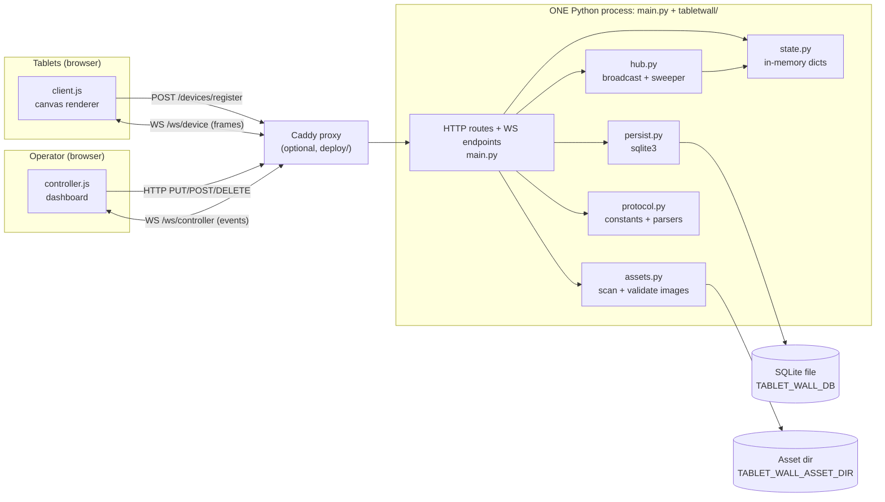
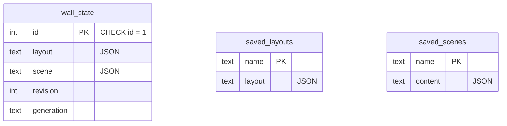

# tablet-wall-ai — Codebase Guide

> Read this first. It describes the architecture and current state of the repository.
> Companion file: `docs/codebase-explorer.html` (same content, visual and interactive).
> Both files must stay in sync. If you change one, change the other.

**Pass:** 1 (overview, architecture, one main flow, decisions, reading order).
**Verified on:** 2026-10-07, commit `0899e04`. `uv run pytest` gave 500 passed.

**Evidence labels used below**

- **[Fact]** — read directly in code or docs.
- **[Inference]** — reasonable conclusion from the code. Not stated by the authors.
- **[Unknown]** — not determined yet.

---

## 1. What this project is

[Fact] `tablet-wall-ai` turns a set of tablets into one coordinated display wall.

- Each tablet opens the **client** page. It registers itself with the server.
- An operator opens the **controller** page. It shows the roster of tablets and drives the wall.
- The operator places each tablet on a shared **wall canvas** (an abstract coordinate space).
- The operator can show a solid colour per tablet, a **calibration** pattern, or one curated **still image** that spans the whole wall. Each tablet paints only its slice.

[Fact] The name contains "ai" for historical reasons. `README.md` states that no AI capability exists or is planned.

[Fact] Status (from `README.md`): Phase 2 software complete. Physical tablet validation is pending. Phase 3 (security, deployment) has reference files only. No authentication exists inside the app.

**Users**

| Actor | What they do | Entry |
| --- | --- | --- |
| Tablet (wall-mounted) | Self-registers, holds a WebSocket, paints its slice | `frontend/client/` |
| Operator | Places tablets, picks content, saves layouts | `frontend/controller/` |
| Reverse proxy (Caddy, optional) | Splits tablet ingress from operator ingress | `deploy/hotspot.Caddyfile` |

### Simple mental model

> One Python process holds the wall state in memory. Tablets and controllers keep a WebSocket open to it. Operators change the state through HTTP. The server saves the change to SQLite first, then pushes the new state to everyone.

---

## 2. High-level architecture

[Fact] It is one FastAPI process (a monolith) plus static frontends. There is no queue, no worker process, and no external API.



**Boundaries**

| Place | What runs there |
| --- | --- |
| Tablet browser | `frontend/client/*`. Renders canvas. Keeps its own copy of the last accepted `wall` frame. |
| Operator browser | `frontend/controller/*`. Keeps roster map, wall, asset list. Sends commands. |
| Server process | All authority. Roster, sockets, wall state live in module-level Python objects. |
| SQLite file | Active wall, plus named layouts and scenes. Nothing else. |
| Asset directory | Curated JPEG/PNG bytes. Read-only for the app. |

**Sync vs async**

- HTTP request/response is synchronous from the operator's view.
- WebSocket pushes are asynchronous. The HTTP caller does not wait for tablets to render.
- The only background task is the heartbeat sweeper (`hub._sweep_loop`).

**Persistence split** [Fact]

| Persisted (SQLite) | Memory only (lost on restart) |
| --- | --- |
| Active layout, active scene, revision, generation | Device roster `devices` |
| Saved layouts (`saved_layouts`) | Sockets, presence, `last_seen` |
| Saved scenes (`saved_scenes`) | Per-device assigned colour |
| | Protocol version and caps per device |

After a restart the roster is empty. Tablets re-register on their own. A saved placement whose tablet has not returned is a **vacant reservation**.

---

## 3. Repository structure (important parts)

```
tablet-wall-ai/
├── main.py                  Entry point. FastAPI app, models, routes, WS endpoints, origin guard (1448 lines)
├── tabletwall/
│   ├── protocol.py          Constants, close codes, pure parsers/validators. Imports nothing local.
│   ├── state.py             Module-level state: devices, sockets, wall. Wire-shape builders.
│   ├── hub.py               Broadcast helpers + heartbeat sweeper.
│   ├── persist.py           SQLite: wall_state, saved_layouts, saved_scenes.
│   └── assets.py            Scan, validate, hash, serve curated images.
├── frontend/
│   ├── client/              index.html, client.js (1824), client.css — runs on tablets
│   └── controller/          index.html, controller.js (4088), controller.css — operator UI
├── PROTOCOL.md              The realtime contract. Source of truth for message shapes.
├── tests/                   pytest (500 tests) + one Node test for client image logic
├── simulator/               Test-only: 18 virtual tablets against the real app
├── deploy/                  Caddy config, systemd template, backup tool, smoke scripts, ops docs
├── Makefile                 sync, dev, run, test, sim, clean
├── pyproject.toml           Deps: fastapi[standard], pillow. Dev: httpx2, pytest, pytest-timeout
└── README.md                Overview, API table, known limitations, roadmap
```

| Path | Role | Depends on | Depended on by | Learn |
| --- | --- | --- | --- | --- |
| `main.py` | entry point + API layer + domain logic | all of `tabletwall/` | tests, `fastapi run` | now |
| `tabletwall/protocol.py` | utilities / contract constants | stdlib | state, hub, assets, main | now |
| `tabletwall/state.py` | in-memory data layer | protocol | hub, main | now |
| `tabletwall/hub.py` | delivery / infrastructure | protocol, state | main only | now |
| `tabletwall/persist.py` | data layer (SQLite) | stdlib | main only | now |
| `tabletwall/assets.py` | domain + filesystem | protocol, Pillow | main | later |
| `frontend/client/client.js` | frontend (tablet) | browser APIs | — | now (top half), later (image) |
| `frontend/controller/controller.js` | frontend (operator) | browser APIs | — | later |
| `PROTOCOL.md` | contract doc | — | everything | now |
| `deploy/*` | build/deployment | — | — | later |
| `simulator/*` | tests | main | — | later |

[Fact] Dependency direction inside `tabletwall/`: `protocol` ← `state` ← `hub`. `persist` and `assets` are independent leaves (`assets` imports `protocol`). Only `main.py` imports `hub`, `persist`, `assets`. No circular import found.

[Fact] `main.py` re-exports state objects (`devices`, `wall`, `device_sockets`, …) by name. Tests mutate them through `main`. Never copy or rebind these objects. Only mutate in place (`wall.clear(); wall.update(...)`).

---

## 4. Main end-to-end flow: operator shows an image on the wall

**Trigger:** operator selects an asset in the controller and presses "Show on wall".

```mermaid
sequenceDiagram
  participant Op as controller.js
  participant API as main.put_scene
  participant As as assets.find
  participant CW as main._commit_wall
  participant DB as persist.save_state
  participant Hub as hub._broadcast_wall
  participant Tab as client.js (each tablet)
  Op->>API: PUT /scene {content:{type:"image",asset:"sha256:…"}}
  API->>API: Pydantic SceneUpdate/SceneContent validation
  API->>As: asyncio.to_thread(assets.find, id)  (rescan, hash, decode)
  As-->>API: Asset (width, height) or None -> 422
  API->>CW: _commit_wall(apply)
  CW->>CW: deepcopy(wall); change(proposed); revision += 1
  CW->>DB: save_state(proposed)  (commit)
  CW->>CW: change(wall); revision += 1   (live state, only after commit)
  API->>Hub: await _broadcast_wall()
  Hub-->>Op: wall_updated {wall}   (v2 controllers)
  Hub-->>Tab: wall frame (per device, caps-filtered)
  Tab->>API: GET /assets/sha256:… (same origin)
  API-->>Tab: bytes (re-hashed before serving)
  Tab->>Tab: decode, draw centred cover of whole wall, clip to own visible rect
  API-->>Op: 200 full wall state
```

**Steps with code references**

| # | Step | Where | Data change |
| --- | --- | --- | --- |
| 1 | Operator action calls `PUT /scene` | `frontend/controller/controller.js` `applyImageScene()` (~line 1590) | JSON body: `{content:{type,asset,fit?}}` |
| 2 | Body validated. Unknown keys rejected (422). Image needs a well-formed `sha256:` id. `fit` defaults to `cover`. | `main.py` `SceneContent`, `SceneUpdate` | Pydantic model |
| 3 | Origin guard (middleware) runs **before** the route, if `TABLET_WALL_OPERATOR_ORIGIN` is set | `main.py` `operator_origin_guard` | 403 on mismatch, no side effect |
| 4 | Asset looked up with a fresh directory scan in a worker thread | `main.py` `put_scene` -> `assets.find` -> `refresh` | ID resolved to `Asset`; intrinsic size comes from the file, never from the caller |
| 5 | Persisted scene content built: `{type, asset, fit, intrinsicWidth, intrinsicHeight}`. **No URL.** | `main.py` `put_scene` | URL is composed later by `state._project_scene` |
| 6 | Commit boundary: copy, mutate, save, then mutate live | `main.py` `_commit_wall` (~line 312) | `revision` +1. SQLite row `wall_state` rewritten |
| 7 | Broadcast. Controllers get `wall_updated`. Each v2 device gets a `wall` frame | `tabletwall/hub.py` `_broadcast_wall` -> `state._wall_frame` | Frame carries wall size, this device's `placement`, scene, `revision`, `generation` |
| 8 | Device without the `image` cap gets `color` content instead | `state._wall_frame` | Content downgrade per device |
| 9 | Tablet accepts the frame only if revision is newer (same generation) | `client.js` `applyWallFrame` (~line 1524) | Held `wallState`, `heldRevision`, `heldGeneration` |
| 10 | Tablet loads `/assets/{id}` with a 15 s deadline and a token to drop stale attempts | `client.js` image load code | `imageStatus`: none -> loading -> ready / failed |
| 11 | Tablet draws: image rect computed from **wall size + image size only**, then clipped to this tablet's visible rect | `client.js` `drawWallImage` (~line 1363) | Pixels |
| 12 | Asset route re-hashes bytes before serving | `main.py` `get_asset` -> `assets.fetch` | 404 if hash differs. `Cache-Control: immutable` |

**Why step 11 produces aligned seams [Fact]:** every tablet computes the same wall-space image rectangle (`s = max(W/iw, H/ih)`, centred). Each then maps its own *visible rect* (placement minus bezel) onto its viewport. Neighbouring tablets therefore agree about where the picture is.

**Failure points on this path**

- Directory unreadable -> `assets.refresh` raises (HTTP 500). Missing directory -> empty inventory (-> 422 "Unknown asset").
- `save_state` raises -> memory unchanged, no broadcast, route returns 5xx.
- Tablet image fetch fails or exceeds 15 s -> tablet paints "IMAGE FAILED", tap retries. Replayed `wall` frame after reconnect also retries.

---

## 5. Key design decisions (so far)

| # | Decision | Evidence | Problem solved | Tradeoff | If changed |
| --- | --- | --- | --- | --- | --- |
| D1 | **Single process, state in module-level dicts** | `tabletwall/state.py`; README "Run one server worker per wall/database" | Simple, no locks needed on one event loop | Cannot scale out. Two workers would diverge | Need shared store + pub/sub; rewrite `state`/`hub` |
| D2 | **Persist before apply before broadcast** (`_commit_wall`) | `main.py` `_commit_wall`; `tests/test_commit_boundary.py` | Memory, disk, and what clients were told never disagree | Extra deepcopy per change. Blocking sqlite call inside request | Breaking order can tell clients about state that vanishes on restart |
| D3 | **`revision` + `generation`** | `state._new_generation`, `main._restore_wall_state`, `client.js applyWallFrame`, PROTOCOL.md | Replay-safe reconnects. Restored/rolled-back server still accepted | Clients must track two tokens | Without generation, a restored server at lower revision is ignored forever |
| D4 | **Layout and scene are separate** | `wall["layout"]` vs `wall["scene"]`; separate `saved_layouts`/`saved_scenes` tables | Recalling content must not wipe placement work | Two recall paths to maintain | Fusing them makes "recall" ambiguous |
| D5 | **Roster not persisted; placements are** | README Known limitations; "vacant reservation" logic in `put_placement`/`wall_auto` | Tablets re-register on their own; no stale devices | Placements can point at unknown devices | Persisting roster needs presence reconciliation |
| D6 | **Content-addressed assets (`sha256:`), no upload, no paths** | `assets.py` docstring, `protocol._ASSET_ID_PATTERN` | No path traversal. Rename-safe. Cache-safe. Race-safe (re-hash on serve) | Bytes change = new identity. Each read rescans the directory | Path-based IDs would need traversal defences |
| D7 | **Client re-registers before every connect** | `client.js register()` / `attemptCycle()` | Roster is memory-only; restart recovers by itself | Extra POST per reconnect | — |
| D8 | **Registration is the only way to create a device** (socket for unknown id closes `4404`) | `main.ws_device` | Single source of device metadata | Two-step handshake for clients | — |
| D9 | **Versioned protocol with caps** | `protocol.SUPPORTED_PROTOCOLS`, `SERVER_CAPS`; `state._wall_frame` | Old cached tablets keep working. Server never sends what a client cannot render | Two code paths (v1/v2) | Dropping v1 breaks stale cached clients |
| D10 | **WebSockets push, no polling** | `hub.py`; controller comment "There is NO polling" | Live roster, low traffic | Needs reconnect + heartbeat logic on both sides | — |
| D11 | **Two-origin proxy; app-level Origin check is CSRF fence only** | `main.py` origin guard comments; `deploy/hotspot.Caddyfile` | Operator surface hidden from tablet LAN | Auth relies entirely on proxy. App has none | Exposing app directly = open operator routes |
| D12 | **Plain JS, no build step, no frontend framework** | `frontend/*` are static files served by `StaticFiles` | Runs on old tablets, offline | Large single files (4088-line controller) | Adding a bundler changes deploy |

[Inference] D12's motivation (old tablets, no internet) is implied by the `client.js` header ("Must work on a plain-HTTP LAN origin with no internet access"). The authors do not list other reasons.

---

## 6. Wire protocol cheat sheet (full text: `PROTOCOL.md`)

**Sockets**

| Endpoint | Query | First frames | Notes |
| --- | --- | --- | --- |
| `GET /ws/device` | `device_id`, `protocol` (default 1), `caps` | `welcome`, then `wall` (v2), `set_color`; broadcasts `device_online` | Accept first, then close with code on error. Heartbeat every 5 s. Timeout 15 s |
| `GET /ws/controller` | `protocol` | `snapshot` (+ `wall` if v2) | Origin checked **before** accept. Never reads frames meaningfully |

**Close codes** (`protocol.py`): `1000` normal, `4400` bad request, `4404` unknown device, `4408` heartbeat timeout, `4409` replaced by newer socket, `4426` unsupported protocol.

**Frames out:** `welcome`, `wall`, `set_color` (device). `snapshot`, `device_online`, `device_updated`, `device_offline`, `device_removed`, `wall_updated` (controller).

**Wall state shape**

```json
{ "layout": { "width": 2000, "height": 1000,
              "placements": { "<uuid>": { "device_id": "<uuid>", "x":0,"y":0,"w":1000,"h":1000,
                                          "bezel": {"top":0,"right":0,"bottom":0,"left":0} } } },
  "scene":  { "content": {"type":"color"}, "layout":"active" },
  "revision": 0, "generation": "a1b2c3d4" }
```

Content types: `color`, `calibration`, `image` (`asset`, `fit="cover"`, `intrinsicWidth`, `intrinsicHeight`; wire-only `url`).

---

## 7. Data model (summary)

SQLite (`persist.py`). Opened per call, schema applied each time with `CREATE TABLE IF NOT EXISTS` (no migration framework).



The three tables have no foreign keys. They are linked only by shape: a saved scene's `asset` id refers to a file by hash.

In memory (`state.py`): `devices: dict[id, record]`, `device_sockets: dict[id, WebSocket]`, `controller_sockets: set`, `controller_protocols: dict[ws, int]`, `wall: dict`.

---

## 8. Concurrency notes (first pass)

- [Fact] One asyncio event loop. Shared state is plain dicts. Safety rests on **never awaiting while mutating**. `_commit_wall` is synchronous (no `await`), so the change is atomic from other coroutines' view.
- [Fact] Broadcasts iterate copies of socket collections and guard every send (`hub._broadcast`).
- [Fact] `assets` work runs off the loop (`asyncio.to_thread` in `put_scene`; plain `def` routes `get_assets`, `get_asset`).
- [Inference] SQLite calls in `persist.py` are synchronous and run on the event loop inside async routes. Fine for small writes. A slow disk would stall heartbeats.
- [Fact] One socket per device. A newer socket replaces the old (`4409`).
- [Fact] Controller sockets have no heartbeat. A dead one is removed only when a send fails.
- [Unknown] Behaviour under many simultaneous operators editing. Last write wins; no optimistic concurrency check is visible on PUT routes.

---

## 9. Testing and running

```bash
uv sync
make dev            # http://127.0.0.1:8000  (client at /client/, controller at /controller/)
make test           # pytest + node tests/client_image.test.js
make sim            # 18 virtual tablets (no browser)
```

[Fact] Python tests use Starlette `TestClient` in-process. `tests/conftest.py` resets module state and points `TABLET_WALL_DB` / `TABLET_WALL_ASSET_DIR` at temp paths per test.
[Fact] Not covered by automation: real browsers rendering pixels, real tablets, real TLS/Caddy (manual `deploy/smoke.sh`). The simulator explicitly runs no JavaScript.
[Fact] No `.github/` directory exists. README mentions CI as roadmap item 3d (deferred).

---

## 10. Configuration (first pass)

| Variable | Read in | Effect |
| --- | --- | --- |
| `TABLET_WALL_DB` | `persist.db_path()` (per call) | SQLite path. Default `./tablet-wall.db` |
| `TABLET_WALL_ASSET_DIR` | `assets.asset_dir()` (per call) | Image dir. Default `./assets` |
| `TABLET_WALL_OPERATOR_ORIGIN` | `main._origin_denial` (per request) | Enables Origin fence on writes and `/ws/controller`. Invalid value = fail closed (403) |
| `TABLET_WALL_TABLET_ORIGIN` | `main.operator_config` | Reported to controller via `GET /operator-config`. Invalid = 500 |

Make variables: `PORT` (8000), `HOST` (127.0.0.1). The app must run from the repo root because static mounts use relative paths.

---

## 11. Complexity hotspots (first ranking)

| Rank | Area | Why |
| --- | --- | --- |
| Risky | `main._commit_wall` and every route that uses it | Ordering guarantees; many tests depend on them |
| Risky | `client.js` image load/token logic | Async races, stale-attempt rules, 15 s deadline |
| Difficult | `controller.js` (4088 lines) | Large single file, many render functions, wall map editing |
| Difficult | `assets._inspect` / `_read_capped` | Security-sensitive untrusted-file handling |
| Difficult | `main.py` origin validation (`_validated_origin`) | Strict parsing; fail-closed rules |
| Moderate | `hub._sweep_once`, `ws_device` | Slot ownership and replace logic |
| Moderate | `persist.py` | Small, but `_save_one` atomicity matters |
| Easy | `protocol.py`, `state.py` | Pure helpers and plain dicts |

---

## 12. Recommended reading order

1. **Stage 1 — understand first**
   1. `README.md` ("How it works", "Known limitations")
   2. `PROTOCOL.md` (sections: Device lifecycle, Revision and generation, Wall state)
   3. `tabletwall/protocol.py`, then `tabletwall/state.py`
   4. `main.py`: `_restore_wall_state`, `lifespan`, `_commit_wall`, `device_register`, `put_scene`, `ws_device`
2. **Stage 2 — understand next**
   1. `tabletwall/hub.py`, `tabletwall/persist.py`
   2. `frontend/client/client.js`: `register`, `openSocket`, `applyWallFrame`, `render`
   3. `tests/conftest.py`, `tests/test_commit_boundary.py`, `tests/test_websocket.py`
3. **Stage 3 — advanced**
   1. `tabletwall/assets.py`
   2. `frontend/client/client.js` image-load logic; `tests/client_image.test.js`
   3. `frontend/controller/controller.js`
   4. `main.py` origin guard; `deploy/`; `simulator/`

Order rationale: the contract and state first, because every other file is a producer or consumer of them.

---

## 13. Still to explore (next passes)

- Controller internals: wall map editing, placement UI, snapshot UI.
- Client calibration drawing and image-load state machine in detail.
- `deploy/backup.py` (1400 lines) and restore drill.
- Simulator scenarios.
- Security boundary walkthrough with test evidence (`tests/test_security.py`).
- Modification guides (add endpoint, add content type, add DB field).
- Learner quiz questions per subsystem.

## Change log

- Pass 1: initial version.
