This is a working field guide, not a release note. It explains the system as it
is built today, the reasons behind the shape, and the places where the code
makes a trade-off you can learn from.

Use it one of three ways:

- **Understand the system.** Read chapters 1–2, then 13.
- **Change the code.** Read chapter 3 onward, following the Trace it note in each
  chapter.
- **Deploy or test it.** Read chapters 10–12 first, then return to the
  mechanics.

**In one paragraph.** A laptop runs a single FastAPI process. Tablets load a
browser page, register, and hold one WebSocket each. The operator uses a second
browser page to edit a committed wall, calibrate panels, author a playlist, and
start a show. The server saves changes to SQLite before it broadcasts them. For
a timed show it asks each tablet to prepare an occurrence, waits for a short
readiness lease, then commits a future timestamp. The tablet maps the source
image through a server-owned physical plan and its own calibrated viewport, so
each screen draws only the slice behind its glass.

The project is a single Python process that serves two browser applications
and talks to a room full of tablets. There is no container, no message broker,
and no cloud service in the runtime. That small shape is deliberate. The hard
parts are geometry, time, and evidence, not infrastructure.

> **Current state, 26 October 2026.** The software scope of P0 and R1–R5 is
> complete. The eight hardware and deployment gates are still MISSING. R6,
> the conditional segmented or live-media phase, has not started. The frontend
> console has finished phases 1 and 2. Its phase 3, which ports uploads and
> retires the legacy logical view, is not started.
>
> Counts and gate status are dated 26 October 2026. The linked runner reports
> are authoritative when they disagree with this page.

## The wall is three loops

A wall looks like one picture. The software sees three loops that meet at the
glass:

1. **State.** What the wall is: its layout, the scene on it, and the revision
   that orders changes.
2. **Presence.** Which tablets are registered, connected, and healthy enough to
   receive work.
3. **Time.** When the next picture becomes visible, and whether every required
   tablet has proved it can show it.

Most bugs in a system like this come from mixing the loops. A controller write
is not a render. A connected socket is not a ready tablet. A clock estimate is
not an optical measurement. The architecture keeps those claims separate, and
the tests try to keep them separate too.

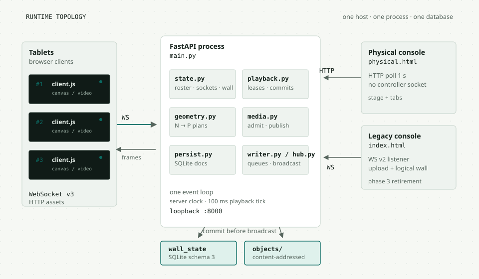

### The four nouns

The vocabulary is small, and the code uses it consistently.

| Noun | Meaning | Where it lives |
| --- | --- | --- |
| **Wall** | The whole presentation: layout, scene, revision, generation. | Memory and the `wall_state` row |
| **Layout** | Where the panels are. A logical layout uses abstract wall units. A physical layout uses millimetres and measured panel profiles. | `wall["layout"]` |
| **Scene** | What to show: a colour, a calibration pattern, or an image. | `wall["scene"]` |
| **Display and calibration** | A measured panel and the viewport-specific mapping from CSS pixels to panel millimetres. | `display_profiles`, `calibrations` |

A **slot** is one device's place in a physical layout. A **cohort** is the set
of tablets required for a playback session. An **occurrence** is one item in
one loop of the playlist. Those three words appear constantly once playback
starts.

### Logical and physical are different walls

A logical wall is the older, simpler mode. It has an abstract coordinate space,
usually 2000 × 1000 wall units. A placement says where a tablet's footprint sits
and how wide its bezel is in those units. The same source image is drawn across
the whole wall, and each tablet clips its own rectangle. This is enough for a
still-image wall and for development.

A physical wall is the measured mode. The operator records each panel's active
area and bezels in millimetres, then a calibration for the exact viewport the
browser reports. The server computes where the source image lands on the panel,
and the client composes that with its own CSS-to-panel matrix. The controller
editor works in millimetres because the operator is measuring a real object.

The distinction matters because a logical unit has no physical meaning. Do not
turn a logical placement into a millimetre claim. The code keeps the two
representations separate on purpose, and the UI tells you which one is active.

### Why one process instead of services

The target is one laptop, one wall, and roughly 15 to 20 tablets on a local
network. A single process makes the common path short:

- One memory space holds the roster, sockets, and active wall.
- One SQLite file holds the committed documents and media metadata.
- One event loop runs HTTP, WebSockets, the playback loop, and the sweeper.
- One reverse proxy can add the trust boundary when the wall leaves loopback.

The cost is explicit. You cannot run two workers against the same SQLite file
and expect them to agree. The README says one process per wall and database.
There is no horizontal scaling story, no broker, and no distributed lease. For
this product, that is a feature: the failure modes stay local and inspectable.

This is not a general-purpose cloud video wall. It is not multi-tenant, it has
no built-in authentication, and it is not an AI product. The name is historical.
The intended deployment is one operator, one wall, and a known set of tablets.

> **Pattern to reuse: separate claims by evidence.** "The server sent a frame"
> is not "the tablet painted it." "The socket is open" is not "the device is
> ready." "The browser drew at t" is not "the panel lit at t." Each layer names
> what it actually knows.

## A small runtime with sharp boundaries

The stack is deliberately ordinary. Every choice is visible in the code.

| Layer | Choice | Why it fits |
| --- | --- | --- |
| HTTP and WebSocket | FastAPI on Starlette, served by Uvicorn | One process, typed request models, native async and WebSocket support |
| Storage | SQLite through the standard library | A single host, transactional commits, no service to operate |
| Media | Pillow for stills, ffmpeg and ffprobe for video | Validate, normalize, and remux local files |
| Frontend | Plain HTML, CSS, and JavaScript | No build step, no framework runtime on a kiosk tablet |
| Rendering | Canvas for stills, a clipped `<video>` for video | Browser decoders do the heavy work |
| Deployment | `make dev` for loopback, optional Caddy for the two-origin setup | The app stays loopback-only behind the proxy |
| Tests | pytest, Node test files, Playwright browser runners | Unit contracts, real DOM, and real browser evidence |

There is no Dockerfile, no Compose file, and no Kubernetes manifest. A tablet
runs a browser page. The server runs as a Python process. Caddy is optional and
only exists in the hotspot reference deployment.

### The modules

The code is a modular monolith. `main.py` is the entry point, but it delegates
to small modules with clear ownership.

| Module | Owns | Does not own |
| --- | --- | --- |
| `main.py` | HTTP routes, WebSocket endpoints, lifespan, request models, the wall commit boundary, playback I/O loop | Geometry math, media validation, persistence details |
| `tabletwall/state.py` | In-memory roster, sockets, active wall, frame projection | Disk, network sends |
| `tabletwall/persist.py` | SQLite schema, migrations, documents, saved layouts and scenes, media metadata | Live sockets or playback |
| `tabletwall/playback.py` | Session state machine, leases, readiness, commits, recovery | WebSocket delivery, wall persistence |
| `tabletwall/clock.py` | Monotonic server clock, epoch, suspend detection, offset estimation | Playback policy |
| `tabletwall/geometry.py` | Normalized source to panel transforms, fits, clips | Browser calibration |
| `tabletwall/displays.py` | Display profiles and calibration records | Rendering |
| `tabletwall/media.py` | Upload admission, staging, worker orchestration, atomic publication | HTTP route shapes |
| `tabletwall/media_worker.py` | Still normalization in a bounded child process | Serving |
| `tabletwall/video.py` | Video probing, validation, remux, poster | Playback timing |
| `tabletwall/media_serve.py` | Range responses and immutable caching | Upload |
| `tabletwall/writer.py` | One bounded queue per socket, coalescing, send timeout | Business state |
| `tabletwall/hub.py` | Broadcast, protocol filtering, stale-socket sweeping | Persistence |

The frontend mirrors the split. `frontend/client/client.js` owns the tablet's
connection and playback. `frontend/client/view.js` owns pure transform math.
`frontend/controller/physical.js` owns the current operator console.
`frontend/controller/controller.js` is the legacy logical controller, still
kept for uploads and the old workflow.

### The boot path

Startup is a useful trace because it touches most layers.

1. Uvicorn imports `main.py` from the repository root. The static mounts use
   relative paths, so the working directory matters.
2. The lifespan opens the database and calls `_restore_wall_state()`.
3. `persist.ensure_schema()` checks the schema version. It refuses a newer or
   damaged database instead of guessing. A migration takes a backup first.
4. The committed wall is loaded. A fresh generation is minted on every start,
   even when the revision is unchanged. Revision and generation are defined in
   chapter 3.
5. The active wall is copied into memory. The roster starts empty.
6. The media worker and asset directories are checked. Missing directories are
   empty, not fatal.
7. The heartbeat sweeper and playback loop start. The first request can arrive.

### The rules behind the shape

The code follows a small set of rules. They explain most of the structure you
will read.

| Rule | Why it is there | Where you see it |
| --- | --- | --- |
| Commit before notify | A broadcast must never describe state that is not durable | `_commit_wall()` saves before it replaces memory or sends |
| Full snapshots, not deltas | A reconnecting client can rebuild from one frame | `wall`, `render`, and `snapshot` frames |
| One owner per coordinate space | Two transforms on one point produce drift | Server `G_N_to_P`, client `U_C_to_P` |
| Explicit state, explicit terminal | A retry or Stop must know what it owns | `preparing`, `armed`, `playing`, `blocked`, `failed` |
| Bounded queues, close the slow reader | Memory must not grow with a bad link | `Writer` with 64 frames, 1 MiB, 5 s |
| Content-addressed, immutable media | A URL names exact bytes, so caches are safe | `objects/<sha>` and sha256 asset ids |
| Adapters over destructive rewrites | Old rows stay inspectable and recoverable | Schema 3 plus the read-time logical adapter |
| Evidence inside the claim | A software pass must not imply an optical result | Runner reports and the eight missing gates |
| One process until the wall proves otherwise | Local state is simpler than distributed state at this size | One worker, one SQLite file, no broker |
| Draft, then Apply | A form keystroke must not write a wall | `state.base`, `state.draft`, ETag apply |

The trade-offs are real. A full snapshot costs bytes on every reconnect. A
bounded writer closes a slow tablet instead of buffering forever. A single
process cannot scale horizontally. Those are acceptable for a wall of 15 to 20
tablets on one host, and the README states the limits instead of hiding them.

The generation is the reset token. A tablet that reconnects after a restart may
have a higher revision than the server's restored row. The new generation tells
the client to accept the restored state anyway. Revision orders changes inside a
generation. Generation orders server lifetimes.

> **Pattern to reuse: make the reset token explicit.** A monotonic version alone
> cannot survive a restart. Pair it with a process lifetime token, and the
> client can tell "older" from "different life."

### Where to start reading

If you have an hour, read these in order:

1. `tabletwall/state.py` for the domain model and the three frame shapes.
2. `main.py` around `_commit_wall` for the write boundary.
3. `tabletwall/protocol.py` and the WebSocket handlers for the wire contract.
4. `tabletwall/playback.py` for the hardest state machine.
5. `frontend/client/view.js`, then the render path in `client.js`.
6. `frontend/controller/physical.html`, then `physical.js`.

The legacy controller is larger than the current console. Read it only when you
need to touch uploads or the logical-wall workflow.

## State lives twice, on purpose

The system keeps the active wall in memory because every frame read needs it.
It also keeps the committed wall in SQLite because a restart must not lose it.
The trick is the order of writes.

### The commit boundary

`main._commit_wall(change)` is the one path for accepted wall changes. It does
four things in order:

1. Copy the current wall and apply the change to the copy.
2. Increment the copy's revision and save it to SQLite.
3. Wait for the transaction to commit.
4. Run the same change on the live wall and increment its revision in place.

The route broadcasts after this helper returns. If the database write fails,
the live wall never changes. If the broadcast fails, the committed state still
wins. A controller that retries sees the same state. This is a write-ahead
commit, not an optimistic update.

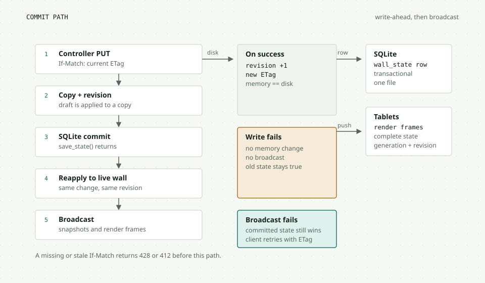

The v3 config and physical layout routes add a second guard. They require
`If-Match` with the current ETag. A missing header returns 428. A stale header
returns 412. The older legacy wall, scene, and placement routes do not use
`If-Match`; they still commit through the same boundary. The physical controller
keeps its local draft when it gets a 412, shows the conflict, and asks the
operator to reload or reapply. That is why "Apply" is an explicit action, not a
debounce.

```text
PUT /api/v3/layout
If-Match: "8b1f0c2e"

HTTP/1.1 412 Precondition Failed
{"detail": "layout changed; reload the committed config"}
```

The draft is still in `state.draft`. The operator can compare, reload, or apply
again after the new ETag is loaded. A dropped draft would turn a conflict into
data loss.

The older logical API and the newer v3 API share the commit boundary but not
their write models. Logical placements use wall units. Physical layouts use
millimetres and immutable profile and calibration revisions. A physical layout
active on the server makes the legacy layout mutations return 409. The reverse
is not true: the v3 routes can read a logical wall, but they cannot pretend it
is calibrated.

### Memory versus SQLite

| State | Memory | SQLite | Why |
| --- | --- | --- | --- |
| Devices and sockets | Yes | No | Presence is process-local and expires in seconds |
| Device numbers | Yes | No | A lease, not an identity |
| Active wall | Yes | Yes | Every frame needs it. The row is the committed source. |
| Saved layouts and scenes | No | Yes | Recall is a deliberate operator action |
| Playlist | Yes, cached | Yes | Playback reads it often, the row is the saved version |
| Display profiles and calibrations | No, loaded on demand | Yes | Immutable revisions, not live state |
| Media bytes | No | Asset tree on disk | Content-addressed and immutable |
| Media metadata | No | Yes | Ready rows point at durable bytes |
| Playback session | Yes | No | A restart stops the show. It does not resume a lease. |

The roster is the clearest example of intentional loss. After a restart, the
database still has placements, but the roster is empty. A placement whose device
has not re-registered appears as a vacant reservation. The tablet reconnects on
its own and reclaims the slot. The system does not invent presence from a row.

### Schema and the read-time adapter

The schema is version 3. Migrations are additive and transactional. Before a
migration, `persist._write_migration_backup()` takes a SQLite online backup,
checks its integrity, fsyncs it, and sets mode 0600. A cross-process file lock
prevents two starts from migrating at once. A future version, a foreign file, or
a missing required table raises `SchemaError` and refuses to start. That is safer
than writing defaults over an unknown database.

Older logical documents stay in their original bytes. `_runtime_layout()` and
`_runtime_scene()` unwrap the schema-2 envelopes at read time and project them
into the runtime form. New physical writes use the schema-2 envelope. This
read-time adapter avoids an irreversible rewrite of rows that may be damaged or
still needed by an older client.

> **Pattern to reuse: migrate on read when the old form is still valid.** A
> backup and a reversible adapter are cheaper than a one-way rewrite you cannot
> inspect.

### What can go wrong

The commit path is deliberately synchronous, so it has a simple failure story.
SQLite calls run on the event loop. A slow disk can stall the loop, which is one
reason the target is a single host and a small fleet. A crash between the disk
write and the broadcast leaves the database ahead of memory until the next
start. A crash during a migration is covered by the backup and lock. A crash
during media publication is covered by publishing bytes before marking a row
ready.

The system does not have a distributed consensus story. It does not need one.
The README forbids multiple workers against one database, and the deployment
guide says one process per wall.

**Trace it.** Start at `put_physical_layout_v3` in `main.py`, then follow
`_require_config_etag`, `_commit_wall`, `persist.save_state`, and
`hub._broadcast_wall`. The relevant files are `main.py`, `tabletwall/persist.py`,
`tabletwall/state.py`, and `tabletwall/hub.py`.

## One wire, three protocols

The transport is HTTP for commands and WebSocket for pushes. The protocol
version decides which frame shapes a client can understand. The server supports
v1, v2, and v3 at the same time.

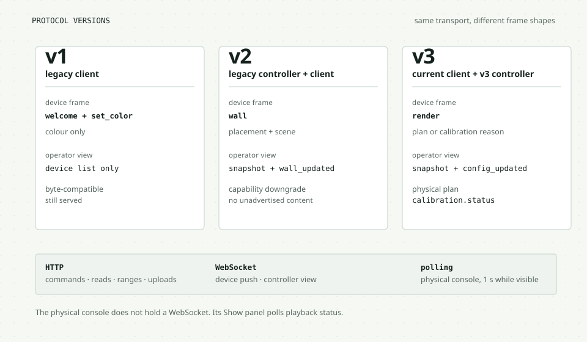

### The three contracts

| Version | Who uses it | Device frame | Controller view |
| --- | --- | --- | --- |
| v1 | Old clients | `welcome` and `set_color` only | Device list only; no wall or config |
| v2 | Legacy controller and v2 clients | `wall` with a per-device placement and scene | `snapshot`, `wall_updated`, device events |
| v3 | Current tablet client and v3 controller protocol | `render` with a mode, a render sequence, and a physical plan or calibration reason | `snapshot` with `config`, `config_updated` |

The physical console does not hold a WebSocket. It polls `/api/v3/playback`
once a second while the page is visible. The console itself is described in
chapter 9. Config, library, layouts, diagnostics,
and saved-state reads use their own startup or action-driven refresh paths, so
another operator's change may wait for a reload or an explicit refresh. That is
enough for a single-operator screen and keeps the control page simpler. The
tablet client needs a socket because the server pushes prepare, commit, cancel,
and playback frames with timing information.

The HTTP API is grouped by the thing it owns:

| Group | Representative routes |
| --- | --- |
| Device lifecycle | `POST /devices/register`, `GET /devices`, `POST /devices/{id}/rebind`, `WS /ws/device` |
| Logical wall | `GET\|PUT /wall`, `PUT /scene`, `PUT /devices/{id}/placement`, `POST /wall/auto` |
| Physical wall | `GET /api/v3/config`, `PUT /api/v3/displays/{id}`, `PUT /api/v3/calibrations/{id}`, `PUT /api/v3/layout` |
| Content | `GET /assets`, `GET\|HEAD /assets/{id}`, `GET /media`, `POST /uploads`, `GET\|PUT /api/v3/playlist` |
| Playback | `GET /api/v3/playback`, `POST /api/v3/playback/start`, `/pause`, `/stop`, `/next`, `/previous`, `/retry` |
| Operations | `GET /diagnostics`, `GET\|HEAD /assets/{id}`, `GET /api/v3/layouts` |

The v1 controller view is only the device list. It does not receive the wall.
The v3 controller protocol can send `config` snapshots, but the current physical
console uses HTTP polling instead of opening that socket.

A v3 `render` frame is more than a renamed wall frame. In logical mode it carries
the projected scene and the device's own placement. In physical mode it carries
the slot, the calibration status, and the affine `plan` from normalized source
pixels to active-panel millimetres. If the plan cannot be built, the frame says
why: no slot, no profile, no calibration, a profile mismatch, a viewport
mismatch, non-image content, or unknown dimensions. The client never guesses a
physical transform.

A shortened physical render frame looks like this:

```json
{
  "type": "render", "mode": "physical",
  "render_seq": 4, "revision": 12, "generation": "a1b2c3d4",
  "slot": {"center_x_mm": 300, "center_y_mm": 400,
           "mount_angle": 90, "profile_revision": 1,
           "calibration_revision": 1, "participating": true},
  "calibration": {"status": "valid", "revision": 1,
                  "viewport_width": 600, "viewport_height": 800,
                  "quarter_turn": 1, "mm_per_css": [0.1666, 0.1666]},
  "plan": {"panel_from_source": [0, -1600, 800, 0, -350, 537],
           "clip": {"x": 0, "y": 0, "width": 100, "height": 60},
           "source": {"width": 2000, "height": 1000}}
}
```

If the viewport no longer matches the calibration, `calibration.status` is
`needs_calibration`, `plan` is `null`, and the reason names the missing
prerequisite. The client draws the neutral calibration screen.

### The handshake and close codes

A device socket starts after an HTTP registration. The server replies with
`welcome`, then replays the current render or wall frame for v2 and v3. A v1
device gets `welcome` and a `set_color` command when one is sent. The welcome
carries the heartbeat interval. v2 and v3 add the protocol, server
capabilities, and device number. v3 also sends a clock bootstrap before the
replay.

| Close code | Meaning | What the client does |
| --- | --- | --- |
| 4400 | Bad request | Fix the URL or registration |
| 4404 | Unknown device | Register first, then reconnect |
| 4408 | Heartbeat timeout | Reconnect with backoff |
| 4409 | Replaced by another socket | Stop retrying; offer explicit takeover |
| 4426 | Unsupported protocol | Use a supported version |
| 4429 | Writer queue overflow | Reconnect; the socket was too slow |

The `4409` case matters for a real wall. Two browser tabs on one origin share an
identity. The second socket replaces the first, and the first page stops
retrying. It shows a takeover button. That button is an explicit operator
action, not a timer that steals the identity back.

### The bounded writer

Each socket has a `Writer` with a queue of 64 frames, a 1 MiB cap, and a 5-second
send timeout. Overflow closes the socket with 4429. Causal frames such as
welcome, prepare, commit, and cancel are never dropped or reordered. Replaceable
snapshots such as `playback_status`, `wall_updated`, and `config_updated` can be
coalesced: a newer queued snapshot replaces an older one of the same type.

This is backpressure with a clear policy, not a delivery guarantee. If a tablet
cannot keep up, the server closes it and lets the reconnect path recover. A
frame that was sent but never painted is not treated as a successful render.
Playback readiness is a separate, explicit report from the client.

### Presence and heartbeats

The client sends a heartbeat every 5 seconds by default. The server considers a
device online when its socket exists and its last heartbeat is within 15
seconds. A sweeper runs every 2 seconds and closes stale sockets with 4408. The
roster uses two clocks: a wall-clock `last_seen` for display and a monotonic
`last_seen_mono` for expiry. The display timestamp can move. The expiry cannot.

The heartbeat also carries the wake-lock state. That is information for the
operator, not proof that the screen is on. A browser can report a held wake lock
and still be dimmed by the OS. The kiosk gate remains a physical check.

> **Pattern to reuse: keep the transport honest.** A WebSocket push is a
> delivery attempt. Readiness is a separate message with a lease. The server
> does not promote one into the other.

**Trace it.** Start at `ws_device` in `main.py`, then `_device_loop` and
`handleFrame` in `frontend/client/client.js`. Follow `writer.Writer` for sends
and `hub._broadcast_wall` for snapshots. The relevant files are
`tabletwall/protocol.py`, `tabletwall/writer.py`, `main.py`, and
`frontend/client/client.js`.

## Geometry: put the same pixels in the same place

A wall of tablets has a physical problem hiding inside a browser problem. The
browser reports CSS pixels. The panel has millimetres. The camera sees a
rectangle that includes bezels. The source image has normalized coordinates. A
seam looks wrong when any one of those spaces is mixed with another.

The project names every space and keeps the direction of every transform
explicit:

| Space | Unit and origin | Owner |
| --- | --- | --- |
| **W** | Wall millimetres, X right, Y down, audience view | Server |
| **B** | Body millimetres, centred on the tablet body in native orientation | Server and client geometry |
| **P** | Active-panel millimetres, origin at the panel's top-left | Server plan |
| **C** | CSS pixels in the stable usable viewport | Client calibration |
| **D** | Canvas backing pixels | Client renderer |
| **N** | Normalized upright source, both axes 0 to 1 | Source image |

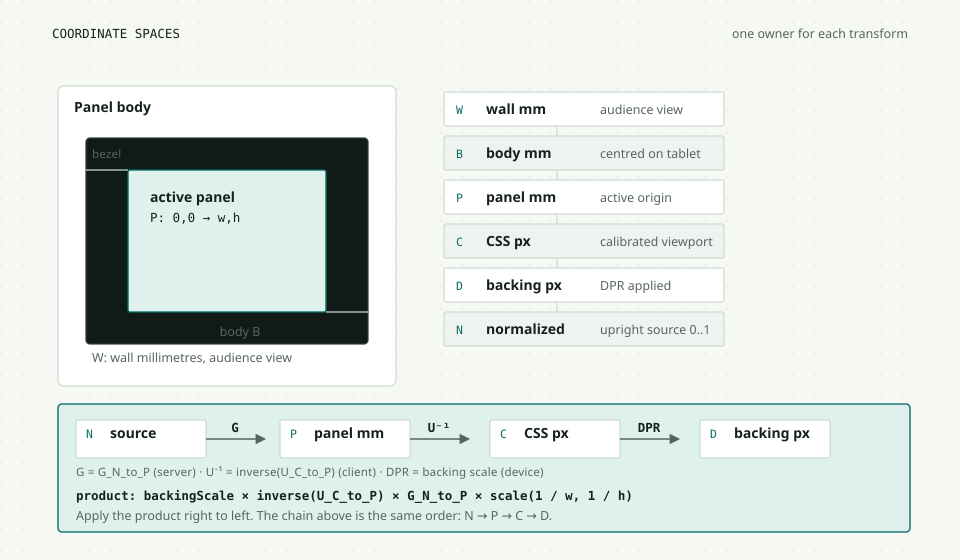

### The transform chain

The server computes `G_N_to_P`: normalized source to active-panel millimetres.
That plan depends on the wall bounds, the slot's centre, the mount angle, the
panel profile, and the image fit. The client computes `U_C_to_P`: CSS pixels to
panel millimetres, from the calibration record for its exact viewport. To draw,
the client composes:

```text
backing scale
  × inverse(U_C_to_P)
  × G_N_to_P
  × scale(1 / source width, 1 / source height)
```

Read the product from right to left. `scale(1 / w, 1 / h)` maps the source's
intrinsic pixels into normalized 0 to 1 coordinates. `G_N_to_P` maps those
normalized coordinates into panel millimetres. `inverse(U_C_to_P)` maps panel
millimetres into the browser's CSS space. `backingScale` maps CSS pixels into
canvas pixels. The order matters. Matrix multiplication applies the rightmost
matrix first.

The server and the client both implement the math. They share fixture data, not
code. `tabletwall/geometry.py` is the Python oracle. `frontend/client/view.js` is
the browser implementation. The fixtures cover quarter turns, asymmetric bezels,
fractional DPR, offsets, and a 180-degree-only change. A disagreement shows up
as a failing fixture before it becomes a visible seam.

A worked centre point makes the chain concrete. Take a 2000 × 1000 source, a
100 × 60 mm active panel, a calibration of 0.1666 mm per CSS pixel, and a
device pixel ratio of 2. The source pixel (1000, 500) becomes:

| Space | Value | Transform |
| --- | --- | --- |
| N | (0.5, 0.5) | `scale(1 / 2000, 1 / 1000)` |
| P | (50, 30) mm | `G_N_to_P` |
| C | (300, 180) CSS px | `inverse(U_C_to_P)` |
| D | (600, 360) back px | `backingScale` at DPR 2 |

The numbers are a centre-point example, not a calibration proof. A real plan
also carries the source fit, panel offset, quarter turn, and clip.

### Why the server owns the plan

The server knows the wall, the slot, the profile, and the mount angle. It can
answer one question consistently for every tablet: "Where should this source
land on your active panel?" If each client invented its own mapping, a profile
change could produce a different answer on each screen. The server also needs the
same plan to validate readiness and to explain a missing calibration.

The client still owns its CSS-to-panel matrix because only the browser knows the
viewport it actually got. The calibration record is keyed by viewport width,
height, DPR, orientation, mode, quarter turn, panel offset, mm per CSS pixel, and
anchor edge. The server only sends a plan when the reported viewport matches a
current calibration for the profile revision. A resize, rotation, or mode change
invalidates the match immediately. The client then shows a "needs calibration"
state instead of a guessed image.

### The editor works in millimetres

The physical console is not a pixel editor. The operator measures the active
panel, records the bezels, and places the body by its centre in wall
millimetres. The stage scales those numbers into an SVG for editing, but the
draft keeps millimetres. Dragging changes the centre. The inspector offers one
millimetre nudges and a 90-degree rotation. A keyboard or numeric path exists for
every pointer action.

The editor keeps the committed layout and the draft separately. `state.base` is
the server's layout. `state.draft` is a clone. A change goes through
`mutateDraft()`, which records undo history and updates the dirty flag. Apply
sends the whole draft with `If-Match`. A 412 keeps the draft and shows the
conflict. Cancel restores the base. Nothing is written until Apply succeeds.

### What calibration cannot prove

A browser can report a viewport, but it cannot prove the panel's physical size.
The profile is an operator measurement. A calibration says "for this reported
viewport, this is the mapping I measured." It does not say the ruler was
accurate, the panel has no hidden overscan, or two different tablet models have
the same colour response.

The roadmap gate is explicit: adjacent-edge seam displacement must be at most
2 mm beyond the intended hidden gap, with uncertainty and photos at every edge.
Desktop fixtures and synthetic measurements do not close that gate. The eight
hardware gates remain MISSING.

> **Pattern to reuse: one owner per coordinate space.** When two layers can
> transform the same point, name the space, name the owner, and test the
> composition. "It looks right" is not a contract.

**Trace it.** Compare `normalizedSourceToPanel` in
`frontend/client/view.js` with `tabletwall/geometry.py`. Then read the editor
flow in `frontend/controller/physical.js`. The relevant files are
`tabletwall/geometry.py`, `tabletwall/displays.py`, `frontend/client/view.js`,
and `frontend/controller/physical.js`.

## Playback is a schedule, not a paint

A timed wall is not a video player with a playlist. It is a group of independent
browsers that must agree on a future instant. The server cannot make a tablet
paint at a time. It can ask the tablet to prove it is ready, give it a timestamp,
and then ask it to commit. The design is built around that limit.

### The clock

`tabletwall/clock.py` starts with a monotonic millisecond clock. The server
publishes an epoch and a `now_ms` value. A client exchanges four timestamps with
the server, estimates the offset from the round trip, and keeps the sample with
the lowest uncertainty. A sample expires after 15 seconds, and the accepted
uncertainty is at most 25 ms.

The clock also detects host suspend. It compares the monotonic clock with
`CLOCK_BOOTTIME`. If the gap is larger than 2 seconds, the server mints a new
epoch and aborts playback. A stale monotonic anchor must not survive a suspend.
The browser-side clock uses the same idea: it schedules against the estimated
server time, not against a local timer that may have slept.

This is not optical synchronization. It is a software estimate of when the
server thinks a frame should appear. A camera is still required to measure when
the panel actually lit.

### Prepare, commit, display

A session has an **occurrence**: a playlist revision, an item index, and a loop
number. The server creates exactly one pending preparation for the next
occurrence. Each participating tablet gets a lease with a connection id and a
preparation id. The tablet reports readiness with a monotonically increasing
evidence sequence.

For a still, readiness includes a decoded image. For a video, it includes
metadata, a seek, a successful play probe, and enough buffered data ahead of the
target. The lease is short, 2 seconds, and the client renews it every 500 ms.
The server accepts a report only when the preparation, version, connection,
occurrence, mapping revision, clock, and evidence sequence all still match.

When every required lease is valid, the server commits a future effective time.
The commit carries the timestamp. The client schedules the paint shortly before
that time and re-checks the clock when the frame callback runs. A commit that
would land in the past is re-anchored forward, never fired late and called on
time.

A cut is a short exchange, not one command:

```text
prepare  {preparation_id: "p41", version: 3, connection_id: "c7",
          effective_server_ms: 1000, prepare_deadline_ms: 1000}
ready    {preparation_id: "p41", version: 3, connection_id: "c7",
          evidence_seq: 1, mapping_revision: 4, decoded: true}
commit   {preparation_id: "p41", prepared_at_version: 3, version: 4,
          effective_server_ms: 1000, connection_id: "c7"}
```

The `ready` frame is renewed while the lease is alive. The server commits only
after every required member has a valid, current lease. The client schedules
against `effective_server_ms`, not against the moment it received the commit.

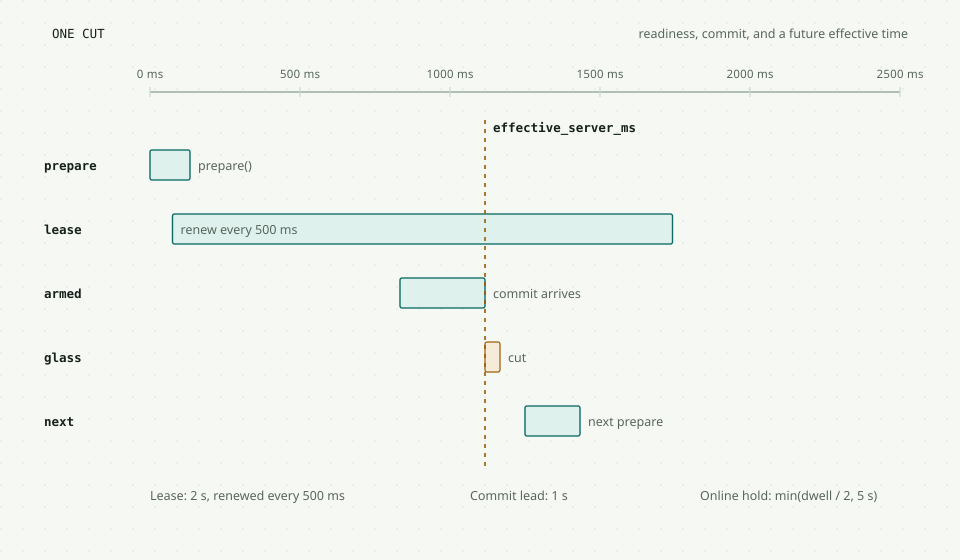

### The state machine

The session states are explicit:

- `preparing`: a pending occurrence is being readied.
- `armed`: the online policy is holding the cut while the rest of the cohort
  catches up.
- `playing`: the server has committed an occurrence. The effective time may
  still be in the future.
- `paused`: the displayed picture is frozen and the pending work is cancelled.
- `final`: the server has committed the last item of a non-looping playlist.
- `blocked`: strict mode could not get the required cohort ready.
- `failed`: online mode could not start or continue.
- `recovering`: a fault or reconnect triggered a group recovery.
- `stopped`: no session.

These are server scheduling states. `playing` does not prove the glass changed.
The status payload also carries `displayed` and `current_effective_ms`: the
previous occurrence remains displayed until the effective time, then the current
one is expected on the glass. A client paint report is a separate claim.

The transitions are explicit. A ready cohort commits directly from `preparing`
to `playing`. If the effective time passes while members are missing, online
mode sets `armed` and holds the cut. At the hold deadline, `armed` commits to
`playing` or becomes `failed` when no member became ready. A strict timeout makes
`preparing` become `blocked`. The last item makes the state `final`. Pause makes
`playing` become `paused`, and resume returns through `preparing`. A fault makes
`playing` become `recovering`, and a successful retry returns to `playing`.
Stop makes an active state `stopped`.

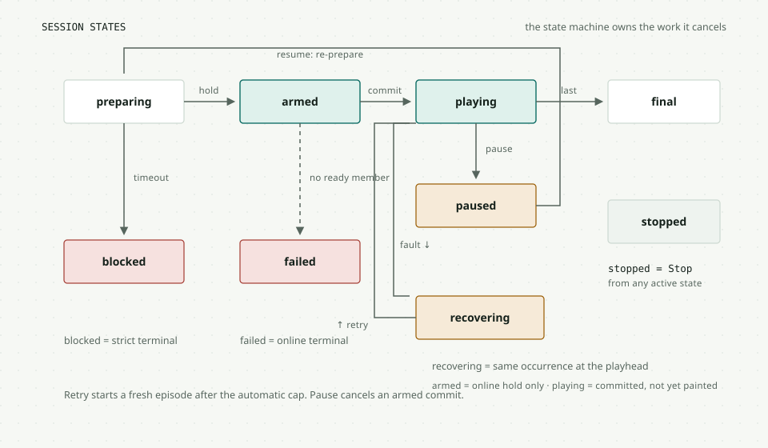

Pause acts on the displayed occurrence, not on a future one. If the committed
effective time has not passed, pause cancels the pending paint. If it has
passed, pause freezes the current item. Resume re-prepares the displayed item at a new anchor.
It does not claim to resume a frozen video frame at the exact millisecond. That
distinction is in the protocol and in the UI copy.

### Strict and online cohorts

The server has two membership policies.

**Online** waits for the participating tablets that are currently online and
protocol-capable. It holds the cut for at most `min(dwell / 2, 5 s)`. Then it
commits without the missing members and records them as missed. The show
continues.

**Strict** waits for every required participating slot, including offline and
protocol-unsupported members. It waits up to the 30-second preparation timeout,
then moves to `blocked` and names the missing tablets. The operator can retry,
stop, or start again. The default is strict when the playlist contains video,
and online otherwise.

The policy is resolved on the server at Start. The controller shows the choice,
but it does not reimplement the rule. A resumed session keeps its policy and
cohort.

### Exclusions

A session can exclude named tablets at Start. An excluded tablet stays on the
persisted scene, is removed from the required cohort, and is not counted as
synchronized. The exclusion is session-only. It does not edit the saved layout
or the scene. All-excluded and unknown ids are refused. The controller shows the
frozen sets while a session is active.

This is a membership decision, not a live kick command. Once a show starts, the
cohort is frozen. A tablet that disconnects during a video enters the recovery
path instead of silently leaving the cohort.

### What is deliberately simple

The first implementation uses hard cuts. Crossfades would need two decoded
frames and a reliable blending clock, and the roadmap makes them conditional on
measured benefit. Native video is bounded to H.264 files with a strict profile,
a local file, and a known duration. HLS and live capture are a separate phase
because they change the producer and delay problem.

> **Pattern to reuse: commit to the future, then verify the present.** The
> server schedules a timestamp only after readiness. The client checks the clock
> again at paint time. Neither side pretends that a timer callback is a
> guarantee.

**Trace it.** Start at `playback.start`, then `_preparation`, `accept_ready`,
`tick`, and `_commit` in `tabletwall/playback.py`. On the client, follow
`handleCommit` and `commitVideo`. The relevant files are
`tabletwall/clock.py`, `tabletwall/playback.py`, `main.py`, and
`frontend/client/client.js`.

## Media: accept bytes, then publish facts

Media is the part of the system that touches untrusted files. The pipeline is
built around a simple rule: a byte is not an asset until it is validated,
durable, and recorded as ready.

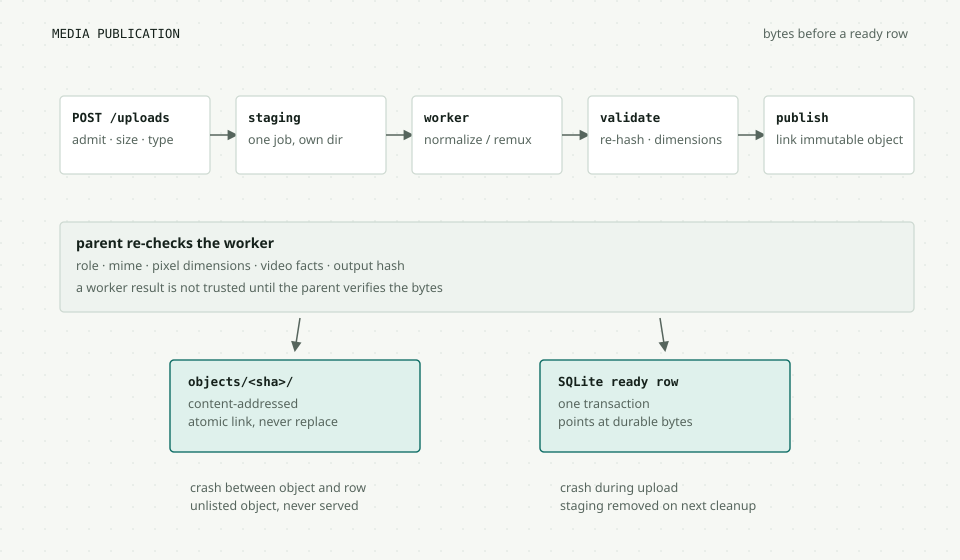

### Admission

`POST /uploads` is disabled by default. The operator enables one of two modes:

- `loopback`: the request must come from a loopback peer. Forwarded headers are
  refused.
- `proxy`: the request must carry exactly one `Origin` equal to the operator
  origin and one valid `X-Tablet-Wall-Operator` credential. The proxy sets the
  credential after Basic authentication. The backend compares it in constant
  time.

Both enabled modes require the exact operator `Origin`. The legacy origin guard
is a CSRF fence, not authentication. Upload admission is separate and stricter.
The deployment trust boundary is described in chapter 10.
The library and diagnostics endpoints use `admit_library()`, which keeps the
credential or loopback rule but does not require an `Origin` for a read.

The content type is limited to JPEG, PNG, MP4, and QuickTime. The length is
checked before the body is read. One upload worker runs at a time, with two
waiters. A 2 GiB quota and a 512 MiB free-space reserve prevent a full disk. A
still source is capped at 32 MiB and 32 megapixels. A video source is capped at
250 MiB and 10 minutes.

### Normalize, validate, publish

A still goes to `tabletwall.media_worker` in a child process with a 30-second
wall clock, 512 MiB of memory, and 25 CPU seconds. The worker applies EXIF
orientation, converts to sRGB, flattens alpha, strips metadata, caps the master
at 4096 pixels on the long edge, and writes renditions at 2048, 1024, and 256
pixels plus a thumbnail. A failure kills the process group and removes staging.

A video goes to `tabletwall.video`. It probes the file, checks H.264 profile and
level, pixel format, frame rate, duration, dimensions, and faststart. It remuxes
the file without transcoding and extracts a poster frame. The parent checks the
selected probe facts again in `media_video.validate_facts()`. This validates the
reported facts; it does not decode every frame a second time.

Publication is content-addressed. The parent re-hashes every output and checks
the worker-reported role, MIME type, and dimensions against the expected shape.
It does not decode the image again. The link into the immutable object tree is
atomic and never replaces an existing object. Only after the bytes are durable
does `_commit_asset()` write the ready rows in one SQLite transaction. A crash
in between leaves unlisted objects. Diagnostics count those orphans, and
staging cleanup removes stale upload jobs. Reclaiming published orphan objects
is not implemented. The server never serves a row that points at missing bytes.

### Ranges and caching

Stills are served from the managed object tree or the curated `assets/`
directory. Video is served by `media_serve.video_response()` with a strong
SHA-256 ETag, `If-None-Match` handling, and up to four ranges. A malformed range
falls back to a full 200 response. An oversized range header is refused. The
cache policy is immutable, one year, because the URL contains the content hash.

The video element uses HTTP ranges to seek and to buffer. The browser still owns
the decoder. The system can enforce the profile and the byte budget, but it
cannot prove the tablet's decoder will keep up. That is the physical decode
gate.

### Backup is a closure, not a file copy

`deploy/backup.py` snapshots SQLite through the online backup API, then walks the
documents for references. It copies the wall, saved layouts, saved scenes, and
playlist media. Unreferenced uploads are marked omitted by design. The manifest
records the schema, pipeline, closure, and media omission. Restore writes to new
targets, verifies hashes, and then starts a disposable app and fetches a restored
image. The drill is automated.

The backup is not a database file copy. A file copy can catch a WAL in an
inconsistent state. The online API gives a transactionally consistent snapshot.
The trade-off is that it still runs on the same host and shares the disk.

### The worker boundary

The child process is a resource boundary. It has a memory cap, a CPU limit, a
timeout, and its own staging directory. A decompression bomb or a malformed
image dies there. The parent does not trust the worker's claim that the bytes
match, so it re-hashes them. It treats the worker's decoded dimensions, MIME
type, and selected video facts as metadata to validate, not as proof that the
decoder was safe. A decoder bug can still affect the child process; the parent
limits the blast radius and kills it on timeout.

Measured peak memory on the 512 MiB worker with `LC_ALL=C`:

| Input | Peak | Time |
| --- | --- | --- |
| 6000 × 4000 JPEG | 225 MiB | 1.7 s |
| 8000 × 4000 RGB PNG | 245 MiB | 2.1 s |
| 8000 × 4000 RGBA PNG | 430 MiB | 2.4 s |

The C locale matters. The default locale can map a large archive into the
worker's budget. This is the kind of detail that only appears when you measure
the real process, not the Python function.

> **Pattern to reuse: write bytes before you mark them ready.** A ready row
> means the bytes exist. Write the bytes first, then set the row. A crash can
> leave garbage, never a lie.

**Trace it.** Start at `POST /uploads` in `main.py`, then
`media.admit_upload`, `receive_body`, `_run_worker`, `_validated_objects`,
`_publish_object`, and `_commit_asset`. The relevant files are
`tabletwall/media.py`, `tabletwall/media_worker.py`, `tabletwall/video.py`,
`tabletwall/media_serve.py`, and `deploy/backup.py`.

## When the wall breaks

A wall is a physical installation with Wi-Fi, sleep, power, and people. The
software treats failure as a normal state, not an exception.

### The client connection loop

The tablet registers before every connection attempt. It posts its device id,
viewport, device type, optional number, and wake-lock state. The HTTP reply is
`{"registered": true, "device": "<id>"}`. Then the client opens the WebSocket,
and the welcome frame carries the assigned number.

The backoff starts at 500 ms, doubles, adds up to 25 percent jitter, and caps at
5 seconds. The cap is deliberate: the field-readiness gate says content must be
correct within 10 seconds of connectivity returning. A 30-second backoff would
fail that gate even when the network is healthy.

A close code changes the loop:

- `4404` means "register first." The client registers and retries.
- `4408` means "heartbeat timeout." The client retries with backoff.
- `4409` means "another socket took this identity." The client stops and shows
  an explicit takeover control.
- `4426` means "unsupported protocol." Retrying will not help.

The viewport is part of the identity. A resize, rotation, or display-mode change
sends a viewport update. A size change re-registers after a short debounce. The
server can then invalidate a calibration that no longer matches.

### Group recovery

A video can fail while it is playing. The client detects a stalled frame
callback, a failed play, or a lost buffer. It sends a `video_fault` frame. The
server freezes the cohort, records the current position, and starts one group
recovery.

The recovery re-prepares the same occurrence at the live playhead. Every
original member must prepare at that position. A second fault during the
recovery is coalesced, not counted as a new attempt. Each occurrence has a cap
of three recovery episodes. Each episode has its own deadline; missing the
deadline ends the recovery as blocked or failed instead of retrying the same
preparation three times. The operator then sees Retry or Start again.

A fault reports the position the client saw. A reconnect uses the server's
computed playhead. Both enter the same group recovery, but the position source
is different. A final session is not rejoined, and a clip with 250 ms or less
remaining does not start a recovery that cannot finish. The client stays on the
persisted scene.

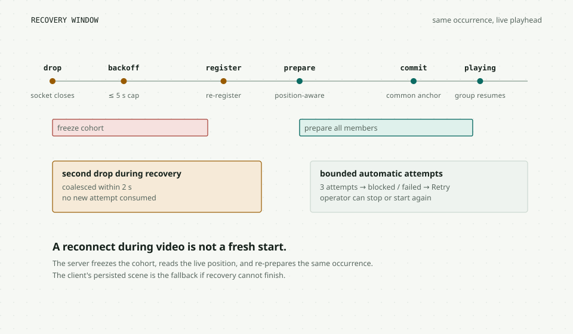

### Wake lock, diagnostics, rebind

The client asks for a Screen Wake Lock when it is visible and the context is
secure. It retries from the heartbeat. The states are `held`, `released`,
`unsupported`, `insecure`, and `denied`. The controller shows the state per
tablet. A held lock is not a kiosk configuration. It does not stop OS sleep by
itself.

The System tab loads diagnostics: media quota, used and free space, object
counts, database schema and size, backup age, online and total clients, and
wake-lock counts. It can re-hash media with `?verify=1`. It can rebind a tablet
that changed origin or storage: choose the new registration and the offline
tablet it replaces. The placement and display number move to the new id. Saved
layouts keep the old id, so the operator must recall and save them again.

### What recovery does not cover

There is no automatic return to the exact video frame after a full host suspend.
The clock epoch changes, the session aborts, and clients restore the persisted
scene. There is no distributed consensus across two servers. There is no
per-tablet authentication, so a LAN peer that guesses a UUID can replace a
socket or spoof presence. Those are deliberate gaps in the current design, not
hidden behavior. The deployment boundary in chapter 10 explains what the proxy
does and does not protect.

> **Pattern to reuse: make failure observable before it is recoverable.** A
> blocked state with the missing names is more useful than a silent retry. The
> operator can decide whether to wait, retry, or stop.

**Trace it.** Start at a `video_fault` frame in `frontend/client/client.js`,
then `accept_fault`, `_start_recovery`, and `_recovery_tick` in
`tabletwall/playback.py`. The relevant files are `frontend/client/client.js`,
`tabletwall/playback.py`, `main.py`, and
`simulator/browser/reconnect_exclusions_run.py`.

## Two frontends, one contract

The project has two browser pages and one legacy page. They look different
because they do different jobs.

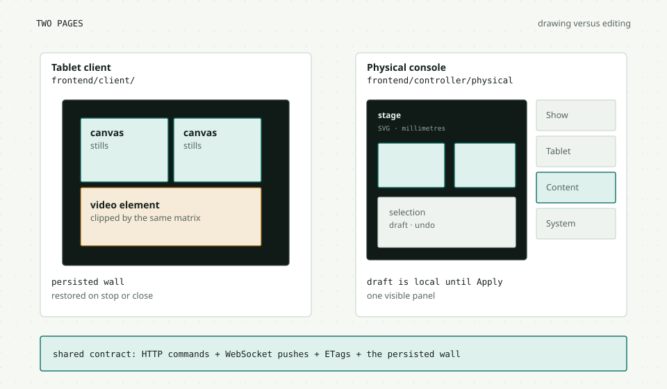

### The tablet client

The tablet page is intentionally sparse. A canvas covers the viewport. It draws
a colour, a calibration pattern, or a still. A video element sits above the
canvas when the current item is video and is clipped with the same physical
matrix.

The client keeps a **persisted wall** separate from the active playback. When a
video starts, the persisted scene is not overwritten. Stop, a socket close, or a
generation change restores it. The HUD appears for five seconds after a touch.
The canvas itself has `pointer-events: none`, so a tap can retry a failed image
or request fullscreen without stealing a drag.

Stills use an attempt cache with a timeout. A failed image keeps a retry target
for the next wall frame or a tap. Videos use a pending and active slot with
strict lineage checks. A stale prepare or commit cannot paint. The client also
sends drift samples and reacts to a stalled frame callback.

### The physical console

The current operator console is one stage with a four-tab rail:

- **Show**: playback controls, the frozen cohort, exclusions, next-cut
  readiness, and details.
- **Tablet**: device list, inspector, profile, and calibration.
- **Content**: library, playlist order, dwell, loop, and upload link.
- **System**: wall bounds, saved layouts, diagnostics, rebind, and the legacy
  link.

The stage stays visible. Selecting a slot opens the Tablet tab and reveals the
inspector for an explicit click or Enter, not for a drag. The rail has a local
draft with Undo, Redo, Apply, and Cancel. The dirty dot on a tab is a local
state indicator, not a server flag.

The responsive behavior is part of the interaction model:

- At 1000 px and wider, the rail is 392 px, or 340 px at 1000–1199, and scrolls
  inside itself. Each tab keeps its own scroll position.
- At 720–999 px, the stage comes first and the rail sits below it.
- At 719 px and below, the tab strip is hidden. The compact Show card is the
  only panel. Tab state is coerced to Show so ARIA and visibility agree.

### The legacy controller

`index.html` and `controller.js` still own the logical-wall workflow and the
upload UI. The current console links to it from System and from the Content
hint. This is deliberate debt. Phase 3 of the console plan is to port upload,
promote the content workflow, and then retire or redirect the logical mode. It
has not started.

The legacy controller uses one listen-only WebSocket and HTTP writes. It has no
polling except a one-second UI tick for relative times. Its state model is
different from the physical console. Do not assume a component can move between
the two pages without changing its contract.

### Accessibility is designed in

The console uses one polite page status region for state changes. The playback
countdown is `aria-hidden`, so a screen reader does not hear a number update
every second. Tabs use a roving tabindex and Arrow, Home, and End keys. The stage
is a focusable region. Nudge buttons have full labels. The skip links target the
stage and the controls. Focus rings are visible, and reduced-motion preferences
disable smooth scrolling and transitions.

The compact view is not a shrunken desktop. It is a read-only show view with a
single card and a More disclosure. Full forms wait for a larger screen or the
deferred authenticated controller tablet. That is a scope decision, not a
missing CSS breakpoint.

> **Pattern to reuse: make the draft a first-class object.** A local draft with
> explicit Apply is easier to reason about than a form that writes on every
> keystroke. The dirty state can be shown, cancelled, and tested.

**Trace it.** Read `frontend/controller/physical.html`, then `init`, `showTab`,
`selectDevice`, and `applyLayout` in `physical.js`. The relevant files are
`frontend/controller/physical.html`, `frontend/controller/physical.js`,
`frontend/client/client.js`, and `frontend/client/view.js`.

## Security and deployment: the proxy is the boundary

The application has no login. This is the first thing to understand about its
security model. Anyone who can reach the backend can register a device, read the
roster, or repaint the wall. The project does not pretend otherwise. The
deployment reference puts a reverse proxy in front and binds the app to
loopback.

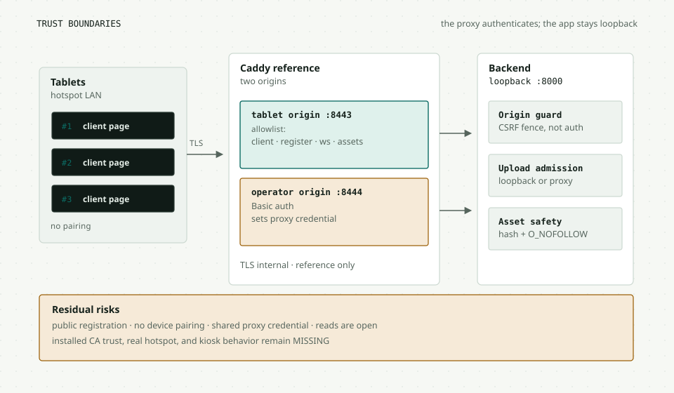

### Two origins, two jobs

`deploy/hotspot.Caddyfile` defines a reference deployment with two listeners:

| Origin | Who | What it allows |
| --- | --- | --- |
| `https://<hotspot-ip>:8443` | Tablets on the hotspot | Client page and assets, `POST /devices/register`, device WebSocket, and exact content-addressed asset URLs. Everything else is 403. |
| `https://localhost:8444` | Operator on the laptop | HTTP Basic auth, then the controller, operator APIs, uploads, diagnostics, and the controller WebSocket. |

Both proxy to one backend on `127.0.0.1:8000`. The tablet listener strips any
client-supplied operator credential. The operator listener sets the credential
after Basic auth and strips the browser's `Authorization` and `Cookie` headers.
The backend compares the credential in constant time. It cannot prove where the
header came from, so loopback isolation and the proxy configuration are part of
the control.

The reference is not installed or validated by the repository. The service unit
contains placeholders. The local CA, the real hotspot, the tablet trust store,
and the kiosk configuration are all physical gates.

### What the guards actually do

The origin guard in `main.py` is defense in depth, not authentication. When
`TABLET_WALL_OPERATOR_ORIGIN` is configured, it requires exactly one `Origin`
header on state-changing HTTP methods and rejects missing, duplicate, `null`,
or mismatched values with 403. If the variable is unset, the guard is inert.
It exempts only `POST /devices/register`. It does not protect reads, and it
does not identify a person.

The upload admission is stronger because it handles files:

- `TABLET_WALL_UPLOAD_MODE=disabled` is the default.
- `loopback` requires a loopback peer and refuses forwarded headers.
- `proxy` requires the exact operator origin and a constant-time comparison of
  a proxy-set credential at least 16 characters long.

The media library and diagnostics use the credential or loopback rule without
the origin requirement. That lets the controller read the library while keeping
the upload path narrow. Uploads are disabled by default because a wall with no
trusted ingress should not accept arbitrary files. The proxy credential is a
shared deployment secret, not a per-operator identity.

### The threat table

| Threat | Current control | Residual risk |
| --- | --- | --- |
| A LAN peer impersonates a tablet | Device UUID and socket replacement | No pairing or per-device secret. A guessed UUID can replace a socket. |
| A browser on another site repaints the wall | Exact operator `Origin` on writes | Reads are open. The guard is not authentication. |
| An unauthenticated upload | Upload mode, origin, proxy credential, loopback peer | The proxy credential is shared, not per operator. |
| Malicious image or video | Content-type allowlist, magic bytes, size and pixel caps, child worker, re-validation, metadata strip | A decoder bug in the worker is still possible. The worker limits the blast radius. |
| Path traversal or symlink swap | Regular, non-symlink files, `O_NOFOLLOW`, exact hash checks | The asset directory is operator-controlled. |
| Stale or forged layout write | ETag and `If-Match`, 412, 428 | A client with the current ETag can write. |
| Stolen device identity | None | Pairing, revocation, and rotation are future work. |
| TLS interception | Local CA in the reference | Installed trust on real tablets is a gate. |

There is no CORS middleware. The app expects same-origin reads and a proxy in
front. The WebSocket controller endpoint performs its own origin denial before
accepting the socket.

### Deployment modes

The simplest mode is loopback:

```bash
uv sync
make dev          # http://127.0.0.1:8000
```

The app serves the client, the physical console, and the legacy console from
static mounts. Uploads are disabled unless you configure a mode. This is a
development and single-laptop mode, not a trusted LAN deployment.

The two-origin mode uses the hotspot wrapper:

```bash
export WALL_HOTSPOT_IP=192.168.4.1
export WALL_OPERATOR_PASSWORD_HASH='...'
export TABLET_WALL_OPERATOR_ORIGIN='https://localhost:8444'
export TABLET_WALL_TABLET_ORIGIN="https://$WALL_HOTSPOT_IP:8443"
make run
deploy/run-hotspot.sh
```

The wrapper rejects a missing, wildcard, or non-local hotspot address. The
backend binds loopback. The tablet listener allows only the client page and the
assets it needs. The operator authenticates at the proxy. The real deployment
still needs a chosen host name, a certificate plan, firewall rules, and a kiosk
procedure.

### Backup and restore

`deploy/backup.py` has three commands:

```bash
uv run python deploy/backup.py backup \
  --db tablet-wall.db \
  --assets assets \
  --media media \
  --dest "$BACKUP_DEST"
uv run python deploy/backup.py verify --src "$BACKUP_DEST"
uv run python deploy/backup.py restore --src "$BACKUP_DEST" \
  --db NEW.db --assets NEW/assets --media NEW/media
```

The manifest records the schema, pipeline, references, and omitted media. The
backup reads the live database through SQLite's online API, then verifies its
own staging directory before a rename publishes the snapshot. A restore writes
to new targets and refuses to overwrite. Stop the service before a restore. The
drill runs a backup while the app is running, restores to new paths, starts a
disposable app, and fetches a restored image.

> **Pattern to reuse: keep the trust boundary outside the app when the app has
> no identity model.** A loopback bind plus a proxy with real authentication is
> easier to reason about than a home-grown login inside a single-process app.

**Trace it.** Read `operator_origin_guard` in `main.py`, then
`media.admit_upload` in `tabletwall/media.py`, then the listener blocks in
`deploy/hotspot.Caddyfile`. The relevant files are `main.py`,
`tabletwall/media.py`, `deploy/hotspot.Caddyfile`, and `deploy/backup.py`.

## Budget the milliseconds

A wall feels broken when it is late. The system has two different latency
budgets: the control loop that keeps state and presence correct, and the glass
budget that decides when a picture appears.

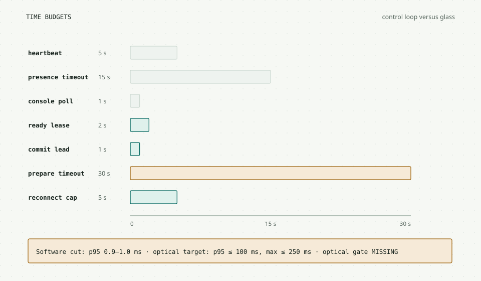

### The control loop

| Interval | Value | Why |
| --- | --- | --- |
| Device heartbeat | 5 s | Cheap presence and wake-lock reporting |
| Presence timeout | 15 s | Tolerates a missed heartbeat without hiding a dead tablet |
| Sweeper | 2 s | Closes stale sockets promptly |
| Console playback poll | 1 s | Enough for status without a controller socket |
| Playback loop | 100 ms | Checks leases, clocks, and commits |
| Prepare timeout | 30 s | Bounded wait for a strict cohort |
| Ready lease | 2 s, renewed every 500 ms | A readiness proof goes stale quickly |
| Commit lead | 1 s | Time to schedule against the future timestamp |
| Online hold cap | `min(dwell / 2, 5 s)` | Bounded partial start |
| Video buffer goal | 5 s or the remaining clip | Enough to survive a short stall |
| Reconnect backoff cap | 5 s | Fits the 10 s field-readiness gate |
| Recovery attempts | 3 | Bounded automatic recovery |

The controls are deliberately short. A stale readiness proof is more dangerous
than a delayed cut. A held socket is less useful than a quick reconnect.

### The software cut measurement

The 100-cut runner uses three calibrated desktop Chromium clients on one host
clock. It recorded 100 of 100 cuts, zero failed events, zero degradation
windows, and zero holds. The healthy-subset onset delta was p50 0.2 ms, p95
0.9–1.0 ms, and max 1.1–1.3 ms. The draw timestamp was about 39.8 ms before the
planned instant.

These are software draw timestamps. They are not optical measurements. They do
not include camera exposure, panel response, browser compositing, or the
physical clock of a tablet. The optical gate remains MISSING, with a target of
p95 at most 100 ms and max at most 250 ms.

### The upload budget

The upload path is bounded at every step:

| Limit | Still | Video |
| --- | --- | --- |
| Source size | 32 MiB | 250 MiB |
| Source dimensions | 32 MP | 1920 × 1080 |
| Duration | n/a | 1 s to 10 min |
| Worker time | 30 s | 120 s |
| Worker memory | 512 MiB | 512 MiB |
| Receive time | 60 s | 600 s |
| Output | Master ≤ 4096 px, renditions 2048, 1024, 256 | Remuxed H.264 and poster |
| Store quota | 2 GiB with 512 MiB free reserve | Shared |

The worker memory numbers came from real measurements, not estimates. A
6000 × 4000 JPEG peaked at 225 MiB. An 8000 × 4000 RGBA PNG peaked at 430 MiB.
The 512 MiB limit is close enough that the C locale matters.

### Scaling

The first trial target is 15 to 20 tablets on a laptop hotspot. The simulator
runs 18 virtual tablets. `deploy/load-smoke.py --devices 20` proves concurrent
connections, not radio capacity. The roadmap warns that 20 × 2 Mbit/s is demand
arithmetic, not hotspot throughput evidence.

The server is one process with one SQLite file. There is no broker and no
horizontal scale-out. If the wall grows beyond the target, the first limits are
the event loop, the hotspot airtime, the video decode budget, and SQLite write
serialization. The design does not hide those limits behind a queue.

The 2 GiB media quota and the 512 MiB reserve are operator controls, not infinite
storage. A 10-minute video at a few megabits per second is tens of megabytes. A
few dozen clips can fit. A library of raw camera files will not.

> **Pattern to reuse: budget each layer separately.** A fast server commit does
> not prove a fast panel. A short heartbeat does not prove a stable Wi-Fi link.
> Name the layer, measure it, and keep the claim inside its boundary.

**Trace it.** Start at the timing constants in `tabletwall/clock.py` and
`tabletwall/playback.py`, then follow `_playback_loop` in `main.py`. The
relevant files are `tabletwall/clock.py`, `tabletwall/playback.py`, `main.py`,
and `simulator/browser/run.py`.

## Evidence is part of the design

The project has an unusual amount of test machinery for its size. That is not
accidental. The hard claims are about time and physical alignment, and those
claims are easy to fake with a passing unit test.

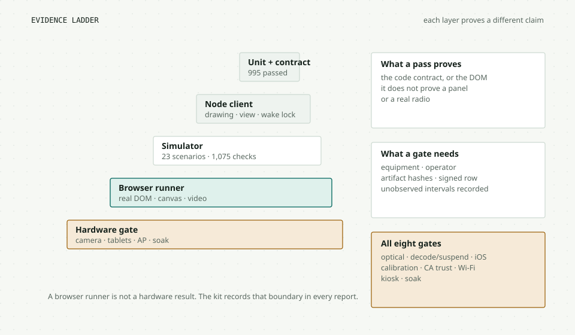

### The layers

| Layer | What it proves | Current shape |
| --- | --- | --- |
| Python unit and contract tests | State machines, API contracts, migrations, admission, geometry oracles | 995 passed at the current HEAD |
| Node client tests | Still drawing, view math, wake-lock state | 71 client, 12 view, 10 wake-lock |
| Report and browser-safety tests | Evidence schema, safe cleanup, no false success | 45 |
| Simulator | 23 scenarios, 1,075 checks, 18 virtual sockets | No browser, no pixels |
| Durable browser runners | Real Chromium DOM, WebSocket, canvas, video, Playwright | See the runner table below |
| Validation kit | Optical analyzer, device probe, trust checker, calibration checker, fleet and network harnesses | Dry-run only |
| Hardware gates | Real tablets, camera, AP, CA trust, kiosk, soak | All eight MISSING |

The durable browser runners are the most useful learning tool because each one
drives the real UI and records a report:

| Runner | Current evidence |
| --- | --- |
| `controller_run.py` | 95/95 checks, 14/14 scenarios, twice on a clean worktree |
| `video_transitions_run.py` | 51/51 checks |
| `group_recovery_run.py` | 19/19 checks |
| `recovery_acceptance_run.py` | 88/88 checks, 5/5 scenarios |
| `reconnect_exclusions_run.py` | 21/21 checks, 5/5 scenarios |
| `field_run.py` | 12/12 checks |
| `base run.py` | 105/105 on the Phase 1 tree. Current re-run aborts at the old Pause selector because the console is tabbed. |
| `video_run.py` | 35/35 on the Phase 1 tree. Current re-run aborts at the hidden playlist picker for the same reason. |

The last two rows are honest drift, not a product failure. The console moved
playback and playlist controls into tabs. The older runners still click the old
flat DOM. They need a tab helper and a fresh run. This is a useful lesson: a
green test suite is only green for the DOM it was written against.

### The evidence contract

Every hardware-validation-kit report uses `tools/validation/evidence.py` and
the schema in `docs/validation/EVIDENCE-SCHEMA.md`. Browser-runner reports have
their own shapes and a normalizer; they do not all carry the kit fields. A kit
report records:

- the application SHA and tool versions;
- the original cohort and expected scenarios;
- every check, failure reason, skipped interval, and unobserved interval;
- artifact paths, sizes, and SHA-256;
- an explicit completion state;
- `hardware_gate_status = MISSING` and `hardware_claim = false`.

The frozen targets are in `docs/validation/ACCEPTANCE.md`. The gate matrix is in
`docs/validation/HARDWARE-VALIDATION.md`. Synthetic fixtures, desktop Chromium,
WebKit, loopback Caddy, and a simulated fleet cannot close a gate. Only a signed
operator result with real equipment can.

### How to run it

```bash
uv sync
make test                    # pytest + client image tests
make sim                     # 18 virtual tablets, TestClient
uv run python -m simulator.browser.controller_run --artifacts /tmp/controller
uv run python -m simulator.browser.video_transitions_run --artifacts /tmp/transitions
uv run python deploy/drill.py
```

The browser runners start their own disposable server on a free port and use
temporary storage. They do not touch the live wall. That isolation is part of
the evidence contract. A runner that points at a production database is not
acceptable evidence.

> **Pattern to reuse: write down what the evidence cannot prove.** A test report
> that says "software timing, not optical" is more trustworthy than a green check
> with an implied physical claim.

**Trace it.** Read one runner, then its report. Start with
`simulator/browser/controller_run.py`, then `simulator/browser/report.py`,
`tools/validation/evidence.py`, and `docs/validation/HARDWARE-VALIDATION.md`.

## Roadmap, vocabulary, and traces

The roadmap uses two numbering systems, which is confusing until you see why.
The older README phases describe product milestones. The newer P0/R1–R6 labels
describe delivery phases with explicit gates. The console has its own phase
numbers.

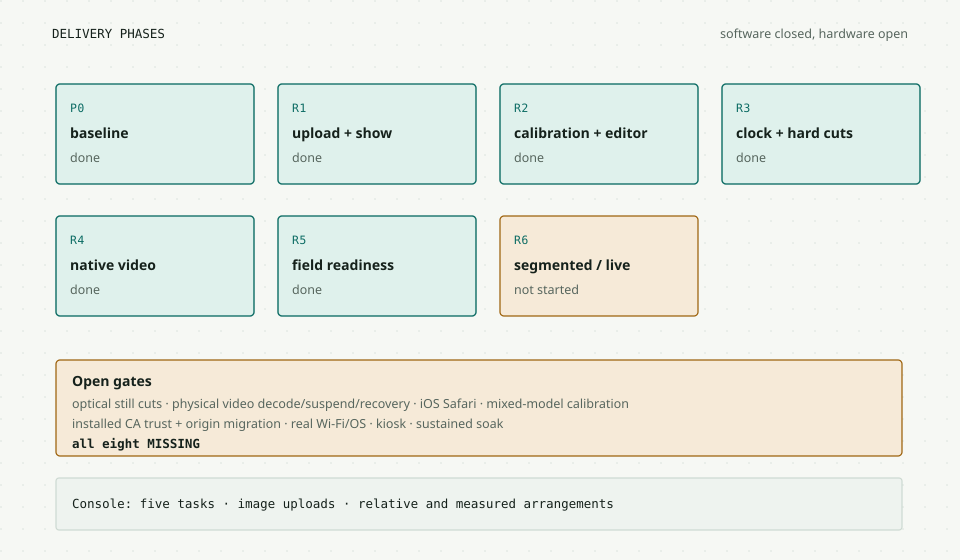

### Current phase status

| Phase | Software status | What remains |
| --- | --- | --- |
| P0 baseline | Complete | Standalone, sleep, and hardware rows |
| R1 upload and show | Complete | Physical upright-photo evidence |
| R2 calibration and editor | Complete | Mixed-model seam and calibration |
| R3 clock and hard cuts | Complete | 100-cut optical measurement |
| R4 native video | Complete | Physical decode, suspend, and optical run |
| R5 field readiness | Complete | CA trust, real Wi-Fi, kiosk, soak |
| R6 segmented or live | Not started | Needs a written source and delay requirement |

The README phases are:

- Phase 0, hygiene: done.
- Phase 1, core loop: done.
- Phase 2, still wall: software done, physical validation open.
- Phase 3, safe unattended operation: not complete. 3a and 3b are reference
  artifacts. 3c and 3d are deferred.
- Phase 4, timed media: software slice done, physical validation open.

The console phases are:

- Phase 1, low-risk fixes: done.
- Phase 2, tabbed rail: done.
- Phase 3, upload port and legacy retirement: not started.

### Vocabulary

| Word | Meaning in this project |
| --- | --- |
| **Wall** | Layout, scene, revision, and generation |
| **Logical wall** | Abstract wall units, not millimetres |
| **Physical wall** | Measured panel profiles and calibrations in millimetres |
| **Placement** | A device footprint in a logical wall |
| **Slot** | A device's place in a physical layout |
| **Display profile** | Measured active area and bezels |
| **Calibration** | Viewport-specific CSS-to-panel mapping |
| **Scene** | What to show: colour, calibration, or image |
| **Asset** | Content-addressed bytes and metadata |
| **Generation** | Process lifetime reset token |
| **Revision** | Monotonic change counter within a generation |
| **ETag** | The revision token used by `If-Match` |
| **Occurrence** | Playlist revision, item index, and loop number |
| **Cohort** | Required tablets for a session |
| **Lease** | A short readiness claim from one tablet |
| **Prepare** | Ask a tablet to load a specific occurrence |
| **Commit** | Schedule that occurrence at a future timestamp |
| **Strict** | Wait for every required participating slot |
| **Online** | Wait only for the online, capable cohort |
| **Recovery** | Re-prepare the same occurrence at the live playhead |
| **Exclusion** | A session-only membership removal |

### Six traces to learn the system

Use these as exercises. Each one exercises a different boundary.

**1. Follow a boot.** Start at `main.py` lifespan, then
`persist.ensure_schema()`, `_restore_wall_state()`, `state._new_generation()`,
and the first `/api/v3/config` read. Ask: what happens to a wall row from a
future schema? What happens to a placement whose device never returns?

**2. Follow a wall write.** Pick `PUT /api/v3/layout`. Trace the ETag check,
`_commit_wall()`, `persist.save_state()`, and `hub._broadcast_wall()`. Ask: at
which line does the change become true? What does a 412 preserve?

**3. Follow a cut.** Start at `POST /api/v3/playback/start`. Follow
`playback.start()`, the prepare frame, `accept_ready()`, `tick()`, `_commit()`,
and the client's `handleCommit()` or `commitVideo()`. Ask: which check rejects
a stale lease? What happens when the effective time is already past?

**4. Follow a physical pixel.** Start at `view.js` `normalizedSourceToPanel()`,
then `canvasTransform()`. Compare it with `tabletwall/geometry.py`. Ask: which
matrix does the server own? Which one does the client own? Why is DPR in the
client?

**5. Follow an upload.** Start at `POST /uploads`, then `media.admit_upload()`,
`receive_body()`, `_run_worker()`, `_validated_objects()`, `_publish_object()`,
and `_commit_asset()`. Ask: what happens if the process dies after the link but
before the database row? How does the backup decide what to copy?

**6. Follow a recovery.** Start at a client `video_fault` frame, then
`accept_fault()`, `_start_recovery()`, `_recovery_tick()`, and the client's
`prepareVideo()` with a `recovery_id`. Ask: why does the group prepare at the
playhead instead of the start? What is coalesced?

### The five things to remember

- The wall is committed to SQLite before memory and delivery change.
- The server owns geometry. The client owns its calibrated viewport.
- A cut is a future timestamp backed by a required cohort's readiness.
- Media bytes are published before a ready row makes them visible.
- A test pass is a claim about a boundary. Name the boundary, or the claim is
  larger than the evidence.

### Where the deeper records live

- `README.md` for the current status, quickstart, and known limitations.
- `PROTOCOL.md` for the wire contract and frame shapes.
- `docs/planning/tablet-wall-roadmap-2026-10-23/ROADMAP.md` for the delivery
  phases and first ten tickets.
- `docs/planning/tablet-wall-roadmap-2026-10-23/EXECUTION_LOG.md` for the
  implementation and evidence trail.
- `docs/validation/HARDWARE-VALIDATION.md` for the eight gates.
- `simulator/README.md` for the browser runners and their exact scope.
- `docs/design/controller-v2/PLAN.md` for the console phases.

This guide is generated from `GUIDE.md`. When the code changes, edit the
Markdown, rebuild the site, and keep the figures and counts true.
