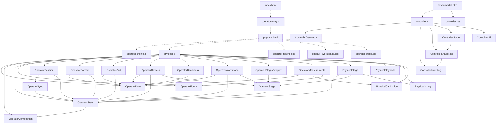

# Controller architecture audit

The migration should preserve the working wall console while moving bounded UI regions to React. The existing session and geometry modules are useful foundations. The highest risk is concurrent ownership of DOM nodes and draft guards, rather than a lack of component candidates.

## Scope, revision, and evidence

Verified against clean worktree commit `bcc3d48ee2fee78015a4ae7f3a814e02cde14588`, dated 2026-11-15, merge of `redesign/workspace-wall`. Repository root was a temporary clean worktree; links are relative to the repository. The shared brief was read in full. Its statement that this checkout precedes Direction B is stale relative to this revision. The main project directory has separate uncommitted edits and was not used as the source of this audit.

This is a source and contract-test audit. “Live” below means the served, operational console according to routing and startup code, not a claim that a production wall was observed. No browser, server, simulator, or physical tablet was run. No repository files were changed. Runtime appearance, accessibility conformance, device behavior, and hardware calibration accuracy remain unverified here. The brief's prior visual findings are supplied context, not new observations.

The repository has no root `AGENTS.md` file at this revision. The session-supplied AGENTS instructions apply. README identifies the console, redirect, and compatibility editor. Static mounting uses `html=True` and revalidation. [README.md:104](../../../README.md:104) [main.py:632](../../../main.py:632)

The six requested design skill files were read in full. Impeccable context found no `PRODUCT.md` or `DESIGN.md`; this bounded audit uses the existing source and the explicit Direction B brief. Modern Web Guidance was searched for accessible modal dialogs; `dialog` and `accessibility` were retrieved. Current Web Interface Guidelines were fetched. Recommendations below are labeled as recommendations and are not implementation or compatibility claims.

Throughput checkpoint is n/a for this read-only investigation. I performed the investigation directly as the assigned research sub-agent, without spawning children.

## 1. Pages, module map, and dependencies

| Page | What it is | Operational status |
| --- | --- | --- |
| `physical.html` | Main wall workspace. Content, Arrange, and Test modes, tablet inspector, saved content and arrangements, server drawer, and opt-in experimental playlist controls. | Live primary console. Uses v3 authority and protocol-3 controller socket. [frontend/controller/physical.html:15](../../../frontend/controller/physical.html:15) [frontend/controller/physical.js:3112](../../../frontend/controller/physical.js:3112) |
| `index.html` | Small entry page with a fallback link. `operator-entry.js` uses `location.replace()` to open `physical.html`, retaining search and hash. | Live entry to the same console, not a second editor. Redirect waits for DOM readiness. [frontend/controller/index.html:13](../../../frontend/controller/index.html:13) [frontend/controller/operator-entry.js:3](../../../frontend/controller/operator-entry.js:3) |
| `experimental.html` | Older logical-wall compatibility editor. Device tiles, logical stage, curated and managed media, named snapshots. | Served and executable, opt-in secondary editor. It can write a logical wall. Startup and reconnect guard hide the app and block editing for physical layouts, unknown layout kinds, unsupported operator-state version, or failed authority reads. It is not dead/demo-only code. [frontend/controller/experimental.html:644](../../../frontend/controller/experimental.html:644) [frontend/controller/controller.js:3403](../../../frontend/controller/controller.js:3403) |

The directory has **27 JavaScript files and four CSS files**. Sizes below are source lines and exact on-disk bytes, not transfer, compressed, or executed bundle sizes. The tables cover every controller JS/CSS file.

### Primary console files

| File | Load/use | Lines / bytes | Global / responsibility | Expects |
| --- | --- | ---: | --- | --- |
| [operator-theme.js](../../../frontend/controller/operator-theme.js:1) | Head | 24 / 1,132 | `None. Head IIFE.`. Initial system/light/dark theme, persistence and toggle. | localStorage; document root, DOMContentLoaded, #theme-toggle. |
| [operator-dom.js](../../../frontend/controller/operator-dom.js:1) | 1 | 44 / 1,577 | `OperatorDom`. Lookup/capture, immutable view copying, text/child helpers. | DOM; optional CommonJS export. No other module. |
| [operator-composition.js](../../../frontend/controller/operator-composition.js:1) | 2 | 36 / 2,054 | `OperatorComposition`. Pure mode/selection reducer, inspector/draft-owner selectors, selection navigation policy. | No module dependency. |
| [operator-state.js](../../../frontend/controller/operator-state.js:1) | 3 | 216 / 14,903 | `OperatorState`. Layout/geometry helpers, signatures, stage view, render evidence, roster projection, read fences. | OperatorComposition; CommonJS require when tested. |
| [operator-forms.js](../../../frontend/controller/operator-forms.js:1) | 4 | 58 / 3,215 | `OperatorForms`. Per-device/group retained field drafts and snapshot-name validation. | No module dependency. |
| [operator-stage.js](../../../frontend/controller/operator-stage.js:1) | 5 | 337 / 26,503 | `OperatorStage`. SVG construction/diff/fitting, panel geometry, evidence/exception and power labels. | OperatorState; DOM/SVG APIs; profile/status/label callbacks. |
| [operator-stage-viewport.js](../../../frontend/controller/operator-stage-viewport.js:1) | 6 | 45 / 2,626 | `OperatorStageViewport`. Measures surrounding stage well, coalesces resize fitting and cancels view-incompatible interaction. | OperatorStage; injected SVG/wrappers/measure; ResizeObserver and requestAnimationFrame. |
| [operator-content.js](../../../frontend/controller/operator-content.js:1) | 7 | 683 / 47,346 | `OperatorContent`. Image inventory/gallery, search, preview/fit/crop, upload, content and test-pattern commands. | OperatorDom, OperatorState; injected state/api/ingest/render/resolve/refresh and lookup; XHR for upload. |
| [operator-grid.js](../../../frontend/controller/operator-grid.js:1) | 8 | 471 / 36,849 | `OperatorGrid`. Membership/order/size model, relative or measured grid proposals, releases, previews and guarded apply. | OperatorState, OperatorDom; injected authority/measurement/identify/render/dirty callbacks. |
| [operator-devices.js](../../../frontend/controller/operator-devices.js:1) | 9 | 493 / 42,050 | `OperatorDevices`. Batch model confirmation, labels, evidence/recovery, remove/forget and replacement review/commit. | OperatorDom, OperatorState, OperatorStage power projection; tabletForms and injected api/selection/authority callbacks. |
| [operator-readiness.js](../../../frontend/controller/operator-readiness.js:1) | 10 | 334 / 17,324 | `OperatorReadiness`. Pure readiness view plus live join URL, QR, trust/network/storage advice and refresh UI. | OperatorDom; injected state/api/copyText; document IDs, image events. |
| [operator-sync.js](../../../frontend/controller/operator-sync.js:1) | 11 | 86 / 6,027 | `OperatorSync`. Protocol-3 WebSocket, roster event merge, periodic reconciliation, reconnect and read fencing. | OperatorState; injected private session state/api/ingest/render/conflict callbacks; WebSocket and timers. |
| [operator-session.js](../../../frontend/controller/operator-session.js:1) | 12 | 129 / 8,891 | `OperatorSession`. Authoritative snapshot owner, freeze/publish/subscribe, guarded HTTP requests, command uncertainty and refresh lifecycle. | OperatorState, OperatorSync at create time; fetch/AbortController/performance by default. |
| [operator-workspace.js](../../../frontend/controller/operator-workspace.js:1) | 13 | 370 / 27,062 | `OperatorWorkspace`. Derived shell/body attributes, join/roster layout, issues, first-run flow, commit ownership and draft-resolution modal. | OperatorDom, OperatorState, OperatorStage; injected draft/commit/selection/mode callbacks and retained nodes. |
| [physical-playback.js](../../../frontend/controller/physical-playback.js:1) | 14 | 1,443 / 70,225 | `PhysicalPlayback`. Experimental transport/status/readiness/exclusion rendering and commands. Loaded even before opt-in. | Large injected dependency bag from physical.js; shared state/api/library/playlist/format/DOM helpers. |
| [physical-sizing.js](../../../frontend/controller/physical-sizing.js:1) | 15 | 337 / 18,028 | `PhysicalSizing`. Pure measured footprints, fit/pack/add-position, logical snap/validation and fresh-viewport shape matching. | Injected profile lookup and records; exports to root and CommonJS. |
| [physical-stage.js](../../../frontend/controller/physical-stage.js:1) | 16 | 781 / 45,535 | `PhysicalStage; also classic globals rosterSummary and configureDeviceSheet`. Stage orchestration, roster/chips/health, selection, pointer editing, inspector, slot transforms. | OperatorState, OperatorStage, PhysicalSizing; injected DOM refs and coordinator mutation/render/measurement/selection callbacks. |
| [physical-calibration.js](../../../frontend/controller/physical-calibration.js:1) | 17 | 68 / 4,195 | `PhysicalCalibration`. Viewport qualification, ruler address/scale/payloads and ruler review state machine. | No controller module dependency; URL and supplied records. |
| [operator-measurements.js](../../../frontend/controller/operator-measurements.js:1) | 18 | 611 / 33,238 | `OperatorMeasurements`. Profile/calibration payloads, retained forms, ruler checks, save and selected-device measurement presentation. | OperatorDom, injected PhysicalCalibration/tabletForms/api/refresh/format/cache/DOM/coordinator callbacks. |
| [physical.js](../../../frontend/controller/physical.js:1) | 19 | 3,218 / 167,554 | `None. Coordinator IIFE.`. Application composition, shared UI state/accessors, initialization, drafts/history, playlist, diagnostics, saved lists and static bindings. | Every primary factory/helper above; live page DOM and browser APIs. Uses state projections instead of direct writes to session authority. |


### Secondary and entry files

| File | Load/use | Lines / bytes | Global / responsibility | Expects |
| --- | --- | ---: | --- | --- |
| [operator-entry.js](../../../frontend/controller/operator-entry.js:1) | Entry | 13 / 674 | `None. IIFE.`. Redirects index to physical.html with search/hash and usable fallback link. | URL/location; #entry-link and #entry-status. |
| [controller-geometry.js](../../../frontend/controller/controller-geometry.js:1) | Experimental 1 | 183 / 7,369 | `ControllerGeometry`. Pure legacy geometry, sizing, visible-rectangle/aspect and content/capability normalization. | No other controller module. |
| [controller-snapshots.js](../../../frontend/controller/controller-snapshots.js:1) | Experimental 2 | 768 / 34,104 | `ControllerSnapshots`. Legacy named layout/scene list/save/overwrite/recall/delete and confirmation/focus state. | Injected snapEl/requestJson/wall/getter/render callbacks; shortAsset/refreshAssets from inventory via coordinator. |
| [controller-url.js](../../../frontend/controller/controller-url.js:1) | Experimental 3 | 30 / 916 | `ControllerUrl`. Frozen loopback-origin classifier. | URL parsing; no other module. |
| [controller-stage.js](../../../frontend/controller/controller-stage.js:1) | Experimental 4 | 1,468 / 72,066 | `ControllerStage`. Legacy logical selection/history, tile/pack preview, drag/resize, inspector and stage layout. | Large injected geometry/device/editor/stage/wall dependencies, snapshot actions and DOM refs from controller.js. |
| [controller-inventory.js](../../../frontend/controller/controller-inventory.js:1) | Experimental 5 | 954 / 42,087 | `ControllerInventory`. Legacy curated/managed inventory, uploads, asset selection and image scene UI/commands. | Injected inventory/runtime/el, normalization, geometry and request/render callbacks. |
| [controller.js](../../../frontend/controller/controller.js:1) | Experimental 6 | 3,458 / 148,950 | `None. IIFE.`. Legacy app coordinator, socket/device roster/color/layout UI, compatibility guard and startup. | All five Controller globals; experimental page templates/DOM; own runtime/editor/inventory state. |


### Stylesheets

| File | Load/use | Lines / bytes | Global / responsibility | Expects |
| --- | --- | ---: | --- | --- |
| [operator-tokens.css](../../../frontend/controller/operator-tokens.css:1) | Primary/entry CSS 1 | 144 / 3,754 | Font face; semantic light/dark colors, spacing/type/radius/height/elevation variables. | Defines global :root tokens and theme selectors, no JS global; local fonts/SchibstedGrotesk-wght.ttf. |
| [operator-workspace.css](../../../frontend/controller/operator-workspace.css:1) | Primary/entry CSS 2 | 543 / 52,846 | Reset/base chrome, stage wrappers, inspector/forms/lists/gallery/commit UI, dialogs, responsive rules. | Expects operator-tokens variables; global classes, IDs, data attributes and ARIA state. |
| [operator-stage.css](../../../frontend/controller/operator-stage.css:1) | Primary CSS 3 | 26 / 2,243 | SVG tablet outlines, labels, selection/focus/preview/offline/exception/resize styles and forced colors. | Expects operator-tokens stage variables and OperatorStage SVG classes/attributes. |
| [controller.css](../../../frontend/controller/controller.css:1) | Experimental CSS | 1,104 / 48,892 | Independent legacy app palette/layout, device tiles, editor/stage, image/media/snapshot UI, dialogs and responsive styles. | Experimental markup and Controller modules; defines its own :root styling rather than loading operator CSS. |


### Physical page load order

All scripts are classic scripts, without `type="module"`, `async`, or `defer`. The head loads tokens, workspace CSS, stage CSS, then theme code. Bottom scripts load in the following order. `physical.js` creates the session and feature factories, then waits for DOM readiness when necessary. The `draft-resolution` dialog is parsed **after** the bottom script tags, so retaining this deferred initialization matters. [frontend/controller/physical.html:10](../../../frontend/controller/physical.html:10) [frontend/controller/physical.html:1137](../../../frontend/controller/physical.html:1137) [frontend/controller/physical.js:3212](../../../frontend/controller/physical.js:3212)

0. `operator-theme.js`.
1. `operator-dom.js`.
2. `operator-composition.js`.
3. `operator-state.js`.
4. `operator-forms.js`.
5. `operator-stage.js`.
6. `operator-stage-viewport.js`.
7. `operator-content.js`.
8. `operator-grid.js`.
9. `operator-devices.js`.
10. `operator-readiness.js`.
11. `operator-sync.js`.
12. `operator-session.js`.
13. `operator-workspace.js`.
14. `physical-playback.js`.
15. `physical-sizing.js`.
16. `physical-stage.js`.
17. `physical-calibration.js`.
18. `operator-measurements.js`.
19. `physical.js`.

UMD-like files choose CommonJS `require()` under Node and a `window` or `globalThis` export in browsers. These are not ES module imports. Other factories attach directly to `window` and rely on dependency injection by `physical.js`. A file loaded earlier may use a dependency later inside `create()`, as session does with `OperatorSync`. [frontend/controller/operator-session.js:3](../../../frontend/controller/operator-session.js:3) [frontend/controller/operator-session.js:14](../../../frontend/controller/operator-session.js:14)

The diagram uses solid arrows for consumes/depends-on and dashed arrows for page loading. Factory callback cycles are coordinated by `physical.js`, rather than true JavaScript import cycles.



The legacy factories' cross-links are injected callbacks and values. Their explicit dependency lists begin at `controller-inventory.js:6`, `controller-snapshots.js:6`, and `controller-stage.js:6`. The graph does not imply those files import one another directly.

## 2. Shared state and update flow

### Domain data and owners

`operator-state.js` **does not define a singleton mutable `state`**. `OperatorState` exports geometry, comparison, stage-selection, render-evidence, sorting, and read-fence functions. The mutable UI coordinator is the closure-local `state` in `physical.js`. `OperatorSession.create()` owns a second private authority state and publishes immutable snapshots. [frontend/controller/operator-state.js:213](../../../frontend/controller/operator-state.js:213) [frontend/controller/physical.js:192](../../../frontend/controller/physical.js:192) [frontend/controller/operator-session.js:17](../../../frontend/controller/operator-session.js:17)

The core layout shapes are:

```text
logical layout
  kind: logical
  width, height: whole logical units
  placements[deviceId]: {x, y, w, h, bezel: {top, right, bottom, left}, ...}
  sizing: {mode: fixed | tablets, padding}
  slots: {} added to the local draft for existing consumers

physical layout
  kind: physical
  bounds: {x, y, width, height} in mm
  slots[deviceId]: {center_x_mm, center_y_mm, mount_angle,
                   nudge_x_mm, nudge_y_mm,
                   profile_revision, calibration_revision, participating, ...}
  sizing: {mode: fixed | tablets, padding}
```

`entries()` chooses slots or placements. `layoutDraft()` clones and normalizes, including the empty logical slots object. Profiles and calibrations are separately revisioned records. Exact pinned revisions, including referenced historical records, populate caches. A current profile is not interchangeable with a slot's pinned profile. [frontend/controller/operator-state.js:5](../../../frontend/controller/operator-state.js:5) [frontend/controller/operator-state.js:49](../../../frontend/controller/operator-state.js:49) [frontend/controller/physical.js:438](../../../frontend/controller/physical.js:438) [frontend/controller/physical.js:879](../../../frontend/controller/physical.js:879)

| State group | Fields and shape | Writers |
| --- | --- | --- |
| Session authority, exposed through `physical.js` getters | `operatorConfig`, `scene`, `capabilities`, `deviceLabels`, `snapshots`, `roster`, `rosterError`, `rosterUnreachable`, `connectionText`, `connectionVersions`, `rosterCheckedAt`, `etag`, `etagState`, `revision`, `generation`, `layoutKind`, `configLoaded`, `displays`, `calibrations`, `tabletModels`, `tabletAssignments`. | Session ingestion and sync own these values. `etagState` additionally projects local `draftConflict` as stale. The getters are defined with `Object.defineProperty`, and default to non-enumerable. [frontend/controller/physical.js:247](../../../frontend/controller/physical.js:247) |
| Arrangement | `base`, `basePlacements`, `draft`, `gridPreview`, `undo[]`, `redo[]`; later `draftBaseEtag`, `draftConflict`, `viewLive`. | Session observer resets/adopts baselines. Coordinator mutators, logical fields, bounds, packing, and physical stage mutate drafts. Grid owns grid preview creation/reset. Workspace and content also change `viewLive`. [frontend/controller/physical.js:856](../../../frontend/controller/physical.js:856) [frontend/controller/physical.js:1069](../../../frontend/controller/physical.js:1069) [frontend/controller/operator-grid.js:145](../../../frontend/controller/operator-grid.js:145) |
| Composition | `selectedId` accessor, read-only `mode`, derived `composition`; private immutable `{mode, selectedTablet}`. `composition` includes `inspectorSubject` and `draftOwner`. | `selectedId` setter dispatches `select-tablet`; `commitMode()` dispatches `set-mode`. Stage selection cancels incompatible drags. [frontend/controller/physical.js:275](../../../frontend/controller/physical.js:275) [frontend/controller/physical.js:693](../../../frontend/controller/physical.js:693) |
| Geometry interaction | `stage: {scale, offX, offY, step, width?, height?}`, `drag`, later `stageTap`, `sheetTrigger`; `modeScroll` keyed by mode. | Stage rendering, pointer handlers, viewport/zoom handlers; mode switching retains scroll. [frontend/controller/physical-stage.js:48](../../../frontend/controller/physical-stage.js:48) [frontend/controller/physical-stage.js:201](../../../frontend/controller/physical-stage.js:201) [frontend/controller/physical.js:701](../../../frontend/controller/physical.js:701) |
| Forms | `formDeviceId`, `profileDirty`, `calDirty`; separate `tabletForms` map below. | Measurement module and setup handlers. Name/model drafts also live in the map. These two flags are not the complete dirty model. [frontend/controller/operator-measurements.js:425](../../../frontend/controller/operator-measurements.js:425) [frontend/controller/physical.js:2516](../../../frontend/controller/physical.js:2516) |
| Shared readiness | `readiness: {}`, later `readinessFetchedAt`. | Config observer supplies initial readiness until a dedicated readiness fetch succeeds. Readiness module then owns updates. [frontend/controller/physical.js:882](../../../frontend/controller/physical.js:882) [frontend/controller/operator-readiness.js:288](../../../frontend/controller/operator-readiness.js:288) |
| Roster fetch coordination | `rosterRefreshPromise`, `rosterLoading`. | `refreshRoster()` deduplicates requests through the promise. `rosterLoading` is initialized but no assignment was found in the controller state-write scan. [frontend/controller/physical.js:2205](../../../frontend/controller/physical.js:2205) |
| Content projection | Later `previewContent`, `activeImageUnavailableId`. | Content module projects private image selection into shared stage state. [frontend/controller/operator-content.js:391](../../../frontend/controller/operator-content.js:391) |
| Experimental media library | `library[]`, `libraryState`, `libraryLoading`, `libraryError`. | Coordinator `loadLibrary()` and library rendering. This is separate from Content's image inventory. [frontend/controller/physical.js:1558](../../../frontend/controller/physical.js:1558) |
| Playlist draft | `playlistEtag`, `playlist: {items[], loop, revision}`, `savedPlaylist`, `playlistLoaded`, `playlistLoading`, `playlistDirty`, `playlistSaving`, `playlistFocus`, `playlistRemoval`. | Coordinator playlist loaders, edit/reorder/remove/save handlers. [frontend/controller/physical.js:1605](../../../frontend/controller/physical.js:1605) [frontend/controller/physical.js:1874](../../../frontend/controller/physical.js:1874) |
| Playback | `playback`, `playbackExclusions[]`, `playbackExclusionRowKey`, `playbackVersion`, `playbackError`, `playbackFetchedAt`, `playbackOkAt`, `playbackFetching`, `playbackBusy`, `playbackAnnouncedState`; timer `playbackTimer`; later `evidenceSignature`. | PhysicalPlayback owns status and commands; coordinator owns timer and evidence signature. [frontend/controller/physical-playback.js:357](../../../frontend/controller/physical-playback.js:357) [frontend/controller/physical.js:3098](../../../frontend/controller/physical.js:3098) |
| Diagnostics | `diagnostics`, `diagnosticsCapturedAt`, `diagnosticsState`, `diagnosticsError`, `diagnosticsLoading`. | Coordinator diagnostics request, rendering, and download code. [frontend/controller/physical.js:2086](../../../frontend/controller/physical.js:2086) [frontend/controller/physical.js:2137](../../../frontend/controller/physical.js:2137) |
| Busy and callback | Accessor `busy` combines closure `compositionBusy` with `session.view().busy`; later `onParticipation(id, participating)`. | `setBusy()` and session request lifecycle. Participation callback routes through a draft mutation. Feature modules also have local busy flags. [frontend/controller/physical.js:290](../../../frontend/controller/physical.js:290) [frontend/controller/physical.js:3188](../../../frontend/controller/physical.js:3188) |

Session itself starts with `{operatorConfig: null, roster: {}, etag: null, etagState: "missing", busy: false, rosterError: null, rosterUnreachable: false, rosterCheckedAt: null, transportText, connectionVersions: {}, readFence}`. Its published snapshot uses `config` rather than `operatorConfig` and adds `uncertain` and `supported`. Private `adoptionVersion` distinguishes a refreshed authoritative snapshot from a status-only publication. [operator-session.js:17](../../../frontend/controller/operator-session.js:17)

Additional closure state is significant. Content keeps selection and upload state; Grid keeps membership, order, sizes, mounting angles and captured command; Devices keeps replacement/forget/name-review plans and connection-sensitive versions; Workspace keeps pending draft-resolution callbacks and issue rows; Readiness keeps the last payload, QR failures, and load status. Coordinator closures retain profile/calibration caches, device row nodes, saved scenes, list versions, return points, logical input validity, and model/measurement comparison reviews. A React port cannot reconstruct these from `state` alone. [frontend/controller/operator-content.js:6](../../../frontend/controller/operator-content.js:6) [frontend/controller/operator-grid.js:72](../../../frontend/controller/operator-grid.js:72) [frontend/controller/operator-devices.js:46](../../../frontend/controller/operator-devices.js:46) [frontend/controller/operator-workspace.js:19](../../../frontend/controller/operator-workspace.js:19) [frontend/controller/physical.js:2219](../../../frontend/controller/physical.js:2219)

### Authority, sockets, polling, and rendering

1. `init()` creates viewport, Content, Grid, Devices, Readiness, and Workspace controllers; subscribes to Session; binds static events; starts sync and initial independent reads. Measurement, physical-stage, and playback factories are created earlier in the coordinator. [frontend/controller/physical.js:1190](../../../frontend/controller/physical.js:1190) [frontend/controller/physical.js:2028](../../../frontend/controller/physical.js:2028) [frontend/controller/physical.js:3112](../../../frontend/controller/physical.js:3112)
2. Sync opens `/ws/controller?protocol=3` and reads `/api/v3/config`. A complete snapshot is authoritative. Device events merge live roster data and render. `config_updated` marks the guard stale, warns if editing, and requests reconciliation. A config lacking runtime devices triggers `/devices` fallback. [frontend/controller/operator-sync.js:8](../../../frontend/controller/operator-sync.js:8) [frontend/controller/operator-sync.js:36](../../../frontend/controller/operator-sync.js:36)
3. A visible-page interval reconciles every 15 seconds. Socket close starts reconciliation and reconnects after three seconds. A one-second coordinator timer ages tablet render evidence and calls `renderAll()` when the derived status signature changes. Experimental playback HTTP polling runs only when opted in and skips hidden pages or an in-flight/busy read. This is not HTTP polling every second for the normal image console. [frontend/controller/operator-sync.js:70](../../../frontend/controller/operator-sync.js:70) [frontend/controller/operator-sync.js:79](../../../frontend/controller/operator-sync.js:79) [frontend/controller/physical.js:3098](../../../frontend/controller/physical.js:3098)
4. Session ingestion rejects unsupported configurations, observes render ages against the monotonic clock, replaces authority, and publishes a deep-frozen cloned snapshot. Subscribers run synchronously. Its epoch/sequence fence rejects old reads after later events and out-of-order reads. [frontend/controller/operator-session.js:21](../../../frontend/controller/operator-session.js:21) [frontend/controller/operator-session.js:26](../../../frontend/controller/operator-session.js:26) [frontend/controller/operator-state.js:208](../../../frontend/controller/operator-state.js:208)
5. `observeSession()` handles local draft retention, historical measurement caches, selection reconciliation and initial saved lists. Runtime-only publications render without resetting drafts. `renderAll()` first calls `Content.update()` and `Grid.update()`, then renders metadata/draft UI, content, roster, SVG, tablet forms, playback, grid, devices, readiness, workspace, logical editor, and diagnostic colours. This ordering is explicitly tested. [frontend/controller/physical.js:856](../../../frontend/controller/physical.js:856) [frontend/controller/physical.js:934](../../../frontend/controller/physical.js:934) [tests/operator_regions_updates.test.js:34](../../../tests/operator_regions_updates.test.js:34)
6. Local actions do not always call the full render pipeline. `afterDraftChange()` fits physical bounds or logical placements, updates draft UI, redraws the stage and logical editor, then grid/workspace and playback preflight. Content and Grid each have local update/render paths and request a stage redraw. There is no central reactive subscription for every UI state field. [frontend/controller/physical.js:1077](../../../frontend/controller/physical.js:1077) [frontend/controller/operator-content.js:390](../../../frontend/controller/operator-content.js:390)

`setTextIfChanged()` avoids text replacement when equal. `setInputValue()` avoids replacing the active field. The SVG has its own keyed recursive child/attribute diff, preserving nodes and restoring focused tablet groups. Gallery and grid rows retain nodes in Maps. Readiness fact lists compare dataset keys. Saved lists and some fact lists rebuild children and restore focus afterward. This is a mix of retained and rebuilt DOM, not one uniform renderer. [frontend/controller/operator-dom.js:25](../../../frontend/controller/operator-dom.js:25) [frontend/controller/physical.js:421](../../../frontend/controller/physical.js:421) [frontend/controller/operator-stage.js:77](../../../frontend/controller/operator-stage.js:77) [frontend/controller/operator-content.js:281](../../../frontend/controller/operator-content.js:281) [frontend/controller/operator-readiness.js:192](../../../frontend/controller/operator-readiness.js:192) [frontend/controller/physical.js:2260](../../../frontend/controller/physical.js:2260)

### Drafts, undo, and conflicts

- Arrangement dirtiness is `gridPreview != null` or a layout-signature difference between `base` and `draft`. Grid input edits are separately dirty before a server preview exists. On first manual edit, the coordinator captures `draftBaseEtag`; grid captures its own `baseEtag` and request version. Preview calls `/api/v3/grid/preview`; apply sends the captured command to `/api/v3/grid` with the preview guard. Explicit releases, offline reservations, sizes, physical revisions and mounting angles are part of the command. Presets do not replace the custom rows, columns, bounds, packed/tiled, or rotation behaviors. [frontend/controller/physical.js:509](../../../frontend/controller/physical.js:509) [frontend/controller/physical.js:1103](../../../frontend/controller/physical.js:1103) [frontend/controller/operator-grid.js:39](../../../frontend/controller/operator-grid.js:39) [frontend/controller/operator-grid.js:343](../../../frontend/controller/operator-grid.js:343) [frontend/controller/operator-grid.js:402](../../../frontend/controller/operator-grid.js:402)
- Content keeps `selected`, `fit`, `background`, `selectionDirty`, `baseEtag`, `selectionVersion`, and optional saved-scene metadata privately. `update()` projects `previewContent`. Selecting or uploading previews; only Show writes. Applied background survives adjustment/recall. Guard mismatch disables Show and offers explicit rebuilding. Saved content previews must be discarded and previewed again rather than silently rebased. `previous` supports restoring prior content, separately from arrangement undo. [frontend/controller/operator-content.js:6](../../../frontend/controller/operator-content.js:6) [frontend/controller/operator-content.js:391](../../../frontend/controller/operator-content.js:391) [frontend/controller/operator-content.js:510](../../../frontend/controller/operator-content.js:510) [frontend/controller/operator-content.js:658](../../../frontend/controller/operator-content.js:658)
- `tabletForms` is keyed by `[deviceId, group]`. A record is `{id, group, baseline, values, baseEtag, version, dirty, conflict}`. Groups include name, model, profile, and calibration. `observe()` updates clean forms but retains dirty values and compares the server baseline. `edit()` captures the current guard on the first edit. `saved()` clears values only for the submitted version. `review()` requires the same version, replaces the baseline/guard, and retains values. Device changes restore each device's draft. Unsaved ruler review is separately invalidated when its device, viewport or inputs change. [frontend/controller/operator-forms.js:8](../../../frontend/controller/operator-forms.js:8) [frontend/controller/operator-measurements.js:434](../../../frontend/controller/operator-measurements.js:434) [frontend/controller/operator-measurements.js:450](../../../frontend/controller/operator-measurements.js:450) [frontend/controller/physical-calibration.js:51](../../../frontend/controller/physical-calibration.js:51)
- Arrangement history is local full-layout snapshots, capped at 80. Changed mutations push undo and clear redo. Dragging captures `preDraft`; completion pushes a single transaction and cancellation restores it. Keyboard undo/redo shares the coordinator history. Adoption or discard resets history. Grid preview and content selection do not gain a universal history stack. Playlist removal has its own single undo record. [frontend/controller/physical.js:13](../../../frontend/controller/physical.js:13) [frontend/controller/physical.js:1069](../../../frontend/controller/physical.js:1069) [frontend/controller/physical.js:1121](../../../frontend/controller/physical.js:1121) [frontend/controller/physical-stage.js:292](../../../frontend/controller/physical-stage.js:292) [frontend/controller/physical.js:1910](../../../frontend/controller/physical.js:1910)
- A remote snapshot with `preserveDraft` retains dirty arrangement **base and draft** plus original guard, then marks conflict if authority changed. `operatorConfig` can therefore be newer than `base`. `stageView()` chooses `base` for View applied. Inference: during a conflict that comparison can show the retained baseline rather than the newest server layout; a migration must explicitly decide how to display those two versions rather than treating `base` as always-current authority. [frontend/controller/physical.js:864](../../../frontend/controller/physical.js:864) [frontend/controller/operator-state.js:30](../../../frontend/controller/operator-state.js:30)
- ETags are optimistic concurrency guards. `request()` sends `If-Match` from the captured explicit guard or requested current guard. It serializes durable commands, rejects unsupported/unreconciled state, and treats timeout/network loss, 5xx or unreadable successful durable responses as uncertain completion. Retry remains blocked until explicit refresh obtains a newer authority adoption. It reconciles response/socket races and exposes `commandEtag` where the command's guard differs from adopted current authority. HTTP 412 retains drafts and raises conflict; 428 reports a missing precondition. [frontend/controller/operator-session.js:42](../../../frontend/controller/operator-session.js:42) [frontend/controller/operator-session.js:76](../../../frontend/controller/operator-session.js:76) [frontend/controller/operator-session.js:107](../../../frontend/controller/operator-session.js:107) [frontend/controller/physical.js:830](../../../frontend/controller/physical.js:830)
- `hasUnsavedEdits()` includes layout, tablet forms, playlist, Content, and Grid. `beforeunload` uses it. Workspace's asynchronous resolve dialog handles image/arrangement previews before navigation or output-changing actions. Those are related but distinct checks. Replacing them with one boolean would lose protections. [frontend/controller/physical.js:504](../../../frontend/controller/physical.js:504) [frontend/controller/physical.js:3184](../../../frontend/controller/physical.js:3184) [frontend/controller/operator-workspace.js:146](../../../frontend/controller/operator-workspace.js:146)

## 3. DOM dependencies and test coupling

The measurable fixed contract is **478 distinct page-declared IDs referenced by live-console JavaScript**. The page declares 564 IDs in total. There are 462 literal ID references found in JS string/template tokens and 16 additional names expanded from finite concatenations. This count includes ID selectors and arrays or maps of ID names, not only direct `getElementById()` calls. Direct literal lookups alone contain 443 distinct strings, including four absent from static HTML. The source locations and grep pins for all 478 are in Appendix A.

Finite additions are `discard-{profile,calibration,model}`, `review-{profile,calibration,model}`, `resolve-discard`, `logical-{pack,tile}`, `diagnostic-colour-all`, and `first-wall-{join,arrange,image}-{status,mark}`. Evidence is at `physical.js:1432`, `physical.js:2493`, `physical.js:2545`, `physical.js:2567`, `operator-workspace.js:186`, and `operator-workspace.js:240`.

The fixed-page count excludes eight generated logical inputs `logical-{x,y,w,h,bezel-top,bezel-right,bezel-bottom,bezel-left}`; three lazily created UI IDs `grid-lock-note`, `grid-blockers`, `tablet-replacement-pointer`; three SVG definitions `operator-wall-clip`, `operator-panel-clip`, `operator-occlusion`; and unbounded gallery IDs `image-applied-{sanitizedAssetId}` and `image-thumbnail-note-{sequence}`. Optional `operator-connection` is looked up but absent from this page. These are additional contracts, not evidence that all 564 static IDs are needed by JS. [frontend/controller/physical.js:1390](../../../frontend/controller/physical.js:1390) [frontend/controller/operator-grid.js:97](../../../frontend/controller/operator-grid.js:97) [frontend/controller/operator-grid.js:121](../../../frontend/controller/operator-grid.js:121) [frontend/controller/operator-devices.js:69](../../../frontend/controller/operator-devices.js:69) [frontend/controller/operator-stage.js:220](../../../frontend/controller/operator-stage.js:220) [frontend/controller/operator-content.js:292](../../../frontend/controller/operator-content.js:292) [frontend/controller/operator-workspace.js:220](../../../frontend/controller/operator-workspace.js:220)

Grep found **176** of the 478 names in `tests/`, **281** in `simulator/browser/`, **127** in both, and **330** in either. These are conservative textual pins, including fixture declarations, source assertions, comments, and browser selectors. They are not counts of independently exercised browser assertions. Appendix A lists every intersecting ID and its first source location in each tree. Secondary-page literal scans find 191 referenced IDs from 205 declarations; entry finds both of its two IDs. Secondary counts exclude generated names and are separate from the primary 478.

### Lookup, attributes, and structure

- `physical.js` builds a large `el` object at script evaluation. Feature factories use injected `lookup`; `OperatorDom.capture(document)` retains the first successful lookup in a Map and retries misses. Readiness still resolves document IDs through `OperatorDom.$`. Moving the **same node** works; replacing it with another node of the same ID leaves captured references stale. The relocation behavior is explicitly tested. [frontend/controller/physical.js:20](../../../frontend/controller/physical.js:20) [frontend/controller/operator-dom.js:5](../../../frontend/controller/operator-dom.js:5) [tests/operator_regions_updates.test.js:8](../../../tests/operator_regions_updates.test.js:8)
- Most static `data-action` and `data-field` values mirror IDs. Binding is usually direct event listeners on those IDs, not one generic dispatcher. Generated playlist controls use `data-action` and `data-index` for focus recovery and browser actions. Generated grid sizing fields use `data-field=w|h`. `data-form` marks six keyed forms and is asserted in contract tests. Keeping an ID alone does not preserve listeners, form submission, focus, or attribute-based drivers. [frontend/controller/physical.js:1702](../../../frontend/controller/physical.js:1702) [frontend/controller/physical.js:1847](../../../frontend/controller/physical.js:1847) [frontend/controller/operator-grid.js:274](../../../frontend/controller/operator-grid.js:274) [tests/operator_workspace_composition.test.js:152](../../../tests/operator_workspace_composition.test.js:152) [simulator/browser/controller_run.py:423](../../../simulator/browser/controller_run.py:423) [simulator/browser/redesign_acceptance.py:888](../../../simulator/browser/redesign_acceptance.py:888)
- Structural selectors matter too. Examples include `.bounds-card`, `.pack-row`, `.field`, `.arrange-tools`, `.stage-toolbar`, `.mode-switch`, `.toolbar-tools`, `.roster-strip`, `.stage-scroll`, `.well-tally`, `.slot`, `.logical-resize`, `#grid-order [data-device-id]`, `.nudge-block`, and `details:not([open]) > :not(summary)`. The viewport reads wrapper padding/borders and actual tally height. Changing wrappers can change geometry without touching an ID. [frontend/controller/physical.js:1003](../../../frontend/controller/physical.js:1003) [frontend/controller/operator-workspace.js:27](../../../frontend/controller/operator-workspace.js:27) [frontend/controller/operator-stage-viewport.js:4](../../../frontend/controller/operator-stage-viewport.js:4) [frontend/controller/physical.js:2702](../../../frontend/controller/physical.js:2702)
- Row identity uses `data-device-id` on roster/grid/SVG nodes, `data-asset-id` on gallery rows, `data-snapshot-name` on saved rows, and `data-index` on playlist rows. ARIA links and labels also reference IDs. They need unique, stable names in React. SVG clip URL IDs must remain valid after bundling or multi-root mounting. [frontend/controller/operator-content.js:285](../../../frontend/controller/operator-content.js:285) [frontend/controller/operator-grid.js:314](../../../frontend/controller/operator-grid.js:314) [frontend/controller/physical.js:2267](../../../frontend/controller/physical.js:2267) [frontend/controller/operator-stage.js:253](../../../frontend/controller/operator-stage.js:253)

| State attribute | Values/owner | Effect to preserve |
| --- | --- | --- |
| `body[data-mode]` | `content`, `arrange`, `test`; Workspace projects Composition. | Panel and editing visibility; touch-action on the SVG. |
| `body[data-subject]` | `tablet`, `tools`; Workspace from selection. | Selected tablet inspector versus mode tools. |
| `body[data-stage-mode]` | `live`, `image-preview`, `arrangement-preview`; `stageView()`. | Preview/live tally, framing, and commit context. |
| `body[data-view]` | `tools`, `tablets`; coordinator navigation. | Mobile navigation and roster view. |
| `body[data-view-zoom]` | `fit`, `2x`; PhysicalStage. | Stage sizing, scrolling, zoom button state. |
| `body[data-connection]` | `loading`, `current`, `stale`; Workspace. | Connection-dependent presentation. |
| `body[data-output-dirty]`, `[data-empty-wall]`, `[data-test-live]`, `[data-no-image]`, `[data-stage-identity]` | Derived booleans; identity `chips` or `text`. | Setup/join presentation, live content labels, warning framing, image identity. |
| `#commit-bar[data-commit]` | `idle`, `image`, `arrangement`, `test`. | Exactly which shared controls and messages are visible. |
| Local states | `data-status`, `data-kind`, `data-preview`, `data-dirty`, `data-required`, `data-available`, `data-presentation`, `data-roster-row`, `data-state`, ARIA pressed/selected/expanded. | Styling, queryable evidence, disclosure/focus behavior, row wrapping. |

Evidence for body projection and commit ownership is `operator-workspace.js:217`; zoom is `physical-stage.js:106`; related CSS starts at `operator-workspace.css:73`, `:136`, `:186`, and `:199`. [frontend/controller/operator-workspace.js:217](../../../frontend/controller/operator-workspace.js:217) [frontend/controller/physical-stage.js:106](../../../frontend/controller/physical-stage.js:106) [frontend/controller/operator-workspace.css:73](../../../frontend/controller/operator-workspace.css:73) [frontend/controller/operator-workspace.css:186](../../../frontend/controller/operator-workspace.css:186)

Tests also depend on **function source text**. Some slice `physical.js` between function declarations and evaluate that substring in a fake VM context. A bundler or function rename can break those tests even if behavior survives. Update these tests alongside the owning island, while retaining behavior coverage. [tests/operator_regions_updates.test.js:39](../../../tests/operator_regions_updates.test.js:39) [tests/operator_workspace_composition.test.js:165](../../../tests/operator_workspace_composition.test.js:165)

## 4. Design tokens and reusable UI

### Token inventory and proposed Tailwind mapping

The current design is an operating tool with restrained monochrome chrome, a dark wall preview, explicit red live and green draft tallies, and amber/red exceptions. Preserve that identity instead of adopting shadcn defaults. This follows Impeccable's Operate mode and frontend-design's rule that the brief and subject determine the visual choices. [frontend/controller/operator-tokens.css:9](../../../frontend/controller/operator-tokens.css:9)

| Existing tokens | Current values | Likely theme aliases |
| --- | --- | --- |
| `--bg`, `--surface`, `--surface-raised`, `--hover`, `--disabled-bg` | Light `#f5f5f3`, `#fff`, `#f5f5f3`, `#ebebe8`, `#e6e6e3`; dark `#131416`, `#1a1c1f`, `#202226`, `#2a2d32`, `#2a2d32`. | `background`, `card`, `popover`, custom `surface-raised`, `muted` and explicit disabled/hover tokens. |
| `--text`, `--muted`, `--border`, `--border-strong`, `--control` | Light `#17181a`, `#686c73`, `#e3e3e0`, `#cececa`, `#85878b`; dark `#edeef0`, `#a1a5ad`, `#2a2d32`, `#44474d`, `#747981`. | `foreground`, `muted-foreground`, `border`, `input`, custom strong-border/control. |
| `--accent`, `--accent-hover`, `--on-accent`, `--selected`, `--focus` | Light `#17181a`, `#303236`, `#fff`, `#e9e9e6`; dark `#edeef0`, `#d2d4d8`, `#17181a`, `#303338`; focus references accent. | `primary`, `primary-hover`, `primary-foreground`, selection and `ring`. Do not blindly map existing accent to shadcn's different “accent” role. |
| `--success*`, `--info*` | Neutral foreground/background/border triplets, different by theme. | Explicit semantic `success` and `info` aliases, retaining subdued appearance. |
| `--attention*`, `--error*` | Light attention `#925700/#fff6e5/#dfc69c`, error `#b42318/#fff1ee/#e9bfb8`; dark attention `#f2b23e/#312919/#685331`, error `#ff7a6b/#321f1e/#704139`. | Custom warning triplet; destructive foreground/background/border triplet. |
| `--tally-live`, `--draft-text`, `--tally-preview` | Light `#d93a26/#18773f/#1e8e50`; dark `#ff5d45/#3dd08a/#3dd08a`. | Dedicated `live`, `draft`, `preview` semantic colors. Keep text labels as well as color. |
| `--stage`, `--stage-text`, `--stage-selected`, `--stage-line`, `--stage-warning`, `--stage-danger`, `--focus-stage` | Stage light `#0a0a0b`, dark `#000`; other values `#edeef0`, `#edeef0`, `#84909e`, `#f4d18a`, `#ff7a6b`, `#edeef0`. | Custom `stage.*` theme keys. Main surface dark-mode aliases are insufficient. |
| Spacing | `--space-1..6 = 4,8,12,16,24,32px`; `--panel-pad=16px`, `--page-pad=20px`, `--rail-w=340px`. | Keep six named source spacings or map to Tailwind `1,2,3,4,6,8`; page `5`. Note existing `space-5` is 24px, not Tailwind's 20px. Retain rail/inspector widths as layout tokens. |
| Radii and controls | Radius `8px`, panel `12px`, chip `999px`; primary/form `32px`, compact/min `28px`. | `rounded-lg`, `rounded-xl`, `rounded-full`, plus explicit `h-control`, `h-control-compact`, minimum target utilities. Preserve coarse-pointer enlargement. |
| Type and elevation | Local Schibsted Grotesk variable font 400–900; 12/13/14/16px font sizes; lead `1.428571`; floating shadow `0 8px 32px rgb(0 0 0 / 20%)`. | `font-sans`, custom label size, `text-xs/sm/base`, named leading and floating shadow. Keep local font URL and swap loading. |

Values and light/dark selectors are in `operator-tokens.css:1`, `:9`, `:74`, and `:110`. Theme cycles system/light/dark via `data-theme` on the document element and `localStorage['tablet-wall-theme']`; system mode removes the attribute. Tailwind dark mode must follow that behavior, including system preference. [frontend/controller/operator-tokens.css:1](../../../frontend/controller/operator-tokens.css:1) [frontend/controller/operator-tokens.css:74](../../../frontend/controller/operator-tokens.css:74) [frontend/controller/operator-tokens.css:110](../../../frontend/controller/operator-tokens.css:110) [frontend/controller/operator-theme.js:3](../../../frontend/controller/operator-theme.js:3)

The following are **candidate React mappings**, not a dependency/version selection. Keep the current CSS variables during coexistence, map Tailwind to them, and choose controller browser support before selecting Tailwind/shadcn versions. The lightweight tablet client remains outside this migration. No Tailwind v4 compatibility with iPadOS 15 is asserted.

| Existing pattern | Candidate React component | Contract and theme |
| --- | --- | --- |
| `.btn`, primary, danger, ghost, compact, icon buttons | shadcn Button variants plus explicit icon-button label support. | Match existing 28/32px density and touch target changes; preserve disabled reasons, primary ownership, focus-visible and forced-colors styles. [frontend/controller/operator-workspace.css:217](../../../frontend/controller/operator-workspace.css:217) |
| Chips, roster chips, playback state, exception strip | Badge for passive status; custom native button for interactive roster/exception items. | `data-status` and text remain authoritative. Use semantic warning/error/live tokens rather than color alone. [frontend/controller/operator-workspace.css:390](../../../frontend/controller/operator-workspace.css:390) [frontend/controller/operator-workspace.js:97](../../../frontend/controller/operator-workspace.js:97) |
| Fact lists and diagnostic facts | Custom `FactList` using `dl/dt/dd`. | Retain semantic pairs and keyed updates; Table only for actual row/column data. [frontend/controller/physical.js:2011](../../../frontend/controller/physical.js:2011) [frontend/controller/operator-readiness.js:192](../../../frontend/controller/operator-readiness.js:192) |
| Fields, grids, checkbox labels, native selects | shadcn Field/Input/Label/Checkbox where appropriate; keep native Select initially. | Preserve units, min/step, invalid state, descriptions and typed text while focused. Map 4/8/12/16px gaps and control tokens. [frontend/controller/operator-workspace.css:206](../../../frontend/controller/operator-workspace.css:206) [frontend/controller/physical.js:1475](../../../frontend/controller/physical.js:1475) |
| Nested `details` disclosures | Custom native Disclosure first; shadcn Collapsible or Accordion only when that interaction is intended. | Preserve meaningful open state and keyboard behavior. Avoid turning independent disclosures into single-open accordion behavior by accident. [frontend/controller/operator-grid.js:229](../../../frontend/controller/operator-grid.js:229) |
| Server, preview resolution, proposed Measure overlay | Native-dialog React wrapper; shadcn Dialog/Sheet is an alternative if native ownership is replaced completely. | One modal/focus owner. Preserve labels, safe initial action, cancel/dirty guard and return-focus behavior; do not run native and library traps together. [frontend/controller/operator-workspace.js:146](../../../frontend/controller/operator-workspace.js:146) [frontend/controller/physical.js:2727](../../../frontend/controller/physical.js:2727) |
| SVG stage and viewport | Custom `WallStage` with an imperative renderer behind a ref at first. | Preserve stage tokens, measured geometry, stable keyed groups, SVG defs, transforms, keyboard and pointer interactions. No shadcn substitute. [frontend/controller/operator-stage.js:196](../../../frontend/controller/operator-stage.js:196) |
| Image gallery and upload | Custom `ImageLibrary` and `ImageChoice`, Button/Input/Progress primitives. | Roving tab stop, arrow navigation, stable asset keys, search/filter focus, selected versus applied identity, unavailable images and separate Show command. [frontend/controller/operator-content.js:281](../../../frontend/controller/operator-content.js:281) [frontend/controller/operator-content.js:601](../../../frontend/controller/operator-content.js:601) |
| Saved arrangements/content and restore points | Custom `SavedArrangementList` / `SavedContentList`, Button, Badge and confirmation primitives. | Keep content previews separate from geometry recall, replacement confirmation, invalid record state, list refresh failure and focus recovery. [frontend/controller/physical.js:2260](../../../frontend/controller/physical.js:2260) [frontend/controller/physical.js:2399](../../../frontend/controller/physical.js:2399) |
| Commit shelf and draft-resolution actions | Custom `CommitBar` driven by a discriminated owner `idle\|image\|arrangement\|test`. | Keep one visible primary action, independent draft guards and live/preview identity. Buttons alone do not model this domain. [frontend/controller/operator-workspace.js:269](../../../frontend/controller/operator-workspace.js:269) [frontend/controller/operator-workspace.css:186](../../../frontend/controller/operator-workspace.css:186) |

Frontend UI Engineering's “separate data fetching from presentation” and “prefer composition over configuration” support thin feature adapters around the existing session. Vercel React rules `client-event-listeners`, `rerender-derived-state-no-effect`, and `rerender-use-ref-transient-values` support one transport owner, derived commit state, and refs for pointer interaction. Apply those narrowly rather than adding a second data cache beside Session. The fetched Web Interface Guidelines' rules on focus-visible, form labels, semantic controls, reduced motion, and gesture alternatives apply to each island's acceptance checks.

### Why the stage is the hardest port

`operator-stage.css` is only 26 lines, but styles a complex SVG contract. It defines selectable tablet outlines/labels, preview and offline dash styles, non-scaling selection halos, focus states, resize handles, warning labels, and forced-colors overrides. Power elements are explicitly hidden there. Most viewport layout and responsive behavior lives in `operator-workspace.css`, so porting only the stage stylesheet is insufficient. [frontend/controller/operator-stage.css:1](../../../frontend/controller/operator-stage.css:1) [frontend/controller/operator-workspace.css:136](../../../frontend/controller/operator-workspace.css:136)

`OperatorStage.panels()` computes logical bezel rectangles or measured profile/body/active rectangles at pinned revisions. Physical placements include center, nudge and mount rotation, including arbitrary manual angles. `draw()` builds a 720-unit view with world translation/scale, wall and active-panel clip paths, one wall-wide contain/cover image transform, occlusion hatching, offline overlays, missing-profile markers, identities and status. Its recursive keyed diff reuses SVG nodes. `fit()` and `fitLabels()` use measured viewport and CTM to keep labels legible. [frontend/controller/operator-stage.js:50](../../../frontend/controller/operator-stage.js:50) [frontend/controller/operator-stage.js:77](../../../frontend/controller/operator-stage.js:77) [frontend/controller/operator-stage.js:115](../../../frontend/controller/operator-stage.js:115) [frontend/controller/operator-stage.js:179](../../../frontend/controller/operator-stage.js:179) [frontend/controller/operator-stage.js:196](../../../frontend/controller/operator-stage.js:196)

PhysicalStage converts screen coordinates with inverse `getScreenCTM()`, captures pointers, retains the drag's transform and pre-draft, snaps logical geometry, supports resizing and nudge/rotation, checks editing context, and cancels incompatible gestures when selection/view/geometry changes. Viewport measurement depends on surrounding layout and a ResizeObserver/animation-frame fit loop. Preserve keyboard alternatives, label fitting, scrolling at 2x, drag transaction boundaries and focus after redraw. Keep this imperative subtree intact until geometry fixtures and browser interaction gates cover a replacement. [frontend/controller/physical-stage.js:91](../../../frontend/controller/physical-stage.js:91) [frontend/controller/physical-stage.js:175](../../../frontend/controller/physical-stage.js:175) [frontend/controller/physical-stage.js:225](../../../frontend/controller/physical-stage.js:225) [frontend/controller/operator-stage-viewport.js:19](../../../frontend/controller/operator-stage-viewport.js:19) [frontend/controller/physical.js:2666](../../../frontend/controller/physical.js:2666)

## 5. Ranked incremental migration islands

These rankings are architectural judgments based on the dependency reads above. None is a validated prototype. Mount roots into bounded containers only after the legacy renderer and event binder stop owning those containers. Preserving IDs while both renderers write the same nodes is not a safe island.

| Rank and island | Value / coupling | Exact boundary and contract |
| --- | --- | --- |
| 1. Saved content list | High value, low-to-medium coupling. Bounded read/list/preview behavior, useful outside the narrow rail. | Mount within existing `#saved-scenes`; let React own its list children only. Preserve rows' `data-snapshot-name`, `data-kind=scene`, validity state, named Preview/Delete controls and focus recovery. Keep `#saved-scenes-empty`, `#scenes-count`, `#scenes-status`, `#scene-message` as legacy-owned siblings until migrated together. Replace `renderSavedScenes()` and row handlers, and stop `updateSavedButtons()` from writing React-owned row buttons. Delegate preview to `operatorContent.previewScene(entry, capturedEtag)` and use the existing guarded command path. Keep `#scene-save-form`, `#scene-name`, and `data-form` untouched initially. [frontend/controller/physical.js:2399](../../../frontend/controller/physical.js:2399) [frontend/controller/physical.js:2461](../../../frontend/controller/physical.js:2461) [frontend/controller/physical.js:2629](../../../frontend/controller/physical.js:2629) |
| 2. Diagnostics/readiness body inside Server | Medium value, relatively bounded coupling. A good first read-focused island; full Server is more coupled. | Mount `#diag-grid` presentation first, retaining `#diag-state`, `#diag-msg`, `#diag-integrity`, `#diag-integrity-text`, `#diag-problems`, refresh/verify/download controls and last-success/error semantics. A broader island must own `#operator-readiness-*` and `#readiness-*` presentations together. Keep `#server-drawer`, `#server-title`, `#server-close`, and the moving `#join-strip` under legacy ownership. Do not recreate or portal the join nodes. [frontend/controller/physical.js:2086](../../../frontend/controller/physical.js:2086) [frontend/controller/physical.js:2137](../../../frontend/controller/physical.js:2137) [frontend/controller/operator-readiness.js:205](../../../frontend/controller/operator-readiness.js:205) |
| 3. Saved arrangements list | High value, medium coupling. Good second list after content. | Mount in `#saved-layouts`. Retain `data-snapshot-name`, `data-kind=logical\|physical`, automatic-return-point distinction, invalid Recall state, preview SVG geometry, visible Recall geometry/Delete actions and focus recovery. Keep `#layout-save-form`, `#layout-name`, `#layout-msg`, `#saved-empty`, count/status, `#return-point*` siblings until intentionally absorbed. Use captured guarded recall through existing `resolveOutput`, not direct unguarded requests. Disable `renderSavedLayouts()` and `updateSavedButtons()` writes inside the root. [frontend/controller/physical.js:2260](../../../frontend/controller/physical.js:2260) [frontend/controller/physical.js:2328](../../../frontend/controller/physical.js:2328) [frontend/controller/physical.js:2363](../../../frontend/controller/physical.js:2363) |
| 4. Measure flow | Very high UX value, high coupling. This is a new modal boundary around existing logic, not an existing Measure dialog. | Current content is `#measurement-details` inside `#device-sheet`; trigger is `#open-tablet-measurements`. First a native dialog can host the **same** form nodes while ownership stays imperative; that alone is not a React-owned form migration. A later React root must replace the measurements factory plus coordinator setup bindings atomically for model/profile/calibration/ruler fields. Preserve `#profile-form`, `#calibration-form`, `#tablet-model`, `#apply-tablet-model`, all `profile-*`, `cal-*`, review/discard IDs and form markers, and measurement comparison region. Keep per-device groups, versions, ETags, viewport capture and ruler decision key. Route open requests from Grid and selection through one adapter; do not create duplicate hidden forms to satisfy tests. [frontend/controller/physical.html:609](../../../frontend/controller/physical.html:609) [frontend/controller/physical.js:2721](../../../frontend/controller/physical.js:2721) [frontend/controller/operator-measurements.js:138](../../../frontend/controller/operator-measurements.js:138) [frontend/controller/physical.js:2516](../../../frontend/controller/physical.js:2516) |
| 5. Image gallery/strip | Very high Direction B value, medium-to-high coupling. Gallery-only port is cheaper than replacing all Content. | Mount within `#image-gallery`, own keyed `li.image-choice[data-asset-id]` children and their buttons/thumbnails, preserve `aria-pressed`, roving `tabindex`, generated description IDs and keyboard/filter focus. Keep `#image-search`, `#image-search-empty`, `#library-status`, `#image-addition` and upload form as siblings first. Expose Content selection commands/state rather than click-proxying DOM. Remove legacy gallery Map rendering and gallery keyboard listeners before React takes children. Commit controls remain outside the root, under existing preview state. The later strip can move the same root under the wall without replacing cached sibling controls. [frontend/controller/operator-content.js:281](../../../frontend/controller/operator-content.js:281) [frontend/controller/operator-content.js:601](../../../frontend/controller/operator-content.js:601) [frontend/controller/physical.html:169](../../../frontend/controller/physical.html:169) |
| 6. Tablet inspector actions | High value, high coupling. Whole inspector is too broad for the first island. | Start with `#tablet-facts` or read-only evidence, then own `#tablet-label-form` as a separate keyed form. Preserve `#device-sheet`, `.tablet-selection`, selected identity, `#tablet-label`, save/discard/review controls, `data-form=tablet-label-form`, name conflict comparison and focus routing. Do not absorb placement inputs, measurement forms, lifecycle/rebind previews and recovery commands in one first step. Full migration must stop `PhysicalStage.syncInspector()`, `OperatorDevices.render()`, `populateDeviceCard()`, and Workspace writes into descendants at the same handoff. [frontend/controller/physical-stage.js:594](../../../frontend/controller/physical-stage.js:594) [frontend/controller/operator-devices.js:111](../../../frontend/controller/operator-devices.js:111) [frontend/controller/operator-devices.js:350](../../../frontend/controller/operator-devices.js:350) |
| 7. Whole Server drawer | Medium value, high coupling; weaker first island than its diagnostic body. | Full root would own `#server-drawer` and its open/close lifecycle, `#btn-server` expanded state, `#server-title` focus, moving `#join-strip`, QR/status, diagnostics, experimental controls and clear-wall confirmation. Current open reparents the join strip into `#server-joining`, close appends it back to `#stage-well`. A React portal cannot coexist with those append calls. Keep existing dialog shell while migrating individual sections. [frontend/controller/physical.js:2727](../../../frontend/controller/physical.js:2727) [frontend/controller/physical.js:2765](../../../frontend/controller/physical.js:2765) |

The commit bar and stage are later shared infrastructure. They cross every island through selection, draft resolution, busy flags, status and focus. A lightweight adapter around the current immutable Session view and feature draft views can feed React; do not expose the mutable coordinator object as a second public store. `Content.view()` and `Grid.view()` already return snapshots, but neither supplies an independent subscription, so their update paths need explicit change notifications at the adapter boundary. [frontend/controller/operator-content.js:658](../../../frontend/controller/operator-content.js:658) [frontend/controller/operator-grid.js:459](../../../frontend/controller/operator-grid.js:459)

For the proposed Measure modal, Modern Web Guidance's `dialog` rule says to use `showModal()` for blocking forms and to keep the unsaved-change guard in `cancel` where newer dismissal attributes are unavailable. Its `accessibility` guide requires meaningful labels, keyboard operation, and visible focus. Keep script invocation compatible with the selected controller support policy; do not assume invoker commands, popovers or `closedby` are available on older Safari. Current code has a custom native-dialog focus wrapper, so remove duplicate trapping only after behavior tests validate the chosen single owner. These recommendations do not extend controller dependencies to the tablet client.

## 6. Risks and guardrails for bundling, module scope, and React

1. **Changing scope can remove required globals.** Physical modules read `window.Operator*` and `window.Physical*`; secondary modules read `window.Controller*`. Converting a file to ESM does not attach exports to window. `physical-stage.js` also defines classic top-level `rosterSummary()` and `configureDeviceSheet()`. Migrate imports or keep an explicit temporary facade and preserve current startup order. Do not rely on implicit globals surviving bundling. [frontend/controller/physical-stage.js:4](../../../frontend/controller/physical-stage.js:4) [frontend/controller/physical-stage.js:10](../../../frontend/controller/physical-stage.js:10) [frontend/controller/physical.js:4](../../../frontend/controller/physical.js:4)
2. **Dual DOM ownership breaks references and transactions.** Captured `el`, cached lookups, row Maps, SVG keyed diff, and React must not own the same descendants. Nodes with duplicate IDs do not solve this. Moving nodes that React owns via legacy append/reparent calls can corrupt reconciliation. [frontend/controller/operator-dom.js:5](../../../frontend/controller/operator-dom.js:5) [frontend/controller/physical.js:2729](../../../frontend/controller/physical.js:2729) [frontend/controller/operator-stage.js:77](../../../frontend/controller/operator-stage.js:77)
3. **The coordinator is not a serializable public store.** Authority and composition accessors are non-enumerable; object spread/JSON can silently omit them. The object also holds mutable drafts, DOM-adjacent gesture data, timers and callbacks. Use explicit snapshots/selectors and action adapters. Preserve frozen authoritative values and separate pending work. [frontend/controller/physical.js:269](../../../frontend/controller/physical.js:269) [frontend/controller/physical.js:277](../../../frontend/controller/physical.js:277) [frontend/controller/physical.js:290](../../../frontend/controller/physical.js:290)
4. **A second fetch/cache/socket owner can race the first.** Session fencing, command serialization, monotonic evidence age, uncertainty and explicit guard capture are correctness mechanisms. Replacing requests with independent component fetches or optimistic wall updates can bypass them. Mount/unmount effects, including development remount behavior, must not duplicate sockets, one-second timers, window listeners, XHR or ResizeObservers. Destroy hooks are incomplete for arbitrary feature remounting; many listeners currently assume page lifetime. [frontend/controller/operator-session.js:42](../../../frontend/controller/operator-session.js:42) [frontend/controller/operator-sync.js:78](../../../frontend/controller/operator-sync.js:78) [frontend/controller/physical.js:3194](../../../frontend/controller/physical.js:3194) [frontend/controller/operator-content.js:681](../../../frontend/controller/operator-content.js:681)
5. **Controlled inputs can erase deliberate drafts.** Inputs currently avoid active-value replacement and retain dirty values by device/group. Invalid logical entries are kept separately until corrected. Synchronizing every React input directly from a server snapshot would erase typing, cross-device drafts, conflict comparisons, or selection during a delayed save. [frontend/controller/physical.js:421](../../../frontend/controller/physical.js:421) [frontend/controller/physical.js:1303](../../../frontend/controller/physical.js:1303) [frontend/controller/operator-forms.js:15](../../../frontend/controller/operator-forms.js:15)
6. **Preconditions must stay attached to reviewed work.** Never replace captured `draftBaseEtag`, image/grid/form baseline guards, rebind connection IDs, or command versions with whatever guard is newest at click time. Explicit rebuild/review is distinct from an automatic refresh. Unknown completion must not become an automatic retry. [frontend/controller/operator-session.js:47](../../../frontend/controller/operator-session.js:47) [frontend/controller/operator-devices.js:471](../../../frontend/controller/operator-devices.js:471) [frontend/controller/physical.js:1163](../../../frontend/controller/physical.js:1163)
7. **CSS migration is a behavior migration.** Body state attributes, hidden states, details, `:has()` selectors, `[aria-pressed]`, stage focus overrides, wrapper measurement and breakpoint-specific min sizes influence visibility, layout and interactions. Tailwind preflight and shadcn base styles can alter SVG, button, details and input defaults. Scope the new base layer, preserve tokens, and verify island rendering at mobile and desktop sizes before deleting legacy rules. No rendered equivalence is established by this audit. [frontend/controller/operator-workspace.css:158](../../../frontend/controller/operator-workspace.css:158) [frontend/controller/operator-workspace.css:199](../../../frontend/controller/operator-workspace.css:199) [frontend/controller/operator-workspace.css:415](../../../frontend/controller/operator-workspace.css:415) [frontend/controller/operator-stage-viewport.js:4](../../../frontend/controller/operator-stage-viewport.js:4)
8. **Static hosting and URLs must survive Vite.** The app serves `/controller` with `html=True`, loads relative fonts/styles/scripts, uses root-relative API/socket/asset URLs, and retains a redirect entry. Configure emitted base/assets and the Python mount together. Do not introduce client-side routes requiring an SPA fallback without backend support. Preserve query/hash forwarding and cache invalidation; current HTML uses per-file `?v=` tokens and the server sends `Cache-Control: no-cache`. [main.py:632](../../../main.py:632) [frontend/controller/operator-entry.js:4](../../../frontend/controller/operator-entry.js:4) [frontend/controller/physical.html:10](../../../frontend/controller/physical.html:10)
9. **Deferred parsing is part of initialization.** The draft-resolution dialog follows the script list; cached feature lookup intentionally admits nodes parsed later. Import-time mounting or bundling the initialization before the DOM is complete can fail even if import order is correct. Theme application intentionally runs in the head before body controls exist. [frontend/controller/physical.html:1164](../../../frontend/controller/physical.html:1164) [frontend/controller/operator-theme.js:10](../../../frontend/controller/operator-theme.js:10) [tests/operator_regions_updates.test.js:8](../../../tests/operator_regions_updates.test.js:8)
10. **Secondary console and tablet client are independent products.** Keep the compatibility guard and old module tests while changing the primary bundle. Do not ship the controller's React, Tailwind, shadcn, or modern platform assumptions into `frontend/client` as a side effect. The present audit does not certify iPadOS 15 behavior. [frontend/controller/controller.js:3403](../../../frontend/controller/controller.js:3403) [README.md:104](../../../README.md:104)
11. **Source-shaped tests need deliberate replacement.** VM tests fake globals/DOM and slice named functions; markup tests assert region ownership and keyed forms; drivers query IDs, data attributes, names and geometry. Keep behavioral tests through adapter changes, then replace brittle source extraction with exported pure functions or direct feature tests where needed. Run browser contracts and real tablet validation before removing old ownership. Passing Node tests alone does not prove the wall port works. [tests/operator_regions_updates.test.js:34](../../../tests/operator_regions_updates.test.js:34) [tests/operator_workspace_composition.test.js:140](../../../tests/operator_workspace_composition.test.js:140) [simulator/browser/composition_gates.py:1](../../../simulator/browser/composition_gates.py:1)

### Verification performed

Read all controller JS/CSS inventories, entrypoints, relevant factories, state paths, selectors, and test/driver references. Generated the ID inventory with Node's bundled Acorn tokenizer, expanded the 16 finite dynamic names manually, and searched `tests/` and `simulator/browser/` for exact identifier-boundary matches. Tokenization excludes JS comments and regex literals from the ID-reference scan. Grep pins intentionally include all text and are labeled conservatively.

Ran `node --test` over all 36 files matching `tests/{controller_,operator_,physical_,stage_}*.test.js`. Exit code was 0. Node reported 46 tests, 46 passes, zero failures, zero skipped. Some scripts contain many internal assertions but report as one file-level test, so 46 is the runner's result, not the total assertion count. Log is [controller-audit-node-tests.log](/tmp/controller-audit-node-tests.log).

No build, browser suite, Python suite, external service, or hardware test was run. No implementation is proposed as ready to merge. Migration validation should start with the existing Node contracts, then `operator_accessibility.py`, `composition_gates.py`, first-run/renewal and restoration/recovery drivers on isolated ephemeral server instances, followed by real target tablets. This follows the brief's incremental-regression and real-device requirements.

### Modern Web Guidance

- I used the retrieved `dialog` rule, “Keep the unsaved-changes guard in a `cancel` handler,” to recommend preserving dirty-form dismissal protection across Safari capabilities and modal-owner changes.
- I used the retrieved `accessibility` rule, “Don't disable browser native focus indicators without providing a replacement,” to retain SVG and control focus contracts through the islands. These are recommendations; no UI code changed.

## Appendix A. Complete primary-page ID contract and test/driver pins

Each row lists one of the 478 fixed page-declared ID dependencies, one JS source location, and the first textual occurrence found in each verification tree. A dash means no exact-name grep match was found, not that an element is untested through roles, text, classes, generated selectors, or screenshots. Dynamic names are linked to their expression. Alphabetic order makes the entire pinned subset explicit without duplicating three long ID lists.

| ID | JS reference | tests/ pin | simulator/browser/ pin |
| --- | --- | --- | --- |
| `add-image` | [operator-workspace.js:47](../../../frontend/controller/operator-workspace.js:47) | [operator_workspace_composition.test.js:56](../../../tests/operator_workspace_composition.test.js:56) | [redesign_acceptance.py:1241](../../../simulator/browser/redesign_acceptance.py:1241) |
| `add-tablet` | [operator-workspace.js:31](../../../frontend/controller/operator-workspace.js:31) | - | - |
| `applied-background` | [operator-content.js:90](../../../frontend/controller/operator-content.js:90) | - | - |
| `applied-scaling` | [operator-content.js:89](../../../frontend/controller/operator-content.js:89) | - | - |
| `apply-tablet-model` | [physical.js:2790](../../../frontend/controller/physical.js:2790) | - | [_redesign_edge_cases.py:420](../../../simulator/browser/_redesign_edge_cases.py:420) |
| `arrange-custom` | [physical.js:1232](../../../frontend/controller/physical.js:1232) | [controller_modules.test.js:108](../../../tests/controller_modules.test.js:108) | - |
| `arrange-empty` | [operator-workspace.js:253](../../../frontend/controller/operator-workspace.js:253) | - | - |
| `arrange-membership` | [operator-grid.js:137](../../../frontend/controller/operator-grid.js:137) | [controller_modules.test.js:117](../../../tests/controller_modules.test.js:117) | [operator_accessibility.py:138](../../../simulator/browser/operator_accessibility.py:138) |
| `arrange-membership-summary` | [operator-grid.js:224](../../../frontend/controller/operator-grid.js:224) | [operator_grid_releases.test.js:172](../../../tests/operator_grid_releases.test.js:172) | [renewal_acceptance.py:3367](../../../simulator/browser/renewal_acceptance.py:3367) |
| `arrange-status` | [physical.js:1029](../../../frontend/controller/physical.js:1029) | - | - |
| `arrange-tools` | [operator-workspace.js:21](../../../frontend/controller/operator-workspace.js:21) | [operator_workspace_composition.test.js:8](../../../tests/operator_workspace_composition.test.js:8) | [renewal_acceptance.py:1584](../../../simulator/browser/renewal_acceptance.py:1584) |
| `bottom-nav` | [operator-workspace.js:231](../../../frontend/controller/operator-workspace.js:231) | - | [composition_gates.py:268](../../../simulator/browser/composition_gates.py:268) |
| `bounds-height` | [physical.js:59](../../../frontend/controller/physical.js:59) | - | - |
| `bounds-mode` | [physical.js:60](../../../frontend/controller/physical.js:60) | - | [_redesign_scenarios.py:192](../../../simulator/browser/_redesign_scenarios.py:192) |
| `bounds-padding` | [physical.js:61](../../../frontend/controller/physical.js:61) | - | - |
| `bounds-width` | [physical.js:58](../../../frontend/controller/physical.js:58) | - | [_redesign_scenarios.py:194](../../../simulator/browser/_redesign_scenarios.py:194) |
| `bounds-x` | [physical.js:56](../../../frontend/controller/physical.js:56) | - | - |
| `bounds-y` | [physical.js:57](../../../frontend/controller/physical.js:57) | - | - |
| `btn-add-slot` | [physical.js:149](../../../frontend/controller/physical.js:149) | - | - |
| `btn-apply` | [operator-grid.js:405](../../../frontend/controller/operator-grid.js:405) | [operator_workspace_composition.test.js:136](../../../tests/operator_workspace_composition.test.js:136) | [first_run_acceptance.py:62](../../../simulator/browser/first_run_acceptance.py:62) |
| `btn-calibration-save` | [physical.js:185](../../../frontend/controller/physical.js:185) | - | [readiness_acceptance.py:358](../../../simulator/browser/readiness_acceptance.py:358) |
| `btn-cancel` | [operator-workspace.js:309](../../../frontend/controller/operator-workspace.js:309) | - | [_redesign_scenarios.py:248](../../../simulator/browser/_redesign_scenarios.py:248) |
| `btn-conflict-reload` | [physical.js:45](../../../frontend/controller/physical.js:45) | - | - |
| `btn-copy-selected-id` | [physical.js:133](../../../frontend/controller/physical.js:133) | - | - |
| `btn-delete-slot` | [physical.js:142](../../../frontend/controller/physical.js:142) | - | - |
| `btn-diag-download` | [physical.js:119](../../../frontend/controller/physical.js:119) | - | [field_run.py:170](../../../simulator/browser/field_run.py:170) |
| `btn-diag-refresh` | [physical.js:117](../../../frontend/controller/physical.js:117) | [operator_workspace_composition.test.js:149](../../../tests/operator_workspace_composition.test.js:149) | [field_run.py:185](../../../simulator/browser/field_run.py:185) |
| `btn-diag-verify` | [physical.js:118](../../../frontend/controller/physical.js:118) | [operator_workspace_composition.test.js:149](../../../tests/operator_workspace_composition.test.js:149) | [field_run.py:171](../../../simulator/browser/field_run.py:171) |
| `btn-layout-save` | [physical.js:125](../../../frontend/controller/physical.js:125) | - | [_redesign_edge_cases.py:1158](../../../simulator/browser/_redesign_edge_cases.py:1158) |
| `btn-layouts-refresh` | [physical.js:66](../../../frontend/controller/physical.js:66) | - | [_workspace_shell.py:55](../../../simulator/browser/_workspace_shell.py:55) |
| `btn-match-shape` | [physical.js:1257](../../../frontend/controller/physical.js:1257) | [controller_modules.test.js:96](../../../tests/controller_modules.test.js:96) | [restoration_acceptance.py:2139](../../../simulator/browser/restoration_acceptance.py:2139) |
| `btn-nudge-x-minus` | [physical.js:143](../../../frontend/controller/physical.js:143) | - | - |
| `btn-nudge-x-plus` | [physical.js:144](../../../frontend/controller/physical.js:144) | - | [controller_run.py:1467](../../../simulator/browser/controller_run.py:1467) |
| `btn-nudge-y-minus` | [physical.js:145](../../../frontend/controller/physical.js:145) | - | - |
| `btn-nudge-y-plus` | [physical.js:146](../../../frontend/controller/physical.js:146) | - | [_redesign_scenarios.py:184](../../../simulator/browser/_redesign_scenarios.py:184) |
| `btn-pack-tablets` | [physical.js:65](../../../frontend/controller/physical.js:65) | - | [_redesign_scenarios.py:208](../../../simulator/browser/_redesign_scenarios.py:208) |
| `btn-playback-more` | [physical.js:110](../../../frontend/controller/physical.js:110) | - | [controller_run.py:892](../../../simulator/browser/controller_run.py:892) |
| `btn-playback-next` | [physical.js:105](../../../frontend/controller/physical.js:105) | - | - |
| `btn-playback-pause` | [physical.js:101](../../../frontend/controller/physical.js:101) | - | [run.py:1921](../../../simulator/browser/run.py:1921) |
| `btn-playback-previous` | [physical.js:104](../../../frontend/controller/physical.js:104) | - | - |
| `btn-playback-retry` | [physical.js:103](../../../frontend/controller/physical.js:103) | - | [group_recovery_run.py:638](../../../simulator/browser/group_recovery_run.py:638) |
| `btn-playback-start` | [physical.js:100](../../../frontend/controller/physical.js:100) | - | [video_run.py:514](../../../simulator/browser/video_run.py:514) |
| `btn-playback-stop` | [physical.js:102](../../../frontend/controller/physical.js:102) | - | [run.py:1926](../../../simulator/browser/run.py:1926) |
| `btn-playlist-add` | [physical.js:70](../../../frontend/controller/physical.js:70) | - | [video_run.py:495](../../../simulator/browser/video_run.py:495) |
| `btn-playlist-library-refresh` | [physical.js:71](../../../frontend/controller/physical.js:71) | - | - |
| `btn-playlist-raw-add` | [physical.js:83](../../../frontend/controller/physical.js:83) | - | - |
| `btn-playlist-save` | [physical.js:78](../../../frontend/controller/physical.js:78) | - | [video_run.py:501](../../../simulator/browser/video_run.py:501) |
| `btn-profile-save` | [physical.js:167](../../../frontend/controller/physical.js:167) | - | [_redesign_scenarios.py:259](../../../simulator/browser/_redesign_scenarios.py:259) |
| `btn-readiness-qr-retry` | [operator-readiness.js:300](../../../frontend/controller/operator-readiness.js:300) | [operator_readiness.test.js:29](../../../tests/operator_readiness.test.js:29) | - |
| `btn-readiness-refresh` | [operator-readiness.js:266](../../../frontend/controller/operator-readiness.js:266) | [operator_readiness.test.js:29](../../../tests/operator_readiness.test.js:29) | - |
| `btn-redo` | [physical.js:39](../../../frontend/controller/physical.js:39) | - | [_redesign_edge_cases.py:231](../../../simulator/browser/_redesign_edge_cases.py:231) |
| `btn-review-arrangement` | [physical.js:2518](../../../frontend/controller/physical.js:2518) | - | [_redesign_scenarios.py:890](../../../simulator/browser/_redesign_scenarios.py:890) |
| `btn-roster-refresh` | [physical.js:54](../../../frontend/controller/physical.js:54) | - | [health_run.py:72](../../../simulator/browser/health_run.py:72) |
| `btn-rotate` | [physical.js:141](../../../frontend/controller/physical.js:141) | - | [run.py:1811](../../../simulator/browser/run.py:1811) |
| `btn-scenes-refresh` | [physical.js:3085](../../../frontend/controller/physical.js:3085) | - | [_workspace_shell.py:55](../../../simulator/browser/_workspace_shell.py:55) |
| `btn-server` | [operator-workspace.js:177](../../../frontend/controller/operator-workspace.js:177) | - | [_workspace_shell.py:26](../../../simulator/browser/_workspace_shell.py:26) |
| `btn-topbar-pause` | [physical.js:31](../../../frontend/controller/physical.js:31) | - | - |
| `btn-topbar-start` | [physical.js:30](../../../frontend/controller/physical.js:30) | - | [controller_run.py:673](../../../simulator/browser/controller_run.py:673) |
| `btn-topbar-stop` | [physical.js:32](../../../frontend/controller/physical.js:32) | - | - |
| `btn-undo` | [physical.js:38](../../../frontend/controller/physical.js:38) | - | [_redesign_edge_cases.py:226](../../../simulator/browser/_redesign_edge_cases.py:226) |
| `btn-wall-health` | [operator-workspace.js:138](../../../frontend/controller/operator-workspace.js:138) | [operator_physical_stage.test.js:146](../../../tests/operator_physical_stage.test.js:146) | [_redesign_scenarios.py:73](../../../simulator/browser/_redesign_scenarios.py:73) |
| `cal-accept-ruler` | [physical.js:2935](../../../frontend/controller/physical.js:2935) | - | - |
| `cal-anchor-edge` | [operator-measurements.js:189](../../../frontend/controller/operator-measurements.js:189) | - | - |
| `cal-copy-ruler` | [operator-measurements.js:362](../../../frontend/controller/operator-measurements.js:362) | - | - |
| `cal-dpr` | [operator-measurements.js:186](../../../frontend/controller/operator-measurements.js:186) | - | - |
| `cal-keep-supplied` | [physical.js:2935](../../../frontend/controller/physical.js:2935) | - | [redesign_acceptance.py:1417](../../../simulator/browser/redesign_acceptance.py:1417) |
| `cal-live-viewport` | [operator-measurements.js:342](../../../frontend/controller/operator-measurements.js:342) | [operator_workspace_composition.test.js:148](../../../tests/operator_workspace_composition.test.js:148) | - |
| `cal-measure-again` | [physical.js:2935](../../../frontend/controller/physical.js:2935) | - | - |
| `cal-method` | [operator-measurements.js:192](../../../frontend/controller/operator-measurements.js:192) | - | [restoration_acceptance.py:2634](../../../simulator/browser/restoration_acceptance.py:2634) |
| `cal-mm-css-x` | [operator-measurements.js:191](../../../frontend/controller/operator-measurements.js:191) | - | - |
| `cal-mm-css-y` | [operator-measurements.js:191](../../../frontend/controller/operator-measurements.js:191) | - | - |
| `cal-mode` | [operator-measurements.js:188](../../../frontend/controller/operator-measurements.js:188) | - | - |
| `cal-offset-x` | [operator-measurements.js:190](../../../frontend/controller/operator-measurements.js:190) | - | - |
| `cal-offset-y` | [operator-measurements.js:190](../../../frontend/controller/operator-measurements.js:190) | - | - |
| `cal-orientation` | [operator-measurements.js:187](../../../frontend/controller/operator-measurements.js:187) | - | - |
| `cal-profile-revision` | [operator-measurements.js:183](../../../frontend/controller/operator-measurements.js:183) | - | - |
| `cal-quarter-turn` | [operator-measurements.js:188](../../../frontend/controller/operator-measurements.js:188) | - | - |
| `cal-ruler-address-note` | [operator-measurements.js:354](../../../frontend/controller/operator-measurements.js:354) | - | - |
| `cal-ruler-decision` | [operator-measurements.js:238](../../../frontend/controller/operator-measurements.js:238) | - | [redesign_acceptance.py:1411](../../../simulator/browser/redesign_acceptance.py:1411) |
| `cal-ruler-error-x` | [operator-measurements.js:468](../../../frontend/controller/operator-measurements.js:468) | - | - |
| `cal-ruler-error-y` | [operator-measurements.js:469](../../../frontend/controller/operator-measurements.js:469) | - | - |
| `cal-ruler-link` | [operator-measurements.js:353](../../../frontend/controller/operator-measurements.js:353) | - | - |
| `cal-ruler-mm-x` | [operator-measurements.js:326](../../../frontend/controller/operator-measurements.js:326) | - | - |
| `cal-ruler-mm-y` | [operator-measurements.js:327](../../../frontend/controller/operator-measurements.js:327) | - | - |
| `cal-ruler-preview` | [operator-measurements.js:240](../../../frontend/controller/operator-measurements.js:240) | - | - |
| `cal-ruler-span-x` | [operator-measurements.js:472](../../../frontend/controller/operator-measurements.js:472) | - | - |
| `cal-ruler-span-y` | [operator-measurements.js:473](../../../frontend/controller/operator-measurements.js:473) | - | - |
| `cal-uncertainty` | [operator-measurements.js:192](../../../frontend/controller/operator-measurements.js:192) | - | - |
| `cal-use-ruler` | [operator-measurements.js:324](../../../frontend/controller/operator-measurements.js:324) | - | [redesign_acceptance.py:1404](../../../simulator/browser/redesign_acceptance.py:1404) |
| `cal-use-viewport` | [operator-measurements.js:343](../../../frontend/controller/operator-measurements.js:343) | - | [readiness_acceptance.py:357](../../../simulator/browser/readiness_acceptance.py:357) |
| `cal-viewport-height` | [operator-measurements.js:185](../../../frontend/controller/operator-measurements.js:185) | - | - |
| `cal-viewport-width` | [operator-measurements.js:184](../../../frontend/controller/operator-measurements.js:184) | - | [_redesign_scenarios.py:352](../../../simulator/browser/_redesign_scenarios.py:352) |
| `calibration-current` | [physical.js:169](../../../frontend/controller/physical.js:169) | - | - |
| `calibration-form` | [physical.js:168](../../../frontend/controller/physical.js:168) | [operator_workspace_composition.test.js:148](../../../tests/operator_workspace_composition.test.js:148) | - |
| `calibration-msg` | [physical.js:184](../../../frontend/controller/physical.js:184) | [operator_physical_stage.test.js:139](../../../tests/operator_physical_stage.test.js:139) | [redesign_acceptance.py:1418](../../../simulator/browser/redesign_acceptance.py:1418) |
| `calibration-reason` | [operator-content.js:422](../../../frontend/controller/operator-content.js:422) | - | - |
| `clear-wall` | [physical.js:2571](../../../frontend/controller/physical.js:2571) | [operator_clear_review.test.js:16](../../../tests/operator_clear_review.test.js:16) | [_redesign_edge_cases.py:179](../../../simulator/browser/_redesign_edge_cases.py:179) |
| `clear-wall-cancel` | [physical.js:2578](../../../frontend/controller/physical.js:2578) | [operator_clear_review.test.js:26](../../../tests/operator_clear_review.test.js:26) | [_redesign_edge_cases.py:181](../../../simulator/browser/_redesign_edge_cases.py:181) |
| `clear-wall-confirm` | [physical.js:2571](../../../frontend/controller/physical.js:2571) | [operator_workspace_composition.test.js:149](../../../tests/operator_workspace_composition.test.js:149) | - |
| `clear-wall-confirm-yes` | [physical.js:2581](../../../frontend/controller/physical.js:2581) | [operator_clear_review.test.js:18](../../../tests/operator_clear_review.test.js:18) | [_redesign_edge_cases.py:1524](../../../simulator/browser/_redesign_edge_cases.py:1524) |
| `command-uncertainty` | [physical.js:861](../../../frontend/controller/physical.js:861) | - | [restoration_acceptance.py:3054](../../../simulator/browser/restoration_acceptance.py:3054) |
| `commit-applied-name` | [operator-workspace.js:270](../../../frontend/controller/operator-workspace.js:270) | [operator_workspace_composition.test.js:33](../../../tests/operator_workspace_composition.test.js:33) | - |
| `commit-bar` | [operator-content.js:26](../../../frontend/controller/operator-content.js:26) | [operator_workspace_composition.test.js:35](../../../tests/operator_workspace_composition.test.js:35) | [composition_gates.py:236](../../../simulator/browser/composition_gates.py:236) |
| `commit-draft-name` | [operator-workspace.js:269](../../../frontend/controller/operator-workspace.js:269) | - | - |
| `conflict-panel` | [physical.js:43](../../../frontend/controller/physical.js:43) | - | [_redesign_scenarios.py:828](../../../simulator/browser/_redesign_scenarios.py:828) |
| `conflict-text` | [physical.js:44](../../../frontend/controller/physical.js:44) | - | - |
| `copy-tablet-url` | [operator-readiness.js:316](../../../frontend/controller/operator-readiness.js:316) | [operator_readiness.test.js:28](../../../tests/operator_readiness.test.js:28) | [first_run_acceptance.py:53](../../../simulator/browser/first_run_acceptance.py:53) |
| `crop-bars` | [operator-content.js:74](../../../frontend/controller/operator-content.js:74) | [operator_content_status.test.js:316](../../../tests/operator_content_status.test.js:316) | [restoration_acceptance.py:157](../../../simulator/browser/restoration_acceptance.py:157) |
| `crop-height` | [operator-content.js:77](../../../frontend/controller/operator-content.js:77) | [operator_content_status.test.js:355](../../../tests/operator_content_status.test.js:355) | [restoration_acceptance.py:2050](../../../simulator/browser/restoration_acceptance.py:2050) |
| `crop-width` | [operator-content.js:76](../../../frontend/controller/operator-content.js:76) | [operator_content_status.test.js:354](../../../tests/operator_content_status.test.js:354) | [restoration_acceptance.py:2049](../../../simulator/browser/restoration_acceptance.py:2049) |
| `device-card-body` | [physical.js:151](../../../frontend/controller/physical.js:151) | - | - |
| `device-card-cal` | [physical.js:153](../../../frontend/controller/physical.js:153) | - | - |
| `device-card-empty` | [physical.js:150](../../../frontend/controller/physical.js:150) | - | - |
| `device-card-name` | [physical.js:152](../../../frontend/controller/physical.js:152) | - | [restoration_acceptance.py:2673](../../../simulator/browser/restoration_acceptance.py:2673) |
| `device-count` | [physical.js:48](../../../frontend/controller/physical.js:48) | [operator_physical_stage.test.js:146](../../../tests/operator_physical_stage.test.js:146) | [health_run.py:82](../../../simulator/browser/health_run.py:82) |
| `device-list` | [physical.js:55](../../../frontend/controller/physical.js:55) | [operator_physical_stage.test.js:147](../../../tests/operator_physical_stage.test.js:147) | [first_run_acceptance.py:118](../../../simulator/browser/first_run_acceptance.py:118) |
| `device-sheet` | [operator-workspace.js:204](../../../frontend/controller/operator-workspace.js:204) | [operator_physical_stage.test.js:178](../../../tests/operator_physical_stage.test.js:178) | [first_run_acceptance.py:94](../../../simulator/browser/first_run_acceptance.py:94) |
| `device-sheet-close` | [physical-stage.js:360](../../../frontend/controller/physical-stage.js:360) | [operator_physical_stage.test.js:194](../../../tests/operator_physical_stage.test.js:194) | [_redesign_scenarios.py:28](../../../simulator/browser/_redesign_scenarios.py:28) |
| `diag-grid` | [physical.js:121](../../../frontend/controller/physical.js:121) | - | - |
| `diag-integrity` | [physical.js:122](../../../frontend/controller/physical.js:122) | - | [field_run.py:188](../../../simulator/browser/field_run.py:188) |
| `diag-integrity-text` | [physical.js:123](../../../frontend/controller/physical.js:123) | - | - |
| `diag-last-known` | [physical.js:2122](../../../frontend/controller/physical.js:2122) | [operator_workspace_composition.test.js:149](../../../tests/operator_workspace_composition.test.js:149) | - |
| `diag-msg` | [physical.js:120](../../../frontend/controller/physical.js:120) | - | [field_run.py:172](../../../simulator/browser/field_run.py:172) |
| `diag-problems` | [physical.js:124](../../../frontend/controller/physical.js:124) | - | [field_run.py:201](../../../simulator/browser/field_run.py:201) |
| `diag-state` | [physical.js:116](../../../frontend/controller/physical.js:116) | - | [field_run.py:210](../../../simulator/browser/field_run.py:210) |
| `diagnostic-colour` | [physical.js:2481](../../../frontend/controller/physical.js:2481) | - | [_redesign_edge_cases.py:539](../../../simulator/browser/_redesign_edge_cases.py:539) |
| `diagnostic-colour-all` | [physical.js:2493](../../../frontend/controller/physical.js:2493) | - | [_redesign_scenarios.py:563](../../../simulator/browser/_redesign_scenarios.py:563) |
| `diagnostic-colour-message` | [physical.js:956](../../../frontend/controller/physical.js:956) | - | [_redesign_edge_cases.py:550](../../../simulator/browser/_redesign_edge_cases.py:550) |
| `diagnostic-colour-one` | [physical.js:962](../../../frontend/controller/physical.js:962) | - | [_redesign_scenarios.py:511](../../../simulator/browser/_redesign_scenarios.py:511) |
| `diagnostic-colour-reason` | [physical.js:960](../../../frontend/controller/physical.js:960) | - | - |
| `diagnostic-colour-refresh` | [physical.js:962](../../../frontend/controller/physical.js:962) | - | [_redesign_edge_cases.py:543](../../../simulator/browser/_redesign_edge_cases.py:543) |
| `diagnostic-colour-subject` | [physical.js:958](../../../frontend/controller/physical.js:958) | - | - |
| `diagnostic-colours` | [operator-workspace.js:252](../../../frontend/controller/operator-workspace.js:252) | [operator_workspace_composition.test.js:147](../../../tests/operator_workspace_composition.test.js:147) | - |
| `discard-calibration` | [physical.js:2567](../../../frontend/controller/physical.js:2567) | - | - |
| `discard-model` | [physical.js:2567](../../../frontend/controller/physical.js:2567) | - | - |
| `discard-profile` | [physical.js:2567](../../../frontend/controller/physical.js:2567) | - | [restoration_acceptance.py:2719](../../../simulator/browser/restoration_acceptance.py:2719) |
| `draft-resolution` | [operator-workspace.js:152](../../../frontend/controller/operator-workspace.js:152) | [operator_workspace.test.js:73](../../../tests/operator_workspace.test.js:73) | [_redesign_edge_cases.py:1479](../../../simulator/browser/_redesign_edge_cases.py:1479) |
| `draft-resolution-text` | [operator-workspace.js:157](../../../frontend/controller/operator-workspace.js:157) | - | [restoration_acceptance.py:3194](../../../simulator/browser/restoration_acceptance.py:3194) |
| `draft-state` | [operator-workspace.js:291](../../../frontend/controller/operator-workspace.js:291) | [operator_workspace_composition.test.js:51](../../../tests/operator_workspace_composition.test.js:51) | [first_run_acceptance.py:43](../../../simulator/browser/first_run_acceptance.py:43) |
| `edit-current-image` | [operator-content.js:446](../../../frontend/controller/operator-content.js:446) | [operator_content_status.test.js:62](../../../tests/operator_content_status.test.js:62) | [redesign_acceptance.py:1638](../../../simulator/browser/redesign_acceptance.py:1638) |
| `empty-hint` | [operator-workspace.js:312](../../../frontend/controller/operator-workspace.js:312) | - | - |
| `empty-title` | [operator-workspace.js:311](../../../frontend/controller/operator-workspace.js:311) | - | [first_run_acceptance.py:55](../../../simulator/browser/first_run_acceptance.py:55) |
| `error-text` | [physical.js:42](../../../frontend/controller/physical.js:42) | - | - |
| `etag-state` | [physical.js:36](../../../frontend/controller/physical.js:36) | - | [audit_round.py:225](../../../simulator/browser/audit_round.py:225) |
| `etag-value` | [physical.js:35](../../../frontend/controller/physical.js:35) | - | [renewal_acceptance.py:1044](../../../simulator/browser/renewal_acceptance.py:1044) |
| `exception-strip` | [operator-workspace.js:100](../../../frontend/controller/operator-workspace.js:100) | [operator_wall_status.test.js:58](../../../tests/operator_wall_status.test.js:58) | [composition_gates.py:551](../../../simulator/browser/composition_gates.py:551) |
| `experimental-controls` | [physical.js:3190](../../../frontend/controller/physical.js:3190) | - | [_redesign_scenarios.py:596](../../../simulator/browser/_redesign_scenarios.py:596) |
| `experimental-opt-in` | [physical.js:3011](../../../frontend/controller/physical.js:3011) | - | [run.py:1889](../../../simulator/browser/run.py:1889) |
| `first-wall-arrange` | [operator-workspace.js:208](../../../frontend/controller/operator-workspace.js:208) | [operator_workspace_composition.test.js:75](../../../tests/operator_workspace_composition.test.js:75) | [renewal_acceptance.py:2918](../../../simulator/browser/renewal_acceptance.py:2918) |
| `first-wall-arrange-action` | [operator-workspace.js:83](../../../frontend/controller/operator-workspace.js:83) | [operator_workspace_composition.test.js:76](../../../tests/operator_workspace_composition.test.js:76) | [first_run_acceptance.py:57](../../../simulator/browser/first_run_acceptance.py:57) |
| `first-wall-arrange-mark` | [operator-workspace.js:242](../../../frontend/controller/operator-workspace.js:242) | - | - |
| `first-wall-arrange-status` | [operator-workspace.js:242](../../../frontend/controller/operator-workspace.js:242) | - | - |
| `first-wall-image` | [operator-workspace.js:208](../../../frontend/controller/operator-workspace.js:208) | [operator_workspace_composition.test.js:75](../../../tests/operator_workspace_composition.test.js:75) | [renewal_acceptance.py:2918](../../../simulator/browser/renewal_acceptance.py:2918) |
| `first-wall-image-action` | [operator-workspace.js:87](../../../frontend/controller/operator-workspace.js:87) | [operator_workspace_composition.test.js:66](../../../tests/operator_workspace_composition.test.js:66) | [first_run_acceptance.py:70](../../../simulator/browser/first_run_acceptance.py:70) |
| `first-wall-image-mark` | [operator-workspace.js:242](../../../frontend/controller/operator-workspace.js:242) | - | - |
| `first-wall-image-status` | [operator-workspace.js:242](../../../frontend/controller/operator-workspace.js:242) | - | - |
| `first-wall-join` | [operator-workspace.js:208](../../../frontend/controller/operator-workspace.js:208) | [operator_workspace_composition.test.js:74](../../../tests/operator_workspace_composition.test.js:74) | [renewal_acceptance.py:2918](../../../simulator/browser/renewal_acceptance.py:2918) |
| `first-wall-join-action` | [operator-workspace.js:82](../../../frontend/controller/operator-workspace.js:82) | [operator_workspace_composition.test.js:86](../../../tests/operator_workspace_composition.test.js:86) | [first_run_acceptance.py:51](../../../simulator/browser/first_run_acceptance.py:51) |
| `first-wall-join-mark` | [operator-workspace.js:242](../../../frontend/controller/operator-workspace.js:242) | - | - |
| `first-wall-join-status` | [operator-workspace.js:242](../../../frontend/controller/operator-workspace.js:242) | - | - |
| `fit-applied` | [operator-content.js:80](../../../frontend/controller/operator-content.js:80) | [operator_content_status.test.js:349](../../../tests/operator_content_status.test.js:349) | [restoration_acceptance.py:157](../../../simulator/browser/restoration_acceptance.py:157) |
| `fit-inline` | [operator-content.js:81](../../../frontend/controller/operator-content.js:81) | - | - |
| `fit-summary` | [operator-content.js:80](../../../frontend/controller/operator-content.js:80) | [operator_content_status.test.js:348](../../../tests/operator_content_status.test.js:348) | [restoration_acceptance.py:157](../../../simulator/browser/restoration_acceptance.py:157) |
| `geometry-help-text` | [physical.js:1274](../../../frontend/controller/physical.js:1274) | - | [restoration_acceptance.py:2147](../../../simulator/browser/restoration_acceptance.py:2147) |
| `grid-1x4` | [operator-grid.js:154](../../../frontend/controller/operator-grid.js:154) | [operator_grid_releases.test.js:44](../../../tests/operator_grid_releases.test.js:44) | [_redesign_edge_cases.py:98](../../../simulator/browser/_redesign_edge_cases.py:98) |
| `grid-2x2` | [operator-grid.js:103](../../../frontend/controller/operator-grid.js:103) | [controller_modules.test.js:111](../../../tests/controller_modules.test.js:111) | [experience_acceptance.py:108](../../../simulator/browser/experience_acceptance.py:108) |
| `grid-columns` | [operator-grid.js:178](../../../frontend/controller/operator-grid.js:178) | [controller_modules.test.js:109](../../../tests/controller_modules.test.js:109) | [composition_gates.py:460](../../../simulator/browser/composition_gates.py:460) |
| `grid-common-mount` | [operator-grid.js:185](../../../frontend/controller/operator-grid.js:185) | - | [_redesign_edge_cases.py:467](../../../simulator/browser/_redesign_edge_cases.py:467) |
| `grid-gap` | [operator-grid.js:185](../../../frontend/controller/operator-grid.js:185) | [operator_grid_releases.test.js:54](../../../tests/operator_grid_releases.test.js:54) | [restoration_acceptance.py:2987](../../../simulator/browser/restoration_acceptance.py:2987) |
| `grid-holes` | [operator-grid.js:179](../../../frontend/controller/operator-grid.js:179) | [operator_grid_releases.test.js:83](../../../tests/operator_grid_releases.test.js:83) | [renewal_acceptance.py:2878](../../../simulator/browser/renewal_acceptance.py:2878) |
| `grid-kind` | [operator-grid.js:185](../../../frontend/controller/operator-grid.js:185) | [operator_devices.test.js:287](../../../tests/operator_devices.test.js:287) | [_redesign_edge_cases.py:301](../../../simulator/browser/_redesign_edge_cases.py:301) |
| `grid-message` | [operator-grid.js:78](../../../frontend/controller/operator-grid.js:78) | [operator_grid_releases.test.js:41](../../../tests/operator_grid_releases.test.js:41) | [_redesign_edge_cases.py:1546](../../../simulator/browser/_redesign_edge_cases.py:1546) |
| `grid-order` | [operator-grid.js:165](../../../frontend/controller/operator-grid.js:165) | [operator_grid_releases.test.js:75](../../../tests/operator_grid_releases.test.js:75) | [_redesign_edge_cases.py:283](../../../simulator/browser/_redesign_edge_cases.py:283) |
| `grid-orientation` | [operator-grid.js:185](../../../frontend/controller/operator-grid.js:185) | [operator_grid_releases.test.js:55](../../../tests/operator_grid_releases.test.js:55) | [readiness_acceptance.py:717](../../../simulator/browser/readiness_acceptance.py:717) |
| `grid-padding` | [operator-grid.js:185](../../../frontend/controller/operator-grid.js:185) | [operator_grid_releases.test.js:54](../../../tests/operator_grid_releases.test.js:54) | - |
| `grid-preview` | [operator-grid.js:113](../../../frontend/controller/operator-grid.js:113) | [operator_grid_releases.test.js:40](../../../tests/operator_grid_releases.test.js:40) | [first_run_acceptance.py:59](../../../simulator/browser/first_run_acceptance.py:59) |
| `grid-rebuild` | [operator-grid.js:216](../../../frontend/controller/operator-grid.js:216) | - | [_redesign_scenarios.py:816](../../../simulator/browser/_redesign_scenarios.py:816) |
| `grid-releases` | [operator-grid.js:321](../../../frontend/controller/operator-grid.js:321) | [operator_grid_releases.test.js:31](../../../tests/operator_grid_releases.test.js:31) | - |
| `grid-rows` | [operator-grid.js:177](../../../frontend/controller/operator-grid.js:177) | [controller_modules.test.js:109](../../../tests/controller_modules.test.js:109) | [composition_gates.py:459](../../../simulator/browser/composition_gates.py:459) |
| `grid-sizing` | [operator-grid.js:185](../../../frontend/controller/operator-grid.js:185) | [operator_grid_releases.test.js:55](../../../tests/operator_grid_releases.test.js:55) | - |
| `grid-summary` | [operator-grid.js:78](../../../frontend/controller/operator-grid.js:78) | [operator_grid_releases.test.js:65](../../../tests/operator_grid_releases.test.js:65) | - |
| `grid-summary-facts` | [operator-grid.js:82](../../../frontend/controller/operator-grid.js:82) | [operator_grid_releases.test.js:63](../../../tests/operator_grid_releases.test.js:63) | - |
| `grid-summary-note` | [operator-grid.js:87](../../../frontend/controller/operator-grid.js:87) | [operator_grid_releases.test.js:69](../../../tests/operator_grid_releases.test.js:69) | - |
| `grid-summary-warning` | [operator-grid.js:87](../../../frontend/controller/operator-grid.js:87) | [operator_grid_releases.test.js:66](../../../tests/operator_grid_releases.test.js:66) | - |
| `grid-summary-warning-text` | [operator-grid.js:91](../../../frontend/controller/operator-grid.js:91) | [operator_grid_releases.test.js:68](../../../tests/operator_grid_releases.test.js:68) | - |
| `grid-summary-warning-title` | [operator-grid.js:90](../../../frontend/controller/operator-grid.js:90) | [operator_grid_releases.test.js:67](../../../tests/operator_grid_releases.test.js:67) | - |
| `group-confirm` | [operator-grid.js:185](../../../frontend/controller/operator-grid.js:185) | - | [_redesign_edge_cases.py:322](../../../simulator/browser/_redesign_edge_cases.py:322) |
| `group-hardware` | [physical.js:2588](../../../frontend/controller/physical.js:2588) | - | [_redesign_edge_cases.py:304](../../../simulator/browser/_redesign_edge_cases.py:304) |
| `group-model` | [operator-grid.js:334](../../../frontend/controller/operator-grid.js:334) | - | [_redesign_edge_cases.py:302](../../../simulator/browser/_redesign_edge_cases.py:302) |
| `group-model-title` | [operator-grid.js:335](../../../frontend/controller/operator-grid.js:335) | - | - |
| `group-new-review` | [operator-grid.js:341](../../../frontend/controller/operator-grid.js:341) | - | - |
| `group-result` | [physical.js:2595](../../../frontend/controller/physical.js:2595) | - | [_redesign_edge_cases.py:324](../../../simulator/browser/_redesign_edge_cases.py:324) |
| `group-subjects` | [operator-grid.js:334](../../../frontend/controller/operator-grid.js:334) | - | [_redesign_edge_cases.py:340](../../../simulator/browser/_redesign_edge_cases.py:340) |
| `image-action-status` | [operator-content.js:431](../../../frontend/controller/operator-content.js:431) | - | - |
| `image-addition` | [operator-content.js:607](../../../frontend/controller/operator-content.js:607) | [operator_content.test.js:643](../../../tests/operator_content.test.js:643) | [readiness_acceptance.py:545](../../../simulator/browser/readiness_acceptance.py:545) |
| `image-details` | [operator-content.js:443](../../../frontend/controller/operator-content.js:443) | [operator_content.test.js:461](../../../tests/operator_content.test.js:461) | - |
| `image-details-disclosure` | [operator-workspace.js:252](../../../frontend/controller/operator-workspace.js:252) | - | [readiness_acceptance.py:775](../../../simulator/browser/readiness_acceptance.py:775) |
| `image-discard` | [operator-content.js:425](../../../frontend/controller/operator-content.js:425) | [operator_content_status.test.js:115](../../../tests/operator_content_status.test.js:115) | [_redesign_edge_cases.py:977](../../../simulator/browser/_redesign_edge_cases.py:977) |
| `image-fit` | [operator-content.js:418](../../../frontend/controller/operator-content.js:418) | [operator_content_status.test.js:63](../../../tests/operator_content_status.test.js:63) | [_redesign_edge_cases.py:632](../../../simulator/browser/_redesign_edge_cases.py:632) |
| `image-fit-field` | [operator-content.js:420](../../../frontend/controller/operator-content.js:420) | - | - |
| `image-gallery` | [operator-content.js:189](../../../frontend/controller/operator-content.js:189) | [operator_content.test.js:42](../../../tests/operator_content.test.js:42) | [first_run_acceptance.py:72](../../../simulator/browser/first_run_acceptance.py:72) |
| `image-message` | [operator-content.js:24](../../../frontend/controller/operator-content.js:24) | [operator_content.test.js:87](../../../tests/operator_content.test.js:87) | [_redesign_edge_cases.py:890](../../../simulator/browser/_redesign_edge_cases.py:890) |
| `image-preview-controls` | [operator-content.js:445](../../../frontend/controller/operator-content.js:445) | [operator_content_status.test.js:61](../../../tests/operator_content_status.test.js:61) | [composition_gates.py:257](../../../simulator/browser/composition_gates.py:257) |
| `image-rebuild` | [operator-content.js:425](../../../frontend/controller/operator-content.js:425) | [operator_content_status.test.js:118](../../../tests/operator_content_status.test.js:118) | [_redesign_edge_cases.py:949](../../../simulator/browser/_redesign_edge_cases.py:949) |
| `image-search` | [operator-content.js:56](../../../frontend/controller/operator-content.js:56) | [operator_content.test.js:260](../../../tests/operator_content.test.js:260) | [first_run_acceptance.py:72](../../../simulator/browser/first_run_acceptance.py:72) |
| `image-search-empty` | [operator-content.js:346](../../../frontend/controller/operator-content.js:346) | [operator_content.test.js:423](../../../tests/operator_content.test.js:423) | [restoration_acceptance.py:1467](../../../simulator/browser/restoration_acceptance.py:1467) |
| `image-source-details` | [operator-content.js:453](../../../frontend/controller/operator-content.js:453) | [operator_content_status.test.js:73](../../../tests/operator_content_status.test.js:73) | [_redesign_edge_cases.py:1121](../../../simulator/browser/_redesign_edge_cases.py:1121) |
| `image-source-name` | [operator-content.js:449](../../../frontend/controller/operator-content.js:449) | - | - |
| `image-thumbnail` | [operator-content.js:455](../../../frontend/controller/operator-content.js:455) | - | - |
| `image-title` | [operator-content.js:438](../../../frontend/controller/operator-content.js:438) | [operator_content.test.js:85](../../../tests/operator_content.test.js:85) | [first_run_acceptance.py:79](../../../simulator/browser/first_run_acceptance.py:79) |
| `images-check-connection` | [operator-content.js:458](../../../frontend/controller/operator-content.js:458) | [operator_content.test.js:642](../../../tests/operator_content.test.js:642) | - |
| `inspector-body` | [physical.js:130](../../../frontend/controller/physical.js:130) | [operator_physical_stage.test.js:140](../../../tests/operator_physical_stage.test.js:140) | [controller_run.py:1438](../../../simulator/browser/controller_run.py:1438) |
| `inspector-empty` | [physical.js:129](../../../frontend/controller/physical.js:129) | [operator_physical_stage.test.js:140](../../../tests/operator_physical_stage.test.js:140) | - |
| `inspector-missing` | [physical.js:147](../../../frontend/controller/physical.js:147) | [operator_physical_stage.test.js:140](../../../tests/operator_physical_stage.test.js:140) | - |
| `issues-description` | [operator-workspace.js:137](../../../frontend/controller/operator-workspace.js:137) | - | [composition_gates.py:195](../../../simulator/browser/composition_gates.py:195) |
| `issues-empty` | [operator-workspace.js:348](../../../frontend/controller/operator-workspace.js:348) | - | - |
| `issues-title` | [physical-stage.js:335](../../../frontend/controller/physical-stage.js:335) | [operator_physical_stage.test.js:202](../../../tests/operator_physical_stage.test.js:202) | [restoration_acceptance.py:1697](../../../simulator/browser/restoration_acceptance.py:1697) |
| `join-network` | [operator-readiness.js:212](../../../frontend/controller/operator-readiness.js:212) | [operator_readiness.test.js:28](../../../tests/operator_readiness.test.js:28) | - |
| `join-strip` | [operator-workspace.js:92](../../../frontend/controller/operator-workspace.js:92) | [operator_workspace_composition.test.js:72](../../../tests/operator_workspace_composition.test.js:72) | [first_run_acceptance.py:56](../../../simulator/browser/first_run_acceptance.py:56) |
| `layout-kind-note` | [physical.js:37](../../../frontend/controller/physical.js:37) | - | - |
| `layout-msg` | [physical.js:126](../../../frontend/controller/physical.js:126) | [operator_content_status.test.js:729](../../../tests/operator_content_status.test.js:729) | [_redesign_edge_cases.py:1159](../../../simulator/browser/_redesign_edge_cases.py:1159) |
| `layout-name` | [physical.js:68](../../../frontend/controller/physical.js:68) | [operator_content_status.test.js:729](../../../tests/operator_content_status.test.js:729) | [_redesign_edge_cases.py:1157](../../../simulator/browser/_redesign_edge_cases.py:1157) |
| `layout-save-form` | [physical.js:67](../../../frontend/controller/physical.js:67) | [operator_workspace_composition.test.js:152](../../../tests/operator_workspace_composition.test.js:152) | - |
| `layouts-count` | [physical.js:2317](../../../frontend/controller/physical.js:2317) | - | - |
| `layouts-status` | [physical.js:2229](../../../frontend/controller/physical.js:2229) | - | - |
| `library-status` | [operator-content.js:472](../../../frontend/controller/operator-content.js:472) | [operator_content.test.js:66](../../../tests/operator_content.test.js:66) | [_redesign_edge_cases.py:883](../../../simulator/browser/_redesign_edge_cases.py:883) |
| `logical-editor` | [physical.js:1357](../../../frontend/controller/physical.js:1357) | - | [restoration_acceptance.py:2393](../../../simulator/browser/restoration_acceptance.py:2393) |
| `logical-fields` | [physical.js:1390](../../../frontend/controller/physical.js:1390) | - | - |
| `logical-height` | [physical.js:1372](../../../frontend/controller/physical.js:1372) | [controller_modules.test.js:286](../../../tests/controller_modules.test.js:286) | [_redesign_scenarios.py:389](../../../simulator/browser/_redesign_scenarios.py:389) |
| `logical-message` | [physical.js:1378](../../../frontend/controller/physical.js:1378) | - | - |
| `logical-mode` | [physical.js:1373](../../../frontend/controller/physical.js:1373) | - | [_redesign_scenarios.py:384](../../../simulator/browser/_redesign_scenarios.py:384) |
| `logical-pack` | [physical.js:1432](../../../frontend/controller/physical.js:1432) | - | [_redesign_scenarios.py:457](../../../simulator/browser/_redesign_scenarios.py:457) |
| `logical-padding` | [physical.js:1373](../../../frontend/controller/physical.js:1373) | - | - |
| `logical-rotate` | [physical.js:1431](../../../frontend/controller/physical.js:1431) | - | [_redesign_scenarios.py:444](../../../simulator/browser/_redesign_scenarios.py:444) |
| `logical-snap` | [physical-stage.js:102](../../../frontend/controller/physical-stage.js:102) | [operator_physical_stage.test.js:261](../../../tests/operator_physical_stage.test.js:261) | [_redesign_edge_cases.py:196](../../../simulator/browser/_redesign_edge_cases.py:196) |
| `logical-snap-enabled` | [physical-stage.js:97](../../../frontend/controller/physical-stage.js:97) | [controller_modules.test.js:96](../../../tests/controller_modules.test.js:96) | [restoration_acceptance.py:1431](../../../simulator/browser/restoration_acceptance.py:1431) |
| `logical-snap-note` | [physical.js:1247](../../../frontend/controller/physical.js:1247) | - | - |
| `logical-tile` | [physical.js:1432](../../../frontend/controller/physical.js:1432) | - | [_redesign_scenarios.py:461](../../../simulator/browser/_redesign_scenarios.py:461) |
| `logical-tile-columns` | [physical.js:1447](../../../frontend/controller/physical.js:1447) | - | [_redesign_scenarios.py:449](../../../simulator/browser/_redesign_scenarios.py:449) |
| `logical-tile-gap` | [physical.js:1448](../../../frontend/controller/physical.js:1448) | - | [_redesign_scenarios.py:453](../../../simulator/browser/_redesign_scenarios.py:453) |
| `logical-tile-order` | [physical.js:1438](../../../frontend/controller/physical.js:1438) | - | [_redesign_scenarios.py:455](../../../simulator/browser/_redesign_scenarios.py:455) |
| `logical-tile-rows` | [physical.js:1448](../../../frontend/controller/physical.js:1448) | - | [_redesign_scenarios.py:451](../../../simulator/browser/_redesign_scenarios.py:451) |
| `logical-tile-scope` | [physical.js:1434](../../../frontend/controller/physical.js:1434) | - | - |
| `logical-tile-shape` | [physical.js:1449](../../../frontend/controller/physical.js:1449) | - | [_redesign_scenarios.py:459](../../../simulator/browser/_redesign_scenarios.py:459) |
| `logical-width` | [physical.js:1372](../../../frontend/controller/physical.js:1372) | [controller_modules.test.js:286](../../../tests/controller_modules.test.js:286) | [_redesign_scenarios.py:386](../../../simulator/browser/_redesign_scenarios.py:386) |
| `manual-arrangement-review` | [physical.js:2533](../../../frontend/controller/physical.js:2533) | - | [_redesign_scenarios.py:891](../../../simulator/browser/_redesign_scenarios.py:891) |
| `manual-review-details` | [physical.js:2531](../../../frontend/controller/physical.js:2531) | - | - |
| `manual-review-keep` | [physical.js:2537](../../../frontend/controller/physical.js:2537) | - | [_redesign_scenarios.py:892](../../../simulator/browser/_redesign_scenarios.py:892) |
| `manual-review-summary` | [physical.js:2527](../../../frontend/controller/physical.js:2527) | - | - |
| `match-shape-note` | [physical.js:1257](../../../frontend/controller/physical.js:1257) | - | [restoration_acceptance.py:2395](../../../simulator/browser/restoration_acceptance.py:2395) |
| `measurement-comparison` | [physical.js:2553](../../../frontend/controller/physical.js:2553) | - | - |
| `measurement-details` | [physical.js:2723](../../../frontend/controller/physical.js:2723) | [operator_workspace_composition.test.js:136](../../../tests/operator_workspace_composition.test.js:136) | [_redesign_edge_cases.py:417](../../../simulator/browser/_redesign_edge_cases.py:417) |
| `measurement-keep` | [physical.js:2556](../../../frontend/controller/physical.js:2556) | - | - |
| `measurement-review` | [physical.js:2555](../../../frontend/controller/physical.js:2555) | - | - |
| `mode-title` | [operator-workspace.js:225](../../../frontend/controller/operator-workspace.js:225) | - | - |
| `nav-tablets` | [operator-workspace.js:114](../../../frontend/controller/operator-workspace.js:114) | [operator_wall_status.test.js:90](../../../tests/operator_wall_status.test.js:90) | [first_run_acceptance.py:117](../../../simulator/browser/first_run_acceptance.py:117) |
| `open-tablet-measurements` | [operator-devices.js:213](../../../frontend/controller/operator-devices.js:213) | [operator_devices.test.js:151](../../../tests/operator_devices.test.js:151) | [_redesign_scenarios.py:290](../../../simulator/browser/_redesign_scenarios.py:290) |
| `operator-device-actions` | [operator-devices.js:93](../../../frontend/controller/operator-devices.js:93) | - | - |
| `operator-readiness-advice` | [operator-readiness.js:252](../../../frontend/controller/operator-readiness.js:252) | [operator_readiness.test.js:31](../../../tests/operator_readiness.test.js:31) | - |
| `operator-readiness-backup` | [operator-readiness.js:238](../../../frontend/controller/operator-readiness.js:238) | [operator_readiness.test.js:30](../../../tests/operator_readiness.test.js:30) | - |
| `operator-readiness-details` | [operator-readiness.js:240](../../../frontend/controller/operator-readiness.js:240) | [operator_readiness.test.js:30](../../../tests/operator_readiness.test.js:30) | - |
| `operator-readiness-facts` | [operator-readiness.js:237](../../../frontend/controller/operator-readiness.js:237) | [operator_readiness.test.js:30](../../../tests/operator_readiness.test.js:30) | - |
| `operator-readiness-paths` | [operator-readiness.js:241](../../../frontend/controller/operator-readiness.js:241) | [operator_readiness.test.js:31](../../../tests/operator_readiness.test.js:31) | [renewal_acceptance.py:2701](../../../simulator/browser/renewal_acceptance.py:2701) |
| `pack-columns` | [physical.js:63](../../../frontend/controller/physical.js:63) | - | [_redesign_scenarios.py:204](../../../simulator/browser/_redesign_scenarios.py:204) |
| `pack-gap` | [physical.js:64](../../../frontend/controller/physical.js:64) | - | [_redesign_scenarios.py:206](../../../simulator/browser/_redesign_scenarios.py:206) |
| `page-status` | [physical.js:187](../../../frontend/controller/physical.js:187) | - | [controller_run.py:20](../../../simulator/browser/controller_run.py:20) |
| `panel-content` | [physical.js:27](../../../frontend/controller/physical.js:27) | [operator_workspace_composition.test.js:139](../../../tests/operator_workspace_composition.test.js:139) | [_workspace_shell.py:59](../../../simulator/browser/_workspace_shell.py:59) |
| `panel-show` | [physical.js:25](../../../frontend/controller/physical.js:25) | [test_renewal_heading_roles.py:23](../../../tests/test_renewal_heading_roles.py:23) | [group_recovery_run.py:397](../../../simulator/browser/group_recovery_run.py:397) |
| `panel-test` | [physical.js:26](../../../frontend/controller/physical.js:26) | [operator_workspace_composition.test.js:140](../../../tests/operator_workspace_composition.test.js:140) | [_workspace_shell.py:59](../../../simulator/browser/_workspace_shell.py:59) |
| `pattern-black` | [operator-content.js:423](../../../frontend/controller/operator-content.js:423) | [operator_content.test.js:65](../../../tests/operator_content.test.js:65) | [readiness_acceptance.py:842](../../../simulator/browser/readiness_acceptance.py:842) |
| `pattern-grid` | [operator-content.js:423](../../../frontend/controller/operator-content.js:423) | - | [renewal_acceptance.py:3582](../../../simulator/browser/renewal_acceptance.py:3582) |
| `pattern-message` | [operator-content.js:643](../../../frontend/controller/operator-content.js:643) | [operator_content.test.js:86](../../../tests/operator_content.test.js:86) | - |
| `playback-card` | [physical.js:87](../../../frontend/controller/physical.js:87) | - | [controller_run.py:891](../../../simulator/browser/controller_run.py:891) |
| `playback-cohort-line` | [physical.js:109](../../../frontend/controller/physical.js:109) | - | [controller_run.py:801](../../../simulator/browser/controller_run.py:801) |
| `playback-countdown` | [physical.js:108](../../../frontend/controller/physical.js:108) | - | [controller_run.py:18](../../../simulator/browser/controller_run.py:18) |
| `playback-effective-policy` | [physical.js:86](../../../frontend/controller/physical.js:86) | - | - |
| `playback-exclusion-empty` | [physical.js:95](../../../frontend/controller/physical.js:95) | - | - |
| `playback-exclusion-list` | [physical.js:94](../../../frontend/controller/physical.js:94) | - | [controller_run.py:1525](../../../simulator/browser/controller_run.py:1525) |
| `playback-exclusion-note` | [physical.js:97](../../../frontend/controller/physical.js:97) | - | - |
| `playback-exclusion-summary` | [physical.js:93](../../../frontend/controller/physical.js:93) | - | [controller_run.py:1535](../../../simulator/browser/controller_run.py:1535) |
| `playback-exclusion-warning` | [physical.js:96](../../../frontend/controller/physical.js:96) | - | - |
| `playback-exclusions` | [physical.js:91](../../../frontend/controller/physical.js:91) | - | [controller_run.py:808](../../../simulator/browser/controller_run.py:808) |
| `playback-exclusions-title` | [physical.js:92](../../../frontend/controller/physical.js:92) | - | [controller_run.py:1554](../../../simulator/browser/controller_run.py:1554) |
| `playback-facts` | [physical.js:111](../../../frontend/controller/physical.js:111) | - | [group_recovery_run.py:535](../../../simulator/browser/group_recovery_run.py:535) |
| `playback-members` | [physical.js:113](../../../frontend/controller/physical.js:113) | - | - |
| `playback-members-empty` | [physical.js:114](../../../frontend/controller/physical.js:114) | - | - |
| `playback-msg` | [physical.js:106](../../../frontend/controller/physical.js:106) | - | - |
| `playback-pending` | [physical.js:112](../../../frontend/controller/physical.js:112) | - | - |
| `playback-policy` | [physical.js:84](../../../frontend/controller/physical.js:84) | - | - |
| `playback-policy-block` | [physical.js:85](../../../frontend/controller/physical.js:85) | - | - |
| `playback-poll-note` | [physical.js:115](../../../frontend/controller/physical.js:115) | - | [controller_run.py:392](../../../simulator/browser/controller_run.py:392) |
| `playback-preflight` | [physical.js:90](../../../frontend/controller/physical.js:90) | - | - |
| `playback-session` | [physical.js:98](../../../frontend/controller/physical.js:98) | - | - |
| `playback-stale` | [physical.js:88](../../../frontend/controller/physical.js:88) | - | [controller_run.py:541](../../../simulator/browser/controller_run.py:541) |
| `playback-state-word` | [physical.js:89](../../../frontend/controller/physical.js:89) | - | [controller_run.py:696](../../../simulator/browser/controller_run.py:696) |
| `playback-status` | [physical.js:107](../../../frontend/controller/physical.js:107) | - | [run.py:1918](../../../simulator/browser/run.py:1918) |
| `playback-steps` | [physical.js:99](../../../frontend/controller/physical.js:99) | - | - |
| `playlist-count` | [physical.js:75](../../../frontend/controller/physical.js:75) | - | - |
| `playlist-empty` | [physical.js:74](../../../frontend/controller/physical.js:74) | - | - |
| `playlist-hint` | [physical.js:76](../../../frontend/controller/physical.js:76) | - | [controller_run.py:449](../../../simulator/browser/controller_run.py:449) |
| `playlist-items` | [physical.js:73](../../../frontend/controller/physical.js:73) | - | [video_run.py:498](../../../simulator/browser/video_run.py:498) |
| `playlist-library` | [physical.js:69](../../../frontend/controller/physical.js:69) | - | [video_run.py:491](../../../simulator/browser/video_run.py:491) |
| `playlist-library-msg` | [physical.js:72](../../../frontend/controller/physical.js:72) | - | - |
| `playlist-loop` | [physical.js:77](../../../frontend/controller/physical.js:77) | - | - |
| `playlist-msg` | [physical.js:80](../../../frontend/controller/physical.js:80) | - | [video_run.py:503](../../../simulator/browser/video_run.py:503) |
| `playlist-raw-dwell` | [physical.js:82](../../../frontend/controller/physical.js:82) | - | - |
| `playlist-raw-id` | [physical.js:81](../../../frontend/controller/physical.js:81) | - | - |
| `playlist-undo` | [physical.js:79](../../../frontend/controller/physical.js:79) | - | - |
| `presentation-checks` | [operator-workspace.js:252](../../../frontend/controller/operator-workspace.js:252) | [operator_workspace_composition.test.js:146](../../../tests/operator_workspace_composition.test.js:146) | [_redesign_scenarios.py:574](../../../simulator/browser/_redesign_scenarios.py:574) |
| `profile-active-height` | [operator-measurements.js:157](../../../frontend/controller/operator-measurements.js:157) | - | [restoration_acceptance.py:2632](../../../simulator/browser/restoration_acceptance.py:2632) |
| `profile-active-width` | [operator-measurements.js:157](../../../frontend/controller/operator-measurements.js:157) | - | [_redesign_scenarios.py:257](../../../simulator/browser/_redesign_scenarios.py:257) |
| `profile-bezel-bottom` | [operator-measurements.js:159](../../../frontend/controller/operator-measurements.js:159) | - | - |
| `profile-bezel-left` | [operator-measurements.js:159](../../../frontend/controller/operator-measurements.js:159) | - | - |
| `profile-bezel-right` | [operator-measurements.js:158](../../../frontend/controller/operator-measurements.js:158) | - | - |
| `profile-bezel-top` | [operator-measurements.js:158](../../../frontend/controller/operator-measurements.js:158) | - | - |
| `profile-current` | [physical.js:155](../../../frontend/controller/physical.js:155) | - | - |
| `profile-form` | [physical.js:154](../../../frontend/controller/physical.js:154) | [operator_workspace_composition.test.js:148](../../../tests/operator_workspace_composition.test.js:148) | [restoration_acceptance.py:1424](../../../simulator/browser/restoration_acceptance.py:1424) |
| `profile-label` | [operator-measurements.js:160](../../../frontend/controller/operator-measurements.js:160) | - | [restoration_acceptance.py:2630](../../../simulator/browser/restoration_acceptance.py:2630) |
| `profile-msg` | [physical.js:166](../../../frontend/controller/physical.js:166) | [operator_physical_stage.test.js:139](../../../tests/operator_physical_stage.test.js:139) | [_redesign_scenarios.py:261](../../../simulator/browser/_redesign_scenarios.py:261) |
| `profile-pixel-height` | [operator-measurements.js:162](../../../frontend/controller/operator-measurements.js:162) | - | - |
| `profile-pixel-width` | [operator-measurements.js:161](../../../frontend/controller/operator-measurements.js:161) | - | - |
| `profile-provenance` | [operator-measurements.js:160](../../../frontend/controller/operator-measurements.js:160) | - | [restoration_acceptance.py:2633](../../../simulator/browser/restoration_acceptance.py:2633) |
| `rail-panels` | [physical.js:28](../../../frontend/controller/physical.js:28) | - | [controller_run.py:456](../../../simulator/browser/controller_run.py:456) |
| `rail-tabs` | [physical.js:21](../../../frontend/controller/physical.js:21) | - | [controller_run.py:454](../../../simulator/browser/controller_run.py:454) |
| `readiness-advice` | [operator-readiness.js:249](../../../frontend/controller/operator-readiness.js:249) | [operator_readiness.test.js:31](../../../tests/operator_readiness.test.js:31) | - |
| `readiness-errors` | [operator-readiness.js:243](../../../frontend/controller/operator-readiness.js:243) | [operator_readiness.test.js:27](../../../tests/operator_readiness.test.js:27) | - |
| `readiness-message` | [operator-readiness.js:319](../../../frontend/controller/operator-readiness.js:319) | [operator_readiness.test.js:31](../../../tests/operator_readiness.test.js:31) | - |
| `readiness-refreshed` | [operator-readiness.js:262](../../../frontend/controller/operator-readiness.js:262) | [operator_readiness.test.js:29](../../../tests/operator_readiness.test.js:29) | - |
| `readiness-status` | [operator-readiness.js:207](../../../frontend/controller/operator-readiness.js:207) | [operator_readiness.test.js:27](../../../tests/operator_readiness.test.js:27) | [operator_accessibility.py:15](../../../simulator/browser/operator_accessibility.py:15) |
| `refresh-command-status` | [physical.js:857](../../../frontend/controller/physical.js:857) | - | [renewal_acceptance.py:3750](../../../simulator/browser/renewal_acceptance.py:3750) |
| `refresh-images` | [operator-content.js:262](../../../frontend/controller/operator-content.js:262) | [operator_content.test.js:67](../../../tests/operator_content.test.js:67) | [_redesign_edge_cases.py:724](../../../simulator/browser/_redesign_edge_cases.py:724) |
| `refresh-status` | [physical.js:3172](../../../frontend/controller/physical.js:3172) | [test_redesign_edge_cases.py:122](../../../tests/test_redesign_edge_cases.py:122) | [first_run_acceptance.py:108](../../../simulator/browser/first_run_acceptance.py:108) |
| `replace-active` | [operator-devices.js:452](../../../frontend/controller/operator-devices.js:452) | - | [_redesign_edge_cases.py:1230](../../../simulator/browser/_redesign_edge_cases.py:1230) |
| `replace-apply` | [operator-devices.js:88](../../../frontend/controller/operator-devices.js:88) | - | [_redesign_edge_cases.py:1218](../../../simulator/browser/_redesign_edge_cases.py:1218) |
| `replace-cancel` | [operator-devices.js:88](../../../frontend/controller/operator-devices.js:88) | - | [_redesign_edge_cases.py:1242](../../../simulator/browser/_redesign_edge_cases.py:1242) |
| `replace-hardware` | [operator-devices.js:110](../../../frontend/controller/operator-devices.js:110) | - | [_redesign_edge_cases.py:1179](../../../simulator/browser/_redesign_edge_cases.py:1179) |
| `replace-label` | [operator-devices.js:452](../../../frontend/controller/operator-devices.js:452) | - | - |
| `replace-number` | [operator-devices.js:452](../../../frontend/controller/operator-devices.js:452) | - | - |
| `replace-preview` | [operator-devices.js:262](../../../frontend/controller/operator-devices.js:262) | - | [_redesign_edge_cases.py:1212](../../../simulator/browser/_redesign_edge_cases.py:1212) |
| `replace-saved` | [operator-devices.js:291](../../../frontend/controller/operator-devices.js:291) | - | [_redesign_edge_cases.py:1181](../../../simulator/browser/_redesign_edge_cases.py:1181) |
| `replace-summary` | [operator-devices.js:101](../../../frontend/controller/operator-devices.js:101) | - | [_redesign_edge_cases.py:1239](../../../simulator/browser/_redesign_edge_cases.py:1239) |
| `replace-target` | [operator-devices.js:110](../../../frontend/controller/operator-devices.js:110) | - | [_redesign_edge_cases.py:1177](../../../simulator/browser/_redesign_edge_cases.py:1177) |
| `replace-technical` | [operator-devices.js:474](../../../frontend/controller/operator-devices.js:474) | - | [_redesign_edge_cases.py:1254](../../../simulator/browser/_redesign_edge_cases.py:1254) |
| `replacement-offer` | [operator-devices.js:231](../../../frontend/controller/operator-devices.js:231) | - | [_redesign_scenarios.py:963](../../../simulator/browser/_redesign_scenarios.py:963) |
| `replacement-old` | [operator-devices.js:82](../../../frontend/controller/operator-devices.js:82) | [operator_devices.test.js:267](../../../tests/operator_devices.test.js:267) | [_redesign_scenarios.py:965](../../../simulator/browser/_redesign_scenarios.py:965) |
| `replacement-open` | [operator-devices.js:331](../../../frontend/controller/operator-devices.js:331) | - | [_redesign_scenarios.py:966](../../../simulator/browser/_redesign_scenarios.py:966) |
| `replacement-suggestion` | [operator-devices.js:224](../../../frontend/controller/operator-devices.js:224) | - | [first_run_acceptance.py:91](../../../simulator/browser/first_run_acceptance.py:91) |
| `replacement-suggestion-open` | [operator-devices.js:323](../../../frontend/controller/operator-devices.js:323) | - | - |
| `replacement-suggestion-text` | [operator-devices.js:228](../../../frontend/controller/operator-devices.js:228) | - | - |
| `resolve-commit` | [operator-workspace.js:160](../../../frontend/controller/operator-workspace.js:160) | [operator_workspace.test.js:19](../../../tests/operator_workspace.test.js:19) | [_redesign_edge_cases.py:1480](../../../simulator/browser/_redesign_edge_cases.py:1480) |
| `resolve-discard` | [operator-workspace.js:186](../../../frontend/controller/operator-workspace.js:186) | [operator_workspace.test.js:19](../../../tests/operator_workspace.test.js:19) | [_redesign_edge_cases.py:1520](../../../simulator/browser/_redesign_edge_cases.py:1520) |
| `resolve-stay` | [operator-workspace.js:163](../../../frontend/controller/operator-workspace.js:163) | [operator_workspace.test.js:19](../../../tests/operator_workspace.test.js:19) | [_redesign_edge_cases.py:1481](../../../simulator/browser/_redesign_edge_cases.py:1481) |
| `restore-image` | [operator-content.js:426](../../../frontend/controller/operator-content.js:426) | [operator_content_status.test.js:115](../../../tests/operator_content_status.test.js:115) | [_redesign_scenarios.py:586](../../../simulator/browser/_redesign_scenarios.py:586) |
| `return-point` | [physical.js:2336](../../../frontend/controller/physical.js:2336) | [operator_workspace_composition.test.js:136](../../../tests/operator_workspace_composition.test.js:136) | - |
| `return-point-name` | [physical.js:2337](../../../frontend/controller/physical.js:2337) | - | [_redesign_scenarios.py:473](../../../simulator/browser/_redesign_scenarios.py:473) |
| `return-point-recall` | [physical.js:2630](../../../frontend/controller/physical.js:2630) | - | [_redesign_scenarios.py:478](../../../simulator/browser/_redesign_scenarios.py:478) |
| `review-calibration` | [physical.js:2545](../../../frontend/controller/physical.js:2545) | - | - |
| `review-model` | [physical.js:2545](../../../frontend/controller/physical.js:2545) | - | - |
| `review-profile` | [physical.js:2545](../../../frontend/controller/physical.js:2545) | - | - |
| `roster` | [operator-devices.js:139](../../../frontend/controller/operator-devices.js:139) | [test_commit_boundary.py:18](../../../tests/test_commit_boundary.py:18) | [first_run_acceptance.py:89](../../../simulator/browser/first_run_acceptance.py:89) |
| `roster-status` | [physical.js:53](../../../frontend/controller/physical.js:53) | [operator_physical_stage.test.js:147](../../../tests/operator_physical_stage.test.js:147) | [health_run.py:74](../../../simulator/browser/health_run.py:74) |
| `saved-empty` | [physical.js:128](../../../frontend/controller/physical.js:128) | - | - |
| `saved-layouts` | [physical.js:127](../../../frontend/controller/physical.js:127) | [operator_workspace_composition.test.js:136](../../../tests/operator_workspace_composition.test.js:136) | [readiness_acceptance.py:1074](../../../simulator/browser/readiness_acceptance.py:1074) |
| `saved-scenes` | [physical.js:2330](../../../frontend/controller/physical.js:2330) | [operator_saved_actions.test.js:63](../../../tests/operator_saved_actions.test.js:63) | - |
| `saved-scenes-empty` | [physical.js:2448](../../../frontend/controller/physical.js:2448) | - | - |
| `scene-message` | [physical.js:2431](../../../frontend/controller/physical.js:2431) | [operator_content_status.test.js:693](../../../tests/operator_content_status.test.js:693) | [_redesign_edge_cases.py:918](../../../simulator/browser/_redesign_edge_cases.py:918) |
| `scene-name` | [physical.js:2440](../../../frontend/controller/physical.js:2440) | [operator_content_status.test.js:730](../../../tests/operator_content_status.test.js:730) | [_redesign_edge_cases.py:916](../../../simulator/browser/_redesign_edge_cases.py:916) |
| `scene-save-form` | [physical.js:2635](../../../frontend/controller/physical.js:2635) | [operator_forms.test.js:101](../../../tests/operator_forms.test.js:101) | - |
| `scenes-count` | [physical.js:2450](../../../frontend/controller/physical.js:2450) | - | - |
| `scenes-status` | [physical.js:2464](../../../frontend/controller/physical.js:2464) | - | [renewal_acceptance.py:1048](../../../simulator/browser/renewal_acceptance.py:1048) |
| `screen-column` | [physical-stage.js:506](../../../frontend/controller/physical-stage.js:506) | - | - |
| `selected-id` | [physical.js:132](../../../frontend/controller/physical.js:132) | [operator_physical_stage.test.js:142](../../../tests/operator_physical_stage.test.js:142) | - |
| `selected-image-controls` | [operator-content.js:417](../../../frontend/controller/operator-content.js:417) | - | [_redesign_edge_cases.py:763](../../../simulator/browser/_redesign_edge_cases.py:763) |
| `selected-note` | [physical.js:135](../../../frontend/controller/physical.js:135) | [operator_physical_stage.test.js:143](../../../tests/operator_physical_stage.test.js:143) | - |
| `selected-state` | [physical.js:134](../../../frontend/controller/physical.js:134) | [operator_physical_stage.test.js:142](../../../tests/operator_physical_stage.test.js:142) | - |
| `selected-title` | [physical.js:131](../../../frontend/controller/physical.js:131) | [operator_physical_stage.test.js:142](../../../tests/operator_physical_stage.test.js:142) | [controller_run.py:1439](../../../simulator/browser/controller_run.py:1439) |
| `server-close` | [physical.js:2765](../../../frontend/controller/physical.js:2765) | - | [_workspace_shell.py:31](../../../simulator/browser/_workspace_shell.py:31) |
| `server-dot` | [physical.js:750](../../../frontend/controller/physical.js:750) | - | - |
| `server-drawer` | [operator-workspace.js:257](../../../frontend/controller/operator-workspace.js:257) | [operator_workspace_composition.test.js:136](../../../tests/operator_workspace_composition.test.js:136) | [_workspace_shell.py:23](../../../simulator/browser/_workspace_shell.py:23) |
| `server-joining` | [physical.js:2729](../../../frontend/controller/physical.js:2729) | - | - |
| `server-title` | [physical.js:2733](../../../frontend/controller/physical.js:2733) | - | - |
| `settings-evidence` | [physical.js:2132](../../../frontend/controller/physical.js:2132) | [operator_workspace_composition.test.js:149](../../../tests/operator_workspace_composition.test.js:149) | - |
| `setup-strip` | [operator-workspace.js:234](../../../frontend/controller/operator-workspace.js:234) | [operator_workspace_composition.test.js:34](../../../tests/operator_workspace_composition.test.js:34) | [first_run_acceptance.py:75](../../../simulator/browser/first_run_acceptance.py:75) |
| `show-calibration` | [operator-content.js:421](../../../frontend/controller/operator-content.js:421) | - | [restoration_acceptance.py:1906](../../../simulator/browser/restoration_acceptance.py:1906) |
| `show-colours` | [operator-content.js:423](../../../frontend/controller/operator-content.js:423) | [test_restoration_driver.py:202](../../../tests/test_restoration_driver.py:202) | [_redesign_edge_cases.py:940](../../../simulator/browser/_redesign_edge_cases.py:940) |
| `show-image` | [operator-content.js:182](../../../frontend/controller/operator-content.js:182) | [operator_content.test.js:462](../../../tests/operator_content.test.js:462) | [first_run_acceptance.py:74](../../../simulator/browser/first_run_acceptance.py:74) |
| `sizing-msg` | [physical.js:62](../../../frontend/controller/physical.js:62) | - | - |
| `slot-angle` | [physical.js:138](../../../frontend/controller/physical.js:138) | - | [run.py:1812](../../../simulator/browser/run.py:1812) |
| `slot-center-x` | [physical.js:136](../../../frontend/controller/physical.js:136) | - | [_redesign_edge_cases.py:131](../../../simulator/browser/_redesign_edge_cases.py:131) |
| `slot-center-y` | [physical.js:137](../../../frontend/controller/physical.js:137) | - | - |
| `slot-missing-text` | [physical.js:148](../../../frontend/controller/physical.js:148) | [operator_physical_stage.test.js:141](../../../tests/operator_physical_stage.test.js:141) | - |
| `slot-nudge-x` | [physical.js:139](../../../frontend/controller/physical.js:139) | - | [controller_run.py:1479](../../../simulator/browser/controller_run.py:1479) |
| `slot-nudge-y` | [physical.js:140](../../../frontend/controller/physical.js:140) | - | - |
| `stage-applied-chip` | [operator-workspace.js:279](../../../frontend/controller/operator-workspace.js:279) | - | - |
| `stage-dimensions` | [physical.js:47](../../../frontend/controller/physical.js:47) | - | - |
| `stage-draft-chip` | [operator-workspace.js:283](../../../frontend/controller/operator-workspace.js:283) | - | [renewal_acceptance.py:1183](../../../simulator/browser/renewal_acceptance.py:1183) |
| `stage-identities` | [physical-stage.js:69](../../../frontend/controller/physical-stage.js:69) | - | [redesign_acceptance.py:1084](../../../simulator/browser/redesign_acceptance.py:1084) |
| `stage-key` | [physical-stage.js:60](../../../frontend/controller/physical-stage.js:60) | - | [renewal_acceptance.py:2623](../../../simulator/browser/renewal_acceptance.py:2623) |
| `stage-mode` | [operator-workspace.js:303](../../../frontend/controller/operator-workspace.js:303) | - | [_redesign_edge_cases.py:1120](../../../simulator/browser/_redesign_edge_cases.py:1120) |
| `stage-mode-description` | [operator-workspace.js:305](../../../frontend/controller/operator-workspace.js:305) | [operator_workspace_composition.test.js:49](../../../tests/operator_workspace_composition.test.js:49) | [redesign_acceptance.py:1639](../../../simulator/browser/redesign_acceptance.py:1639) |
| `stage-mode-label` | [operator-workspace.js:302](../../../frontend/controller/operator-workspace.js:302) | [operator_workspace_composition.test.js:36](../../../tests/operator_workspace_composition.test.js:36) | [_redesign_edge_cases.py:942](../../../simulator/browser/_redesign_edge_cases.py:942) |
| `stage-resolution` | [physical-stage.js:59](../../../frontend/controller/physical-stage.js:59) | - | [readiness_acceptance.py:900](../../../simulator/browser/readiness_acceptance.py:900) |
| `stage-scroll` | [operator-stage.js:179](../../../frontend/controller/operator-stage.js:179) | [operator_physical_stage.test.js:539](../../../tests/operator_physical_stage.test.js:539) | [composition_gates.py:120](../../../simulator/browser/composition_gates.py:120) |
| `stage-svg` | [physical-stage.js:399](../../../frontend/controller/physical-stage.js:399) | [operator_workspace_composition.test.js:136](../../../tests/operator_workspace_composition.test.js:136) | [run.py:1808](../../../simulator/browser/run.py:1808) |
| `stage-technical` | [operator-workspace.js:252](../../../frontend/controller/operator-workspace.js:252) | [operator_content_status.test.js:726](../../../tests/operator_content_status.test.js:726) | [readiness_acceptance.py:899](../../../simulator/browser/readiness_acceptance.py:899) |
| `stage-wall-summary` | [physical.js:1456](../../../frontend/controller/physical.js:1456) | - | - |
| `stage-well` | [physical.js:2761](../../../frontend/controller/physical.js:2761) | [operator_workspace_composition.test.js:136](../../../tests/operator_workspace_composition.test.js:136) | [renewal_acceptance.py:1945](../../../simulator/browser/renewal_acceptance.py:1945) |
| `status-stamp` | [physical.js:186](../../../frontend/controller/physical.js:186) | - | - |
| `tab-content` | [operator-workspace.js:22](../../../frontend/controller/operator-workspace.js:22) | [operator_workspace.test.js:121](../../../tests/operator_workspace.test.js:121) | [composition_gates.py:37](../../../simulator/browser/composition_gates.py:37) |
| `tab-show` | [operator-workspace.js:22](../../../frontend/controller/operator-workspace.js:22) | - | [run.py:1809](../../../simulator/browser/run.py:1809) |
| `tab-test` | [operator-workspace.js:22](../../../frontend/controller/operator-workspace.js:22) | - | [operator_accessibility.py:652](../../../simulator/browser/operator_accessibility.py:652) |
| `tablet-action-message` | [operator-devices.js:49](../../../frontend/controller/operator-devices.js:49) | [operator_subject_saves.test.js:62](../../../tests/operator_subject_saves.test.js:62) | [_redesign_edge_cases.py:47](../../../simulator/browser/_redesign_edge_cases.py:47) |
| `tablet-action-name` | [operator-content.js:549](../../../frontend/controller/operator-content.js:549) | [operator_physical_stage.test.js:152](../../../tests/operator_physical_stage.test.js:152) | [readiness_acceptance.py:999](../../../simulator/browser/readiness_acceptance.py:999) |
| `tablet-arrange` | [operator-devices.js:214](../../../frontend/controller/operator-devices.js:214) | [operator_workspace_composition.test.js:53](../../../tests/operator_workspace_composition.test.js:53) | [redesign_acceptance.py:1778](../../../simulator/browser/redesign_acceptance.py:1778) |
| `tablet-back` | [operator-workspace.js:263](../../../frontend/controller/operator-workspace.js:263) | - | [first_run_acceptance.py:100](../../../simulator/browser/first_run_acceptance.py:100) |
| `tablet-evidence` | [operator-devices.js:133](../../../frontend/controller/operator-devices.js:133) | [operator_devices.test.js:85](../../../tests/operator_devices.test.js:85) | [_redesign_edge_cases.py:530](../../../simulator/browser/_redesign_edge_cases.py:530) |
| `tablet-facts` | [operator-devices.js:193](../../../frontend/controller/operator-devices.js:193) | [operator_devices.test.js:118](../../../tests/operator_devices.test.js:118) | [renewal_acceptance.py:25](../../../simulator/browser/renewal_acceptance.py:25) |
| `tablet-fleet-power` | [physical-stage.js:498](../../../frontend/controller/physical-stage.js:498) | - | - |
| `tablet-forget-active` | [operator-devices.js:433](../../../frontend/controller/operator-devices.js:433) | - | [_redesign_edge_cases.py:1386](../../../simulator/browser/_redesign_edge_cases.py:1386) |
| `tablet-forget-cancel` | [operator-devices.js:446](../../../frontend/controller/operator-devices.js:446) | - | [_redesign_scenarios.py:640](../../../simulator/browser/_redesign_scenarios.py:640) |
| `tablet-forget-confirm` | [operator-devices.js:95](../../../frontend/controller/operator-devices.js:95) | - | [_redesign_edge_cases.py:1395](../../../simulator/browser/_redesign_edge_cases.py:1395) |
| `tablet-forget-impact` | [operator-devices.js:88](../../../frontend/controller/operator-devices.js:88) | - | [_redesign_edge_cases.py:1385](../../../simulator/browser/_redesign_edge_cases.py:1385) |
| `tablet-forget-preview` | [operator-devices.js:262](../../../frontend/controller/operator-devices.js:262) | - | [_redesign_edge_cases.py:1382](../../../simulator/browser/_redesign_edge_cases.py:1382) |
| `tablet-forget-text` | [operator-devices.js:96](../../../frontend/controller/operator-devices.js:96) | - | [_redesign_edge_cases.py:1399](../../../simulator/browser/_redesign_edge_cases.py:1399) |
| `tablet-identify` | [operator-devices.js:189](../../../frontend/controller/operator-devices.js:189) | [operator_devices.test.js:56](../../../tests/operator_devices.test.js:56) | [_redesign_edge_cases.py:274](../../../simulator/browser/_redesign_edge_cases.py:274) |
| `tablet-join-guidance` | [operator-readiness.js:214](../../../frontend/controller/operator-readiness.js:214) | - | - |
| `tablet-join-line` | [operator-readiness.js:212](../../../frontend/controller/operator-readiness.js:212) | [operator_readiness.test.js:28](../../../tests/operator_readiness.test.js:28) | - |
| `tablet-joining` | [operator-workspace.js:251](../../../frontend/controller/operator-workspace.js:251) | [operator_workspace_composition.test.js:90](../../../tests/operator_workspace_composition.test.js:90) | [redesign_acceptance.py:878](../../../simulator/browser/redesign_acceptance.py:878) |
| `tablet-label` | [operator-devices.js:108](../../../frontend/controller/operator-devices.js:108) | [operator_subject_saves.test.js:46](../../../tests/operator_subject_saves.test.js:46) | [_redesign_edge_cases.py:45](../../../simulator/browser/_redesign_edge_cases.py:45) |
| `tablet-label-discard` | [operator-devices.js:121](../../../frontend/controller/operator-devices.js:121) | [operator_devices.test.js:75](../../../tests/operator_devices.test.js:75) | [_redesign_edge_cases.py:1457](../../../simulator/browser/_redesign_edge_cases.py:1457) |
| `tablet-label-form` | [operator-devices.js:115](../../../frontend/controller/operator-devices.js:115) | [operator_subject_saves.test.js:48](../../../tests/operator_subject_saves.test.js:48) | [_redesign_edge_cases.py:585](../../../simulator/browser/_redesign_edge_cases.py:585) |
| `tablet-label-review` | [operator-devices.js:120](../../../frontend/controller/operator-devices.js:120) | - | [_redesign_scenarios.py:873](../../../simulator/browser/_redesign_scenarios.py:873) |
| `tablet-label-save` | [operator-devices.js:116](../../../frontend/controller/operator-devices.js:116) | [operator_devices.test.js:64](../../../tests/operator_devices.test.js:64) | [_redesign_edge_cases.py:46](../../../simulator/browser/_redesign_edge_cases.py:46) |
| `tablet-lifecycle` | [operator-devices.js:128](../../../frontend/controller/operator-devices.js:128) | - | [readiness_acceptance.py:1128](../../../simulator/browser/readiness_acceptance.py:1128) |
| `tablet-model` | [operator-measurements.js:418](../../../frontend/controller/operator-measurements.js:418) | [test_device_lifecycle.py:432](../../../tests/test_device_lifecycle.py:432) | [_redesign_edge_cases.py:418](../../../simulator/browser/_redesign_edge_cases.py:418) |
| `tablet-model-status` | [operator-measurements.js:493](../../../frontend/controller/operator-measurements.js:493) | - | [readiness_acceptance.py:570](../../../simulator/browser/readiness_acceptance.py:570) |
| `tablet-name-comparison` | [operator-devices.js:349](../../../frontend/controller/operator-devices.js:349) | - | [_redesign_scenarios.py:874](../../../simulator/browser/_redesign_scenarios.py:874) |
| `tablet-name-help` | [operator-devices.js:119](../../../frontend/controller/operator-devices.js:119) | - | - |
| `tablet-name-keep` | [operator-devices.js:351](../../../frontend/controller/operator-devices.js:351) | - | [_redesign_scenarios.py:875](../../../simulator/browser/_redesign_scenarios.py:875) |
| `tablet-name-review` | [operator-devices.js:88](../../../frontend/controller/operator-devices.js:88) | - | - |
| `tablet-participation` | [operator-devices.js:280](../../../frontend/controller/operator-devices.js:280) | - | [_redesign_scenarios.py:217](../../../simulator/browser/_redesign_scenarios.py:217) |
| `tablet-participation-label` | [operator-devices.js:279](../../../frontend/controller/operator-devices.js:279) | - | - |
| `tablet-provenance` | [operator-devices.js:261](../../../frontend/controller/operator-devices.js:261) | [operator_devices.test.js:127](../../../tests/operator_devices.test.js:127) | [readiness_acceptance.py:664](../../../simulator/browser/readiness_acceptance.py:664) |
| `tablet-qr` | [operator-readiness.js:216](../../../frontend/controller/operator-readiness.js:216) | [operator_readiness.test.js:28](../../../tests/operator_readiness.test.js:28) | - |
| `tablet-qr-error` | [operator-readiness.js:216](../../../frontend/controller/operator-readiness.js:216) | [operator_readiness.test.js:29](../../../tests/operator_readiness.test.js:29) | - |
| `tablet-qr-figure` | [operator-readiness.js:216](../../../frontend/controller/operator-readiness.js:216) | [operator_readiness.test.js:28](../../../tests/operator_readiness.test.js:28) | - |
| `tablet-qr-note` | [operator-readiness.js:226](../../../frontend/controller/operator-readiness.js:226) | [operator_readiness.test.js:28](../../../tests/operator_readiness.test.js:28) | - |
| `tablet-reconnect` | [operator-devices.js:189](../../../frontend/controller/operator-devices.js:189) | [operator_devices.test.js:129](../../../tests/operator_devices.test.js:129) | [_redesign_edge_cases.py:246](../../../simulator/browser/_redesign_edge_cases.py:246) |
| `tablet-recovery` | [operator-devices.js:74](../../../frontend/controller/operator-devices.js:74) | [operator_devices.test.js:86](../../../tests/operator_devices.test.js:86) | [first_run_acceptance.py:92](../../../simulator/browser/first_run_acceptance.py:92) |
| `tablet-recovery-actions` | [operator-devices.js:177](../../../frontend/controller/operator-devices.js:177) | [operator_devices.test.js:55](../../../tests/operator_devices.test.js:55) | - |
| `tablet-recovery-title` | [operator-devices.js:178](../../../frontend/controller/operator-devices.js:178) | [operator_devices.test.js:79](../../../tests/operator_devices.test.js:79) | - |
| `tablet-remove` | [operator-devices.js:262](../../../frontend/controller/operator-devices.js:262) | - | [_redesign_scenarios.py:670](../../../simulator/browser/_redesign_scenarios.py:670) |
| `tablet-retry-image` | [operator-devices.js:189](../../../frontend/controller/operator-devices.js:189) | [operator_devices.test.js:128](../../../tests/operator_devices.test.js:128) | [_redesign_edge_cases.py:275](../../../simulator/browser/_redesign_edge_cases.py:275) |
| `tablet-status-details` | [operator-devices.js:182](../../../frontend/controller/operator-devices.js:182) | - | - |
| `tablet-url` | [operator-readiness.js:211](../../../frontend/controller/operator-readiness.js:211) | [operator_readiness.test.js:27](../../../tests/operator_readiness.test.js:27) | [redesign_acceptance.py:868](../../../simulator/browser/redesign_acceptance.py:868) |
| `tablet-url-note` | [operator-readiness.js:213](../../../frontend/controller/operator-readiness.js:213) | [operator_readiness.test.js:28](../../../tests/operator_readiness.test.js:28) | - |
| `tally-preview` | [operator-workspace.js:223](../../../frontend/controller/operator-workspace.js:223) | - | - |
| `test-empty` | [operator-workspace.js:253](../../../frontend/controller/operator-workspace.js:253) | - | - |
| `theme-toggle` | [operator-theme.js:12](../../../frontend/controller/operator-theme.js:12) | - | - |
| `topbar-playback-state` | [physical.js:29](../../../frontend/controller/physical.js:29) | - | [controller_run.py:683](../../../simulator/browser/controller_run.py:683) |
| `upload-file` | [operator-content.js:564](../../../frontend/controller/operator-content.js:564) | [operator_content.test.js:615](../../../tests/operator_content.test.js:615) | [run.py:1523](../../../simulator/browser/run.py:1523) |
| `upload-form` | [operator-content.js:459](../../../frontend/controller/operator-content.js:459) | [operator_content.test.js:618](../../../tests/operator_content.test.js:618) | [readiness_acceptance.py:549](../../../simulator/browser/readiness_acceptance.py:549) |
| `upload-instruction` | [operator-content.js:460](../../../frontend/controller/operator-content.js:460) | - | [readiness_acceptance.py:546](../../../simulator/browser/readiness_acceptance.py:546) |
| `upload-message` | [operator-content.js:402](../../../frontend/controller/operator-content.js:402) | [operator_content.test.js:626](../../../tests/operator_content.test.js:626) | [_redesign_edge_cases.py:708](../../../simulator/browser/_redesign_edge_cases.py:708) |
| `upload-progress` | [operator-content.js:569](../../../frontend/controller/operator-content.js:569) | - | [readiness_acceptance.py:1267](../../../simulator/browser/readiness_acceptance.py:1267) |
| `upload-submit` | [operator-content.js:464](../../../frontend/controller/operator-content.js:464) | [operator_content.test.js:634](../../../tests/operator_content.test.js:634) | [_redesign_edge_cases.py:696](../../../simulator/browser/_redesign_edge_cases.py:696) |
| `view-toggle` | [operator-workspace.js:306](../../../frontend/controller/operator-workspace.js:306) | - | [_redesign_scenarios.py:117](../../../simulator/browser/_redesign_scenarios.py:117) |
| `view-zoom-2x` | [physical.js:1240](../../../frontend/controller/physical.js:1240) | [controller_modules.test.js:96](../../../tests/controller_modules.test.js:96) | [renewal_acceptance.py:193](../../../simulator/browser/renewal_acceptance.py:193) |
| `view-zoom-fit` | [physical.js:1240](../../../frontend/controller/physical.js:1240) | [controller_modules.test.js:96](../../../tests/controller_modules.test.js:96) | [renewal_acceptance.py:193](../../../simulator/browser/renewal_acceptance.py:193) |
| `wall-checked` | [operator-workspace.js:296](../../../frontend/controller/operator-workspace.js:296) | - | [renewal_acceptance.py:3590](../../../simulator/browser/renewal_acceptance.py:3590) |
| `wall-empty` | [operator-workspace.js:310](../../../frontend/controller/operator-workspace.js:310) | - | [operator_accessibility.py:456](../../../simulator/browser/operator_accessibility.py:456) |
| `wall-generation` | [physical.js:34](../../../frontend/controller/physical.js:34) | - | - |
| `wall-health` | [physical.js:49](../../../frontend/controller/physical.js:49) | [operator_physical_stage.test.js:146](../../../tests/operator_physical_stage.test.js:146) | [first_run_acceptance.py:76](../../../simulator/browser/first_run_acceptance.py:76) |
| `wall-health-short` | [physical-stage.js:436](../../../frontend/controller/physical-stage.js:436) | - | [renewal_acceptance.py:731](../../../simulator/browser/renewal_acceptance.py:731) |
| `wall-issues` | [operator-workspace.js:329](../../../frontend/controller/operator-workspace.js:329) | - | [readiness_acceptance.py:1020](../../../simulator/browser/readiness_acceptance.py:1020) |
| `wall-issues-panel` | [operator-workspace.js:339](../../../frontend/controller/operator-workspace.js:339) | - | [readiness_acceptance.py:1019](../../../simulator/browser/readiness_acceptance.py:1019) |
| `wall-revision` | [physical.js:33](../../../frontend/controller/physical.js:33) | - | - |
| `wall-status-summary` | [operator-workspace.js:139](../../../frontend/controller/operator-workspace.js:139) | [operator_wall_status.test.js:61](../../../tests/operator_wall_status.test.js:61) | [renewal_acceptance.py:3591](../../../simulator/browser/renewal_acceptance.py:3591) |


## Appendix B. Exact factory input interfaces

These are argument names parsed from the current factory definitions. They supplement the module summaries and show the injected dependencies a migration adapter must supply. Defaults and optional callbacks remain specified by the linked source. Pure helper modules without factories are covered in the module map.

| Factory file | Injected argument keys |
| --- | --- |
| [controller-inventory.js:5](../../../frontend/controller/controller-inventory.js:5) | `PROTOCOL`, `aspectOf`, `clockStamp`, `compareIds`, `contentLabel`, `el`, `fmtAspect`, `inventory`, `logStatus`, `normalizeWall`, `renderWall`, `renderWallContent`, `renderWallMap`, `requestJson`, `wallReady`, `runtime` |
| [controller-snapshots.js:5](../../../frontend/controller/controller-snapshots.js:5) | `snapEl`, `wallReady`, `getWall`, `shortAsset`, `requestJson`, `logStatus`, `adoptWallState`, `normalizeWall`, `refreshAssets`, `renderWall`, `syncRecalledLayout`, `renderLayoutShortcuts`, `compareIds` |
| [controller-stage.js:5](../../../frontend/controller/controller-stage.js:5) | `DEVICE_TYPE_NAMES`, `PRESETS`, `SNAPSHOTS`, `aspectDelta`, `aspectOf`, `beginSnapshotRecall`, `clearPlacement`, `compareIds`, `cssEscape`, `deviceCaps`, `devices`, `editor`, `el`, `fmtAspect`, `fmtDelta`, `fmtNumber`, `focusTile`, `forgetDevice`, `isAspectMismatch`, `logStatus`, `normalizeColor`, `paintTileScreen`, `pct`, `placementProblem`, `placementShapeMismatch`, `renderWall`, `renderWallMap`, `requestJson`, `savePlacement`, `savedPlacement`, `seenLabel`, `setDeviceColor`, `shortId`, `stage`, `tiles`, `updateStageReadout`, `viewportAspect`, `visibleRect`, `wallReady`, `runtime` |
| [operator-content.js:3](../../../frontend/controller/operator-content.js:3) | `state`, `api`, `ingestConfig`, `renderStage`, `announce`, `showConflict`, `resolveOutput`, `refreshConnection`, `lookup` |
| [operator-devices.js:36](../../../frontend/controller/operator-devices.js:36) | `state`, `api`, `labelFor`, `profileFor`, `calibrationFor`, `ingestConfig`, `refreshRoster`, `showConflict`, `announce`, `tabletForms`, `resolveOutput`, `removedFromWall`, `selectTablet`, `openArrange`, `renderRoster`, `lookup` |
| [operator-grid.js:69](../../../frontend/controller/operator-grid.js:69) | `state`, `api`, `labelFor`, `validPair`, `profileFor`, `calibrationFor`, `ingestConfig`, `renderStage`, `syncDraftUi`, `isDirty`, `announce`, `showConflict`, `modelBusy`, `modelReview`, `identifyTablet`, `canIdentify`, `discardDraft`, `openMeasurements`, `lookup` |
| [operator-measurements.js:138](../../../frontend/controller/operator-measurements.js:138) | `elements`, `physicalCalibration`, `refresh`, `state`, `num`, `markInvalid`, `ValidationError`, `deviceLabel`, `formatNumber`, `setInputValue`, `setSelectValue`, `api`, `syncTabDots`, `setMsg`, `errorDetail`, `profileFor`, `latestProfile`, `latestCalibration`, `numberedLabel`, `calibrationStatus`, `bodyMetrics`, `tabletForms`, `clearMsg`, `clearError`, `announce`, `resolveOutput`, `setBusy`, `handleWriteError`, `lookup` |
| [operator-readiness.js:187](../../../frontend/controller/operator-readiness.js:187) | `state`, `api`, `copyText` |
| [operator-session.js:14](../../../frontend/controller/operator-session.js:14) | `transport`, `clock`, `syncFactory`, `onConflict`, `isDirty` |
| [operator-stage-viewport.js:19](../../../frontend/controller/operator-stage-viewport.js:19) | `svg`, `field`, `observe`, `measure`, `onResize` |
| [operator-sync.js:3](../../../frontend/controller/operator-sync.js:3) | `api`, `ingestConfig`, `state`, `renderAll`, `showConflict`, `isDirty`, `onStatus` |
| [operator-workspace.js:15](../../../frontend/controller/operator-workspace.js:15) | `state`, `labelFor`, `arrangementDirty`, `arrangementPreview`, `imageDirty`, `applyArrangement`, `showImage`, `discardArrangement`, `discardImage`, `commitMode`, `renderStage`, `stageNames`, `onViewChange`, `selectTablet`, `canCommit`, `clearSelection`, `lookup`, `arrangeElement` |
| [physical-playback.js:5](../../../frontend/controller/physical-playback.js:5) | `API_PLAYBACK`, `ApiError`, `announce`, `api`, `appendText`, `clearChildren`, `clearMsg`, `compareDeviceIds`, `deviceLabel`, `deviceNumber`, `el`, `errorDetail`, `formatDuration`, `formatSpan`, `isDirty`, `isOnline`, `latestProfile`, `libraryAsset`, `numberTag`, `numberedLabel`, `savePlaylist`, `setMsg`, `setTextIfChanged`, `shortId`, `state`, `syncPlaylistCurrent`, `syncTopbarTransport`, `renderFactList` |
| [physical-stage.js:18](../../../frontend/controller/physical-stage.js:18) | `DRAG_THRESHOLD_PX`, `afterDraftChange`, `appliedName`, `announce`, `bodyMetrics`, `calibrationFor`, `beginManual`, `canManualEdit`, `clearMsg`, `clone`, `deviceEntries`, `deviceLabel`, `deviceNumber`, `deviceRows`, `el`, `finiteOr`, `formatNumber`, `isOnline`, `latestProfile`, `mutateDraft`, `numberTag`, `numberedLabel`, `populateDeviceCard`, `profileFor`, `pushUndo`, `roundTo`, `selectedSlot`, `selectionChanged`, `navigateSelection`, `fitStage`, `lookup`, `setInputValue`, `showError`, `showMode`, `state`, `syncTabDots`, `validPair` |
